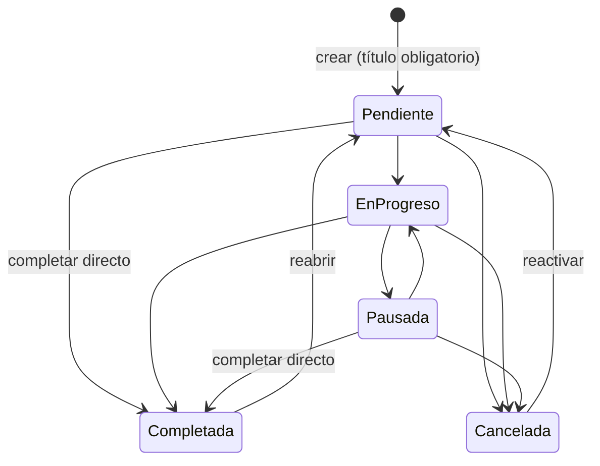

# F01 — Gestión de tareas

| Campo | Valor |
|---|---|
| Estado | **Aprobado** |
| Versión | 1.0 |
| Aprobación | 14-nov-2026, dentro del [Discovery funcional v1.0](../01-discovery/discovery-v1.0.md) |
| Cambios posteriores | Ninguno |

## 1. Objetivo

Permitir capturar, organizar, ejecutar y completar tareas personales, laborales y académicas desde un espacio centralizado, minimizando el esfuerzo de planificación y ofreciendo una experiencia sencilla y motivadora.

## 2. Alcance funcional

| ID | Capacidad | Comportamiento |
|---|---|---|
| F01.01 | Captura rápida | Crear tarea únicamente con título |
| F01.02 | Bandeja de entrada | Mostrar tareas no planificadas |
| F01.03 | Información de tarea | Descripción, prioridad y duración opcionales |
| F01.04 | Gestión de estados | Cinco estados operativos |
| F01.05 | Subtareas | Crear, editar, completar y eliminar |
| F01.06 | Recurrencias | Diarias, semanales y mensuales |
| F01.07 | Edición de recurrencias | Una ocurrencia o todas las futuras |
| F01.08 | Finalización | Completar directamente desde estados activos |
| F01.09 | Progreso | Registrar finalización y mostrar reconocimiento |
| F01.10 | Papelera | Eliminación lógica y recuperación |
| F01.11 | Persistencia | Conservar tareas y cambios entre sesiones |

## 3. Ciclo de vida de una tarea

La **eliminación lógica** es ortogonal al estado: desde cualquier estado la tarea puede moverse a la papelera y restaurarse conservando su información y relaciones (RN-07).

## 4. Reglas de negocio

- **RN-01 · Creación.** El título es obligatorio y no puede contener solo espacios. La tarea nueva inicia en *Pendiente*. Los demás campos son opcionales.
- **RN-02 · Bandeja de entrada.** Toda tarea sin planificación aparece en la bandeja. La bandeja es una vista, no un estado. Una tarea puede existir sin fecha ni duración.
- **RN-03 · Estados.** *Pendiente, En progreso, Pausada, Completada y Cancelada.* Se puede completar directamente desde cualquiera de los tres estados activos. Las completadas pueden reabrirse como pendientes; las canceladas pueden reactivarse como pendientes.
- **RN-04 · Subtareas.** Un solo nivel; cada subtarea tiene título y estado simple (pendiente o completada). Al completar la tarea principal, todas las subtareas pendientes se completan automáticamente. Completar todas las subtareas **no** completa automáticamente la tarea principal.
- **RN-05 · Recurrencias.** Diarias, semanales y mensuales. Cada ocurrencia conserva su propio estado y registro de cumplimiento. Se puede modificar una ocurrencia individual o la serie futura sin alterar el historial anterior.
- **RN-06 · Finalización y progreso.** Completar registra fecha y hora, actualiza el estado y muestra retroalimentación positiva. Una tarea cancelada no cuenta como completada ni genera reconocimiento.
- **RN-07 · Eliminación lógica.** Eliminar traslada la tarea a la papelera; se puede restaurar conservando información y relaciones. La eliminación definitiva no forma parte del flujo habitual del MVP.
- **RN-08 · Persistencia.** Tareas, subtareas, recurrencias, estados y fechas de finalización se conservan entre sesiones.

## 5. Criterios de aceptación

| ID | Escenario | Resultado esperado |
|---|---|---|
| CA-01 | Crear tarea solo con título | Se guarda pendiente y sin fecha |
| CA-02 | Crear tarea con título vacío | Se rechaza y muestra validación |
| CA-03 | Consultar bandeja de entrada | Se muestran tareas sin planificar |
| CA-04 | Editar atributos opcionales | Los cambios persisten |
| CA-05 | Cambiar estado | Se refleja el nuevo estado |
| CA-06 | Completar desde pendiente o pausada | Se completa sin pasos intermedios |
| CA-07 | Completar tarea principal con subtareas pendientes | Todas quedan completadas |
| CA-08 | Completar todas las subtareas | La tarea principal conserva su estado |
| CA-09 | Crear recurrencia diaria, semanal o mensual | Se generan las ocurrencias correspondientes |
| CA-10 | Completar una ocurrencia | Las demás no cambian |
| CA-11 | Editar una ocurrencia | No modifica las restantes |
| CA-12 | Editar ocurrencias futuras | El historial anterior permanece intacto |
| CA-13 | Completar tarea | Se registra fecha/hora y reconocimiento visual |
| CA-14 | Reabrir tarea completada | Vuelve a pendiente sin duplicarse |
| CA-15 | Cancelar tarea | No se contabiliza como logro |
| CA-16 | Eliminar tarea | Se mueve a la papelera |
| CA-17 | Restaurar tarea | Recupera información y relaciones |
| CA-18 | Cerrar y volver a ingresar | Los cambios permanecen guardados |

## 6. Fuera de alcance

Subtareas anidadas en varios niveles · dependencias entre tareas · automatizaciones con agentes de IA · reglas de recurrencia avanzadas · colaboración y asignación a otras personas · puntos, niveles e insignias avanzados · sincronización con calendarios externos.

## 7. Puntos abiertos

1. **Recurrencias mensuales en días 29, 30 y 31:** se propuso usar el último día disponible del mes; pendiente de formalizar como decisión.
2. **Trazabilidad de finalizaciones automáticas de subtareas (RN-04):** se recomendó distinguir internamente las finalizaciones automáticas de las manuales; pendiente de formalizar.

## 8. Dependencias

- **F02** programa las tareas mediante bloques; la planificación y el estado son independientes.
- **F03** clasifica las tareas en áreas y proyectos; opcional para operar F01.
- **F05** genera avisos solo para tareas con fecha límite.
- **F06** contabiliza las tareas principales completadas.
