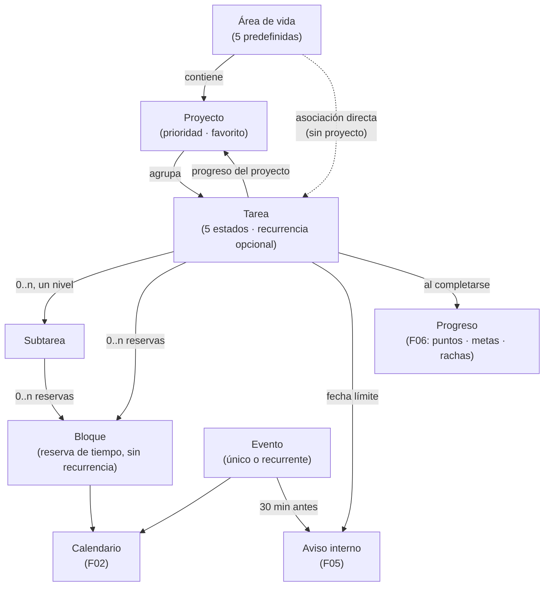
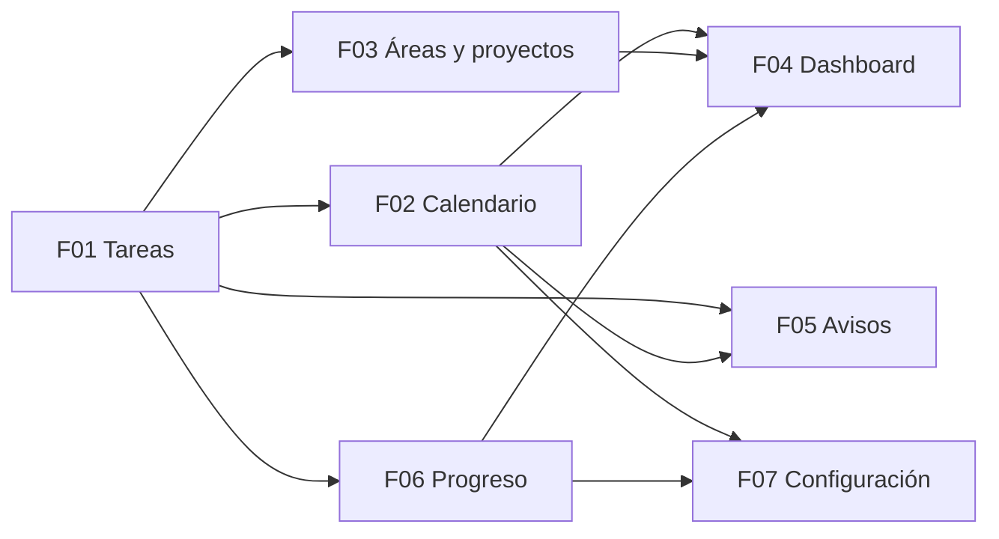

# RELAJAO — Especificación funcional (SPEC)

| Campo | Valor |
|---|---|
| Estado | **Consolidado** — derivado íntegramente de la línea base aprobada; no introduce decisiones nuevas |
| Versión | 1.0 |
| Línea base | [Discovery funcional v1.0](../01-discovery/discovery-v1.0.md) (cerrado el 15-nov-2026) |
| Alcance | Solo definición funcional; la arquitectura está pendiente de autorización |

Este documento es el **integrador** de los requisitos: presenta el modelo conceptual, los principios transversales y la trazabilidad entre funcionalidades. El detalle de cada funcionalidad vive en su propio archivo F01–F07; este documento enlaza, no duplica.

## 1. Visión

RELAJAO es una aplicación de productividad personal que ayuda a organizar responsabilidades, planificar el tiempo y mantener la constancia sin generar sobrecarga innecesaria. Combina **organización** (tareas, proyectos, áreas), **planificación** (calendario, bloques, disponibilidad) y **motivación** (progreso, metas, rachas). El sistema recomienda; **el usuario decide**.

## 2. Modelo conceptual

Invariantes del modelo:

- Una tarea puede existir **sin clasificación, sin fecha y sin duración** (captura rápida).
- Un bloque **referencia** trabajo existente; nunca crea tareas. Planificación y estado son independientes: un bloque pasado no implica ejecución.
- Las ocurrencias recurrentes (de tareas y eventos) son independientes entre sí.
- Las subtareas no cuentan en el progreso de proyectos ni en la gamificación; solo las tareas principales.
- La eliminación es **lógica** (papelera con restauración); la definitiva no es parte del flujo habitual del MVP.

## 3. Principios transversales

| Principio | Efecto en el producto |
|---|---|
| **Keep Simple** | Ante la duda, la capacidad avanzada se pospone (origen de las exclusiones E01–E12 y de D40/D25) |
| **Planificar, no fiscalizar** | Sin registro de minutos reales, cronómetros ni auditoría de ejecución en el MVP |
| **El usuario conserva el control** | Toda sugerencia (horarios, redistribución, liberación de bloques) requiere confirmación explícita |
| **Advertir, no impedir** | Conflictos y sobrecarga se advierten, pero se permite guardar manualmente |
| **Sin castigos** | Rachas que se interrumpen no restan puntos ni insignias; no hay penalizaciones ni comparaciones |
| **Persistencia** | Tareas, planificación, preferencias y progreso se conservan entre sesiones |

## 4. Mapa de funcionalidades

| ID | Funcionalidad | Versión | Documento |
|---|---|---|---|
| F01 | Gestión de tareas | 1.0 | [F01-tareas.md](F01-tareas.md) |
| F02 | Calendario y planificación | 1.0 | [F02-calendario.md](F02-calendario.md) |
| F03 | Áreas de vida y proyectos | 1.1 | [F03-areas-proyectos.md](F03-areas-proyectos.md) |
| F04 | Dashboard | 1.16 | [F04-dashboard.md](F04-dashboard.md) |
| F05 | Notificaciones y recordatorios | 1.0 | [F05-notificaciones.md](F05-notificaciones.md) |
| F06 | Progreso y motivación | 1.0 | [F06-progreso-motivacion.md](F06-progreso-motivacion.md) |
| F07 | Configuración y preferencias | 1.0 | [F07-configuracion.md](F07-configuracion.md) |

### Dependencias entre funcionalidades

F01 y F02 son el núcleo; F03 es opcional para operarlas (una tarea sin área se puede planificar). F04 solo consulta y presenta: no implementa lógica propia de planificación ni de cálculo de progreso.

## 5. Límites del MVP

Las doce exclusiones aprobadas (E01–E12) — integraciones externas, apps móviles nativas, carga masiva y voz, notificaciones externas, personalización avanzada, exportación, analítica avanzada, gamificación avanzada, colaboración, automatización inteligente, gestión avanzada de proyectos y mensajes motivacionales — están detalladas en el [Discovery v1.0, sección 6](../01-discovery/discovery-v1.0.md#6-etapa-4--exclusiones-del-mvp-e01e12). Las exclusiones no eliminan capacidades básicas ya aprobadas.

## 6. Definición de éxito

El MVP se considera validado cuando cumple los diez criterios S01–S10 ([Discovery v1.0, sección 7](../01-discovery/discovery-v1.0.md#7-etapa-5--criterios-de-éxito-s01s10)): flujo completo de tareas, planificación funcional, visibilidad del día, organización personal, recordatorios internos, motivación funcional, persistencia, uso cotidiano sencillo, **prueba piloto de al menos 7 días con usuarios reales** y cumplimiento de los criterios de aceptación de F01–F07 sin defectos críticos abiertos.

## 7. Glosario

| Término | Definición |
|---|---|
| **Tarea** | Unidad de trabajo con título obligatorio y cinco estados; puede ser recurrente |
| **Subtarea** | División de una tarea, un solo nivel, estado binario |
| **Bloque** | Reserva de tiempo en el calendario vinculada a una tarea o subtarea |
| **Evento** | Compromiso del calendario independiente de las tareas |
| **Área de vida** | Una de las cinco categorías predefinidas de clasificación |
| **Proyecto** | Agrupador de tareas dentro de un área, con progreso calculado |
| **Tarea elegible** | Tarea principal no recurrente, no cancelada y no eliminada; base de los indicadores |
| **Aviso** | Notificación interna generada por fecha límite o proximidad de evento |
| **Meta diaria** | Cantidad objetivo de tareas completadas por día, opcional |
| **Racha** | Días consecutivos con la meta diaria cumplida |
| **Línea base** | El Discovery v1.0 congelado; todo cambio posterior requiere una decisión registrada |
