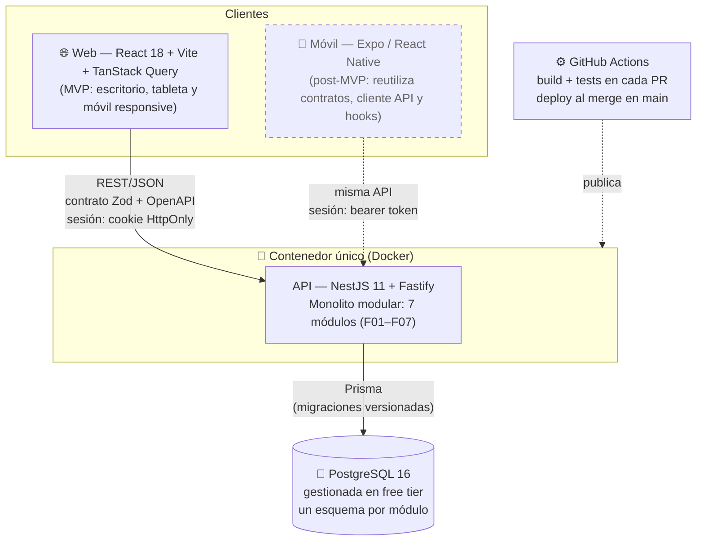
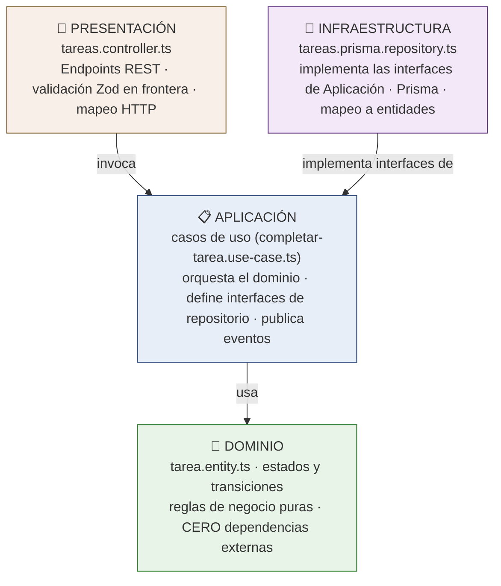
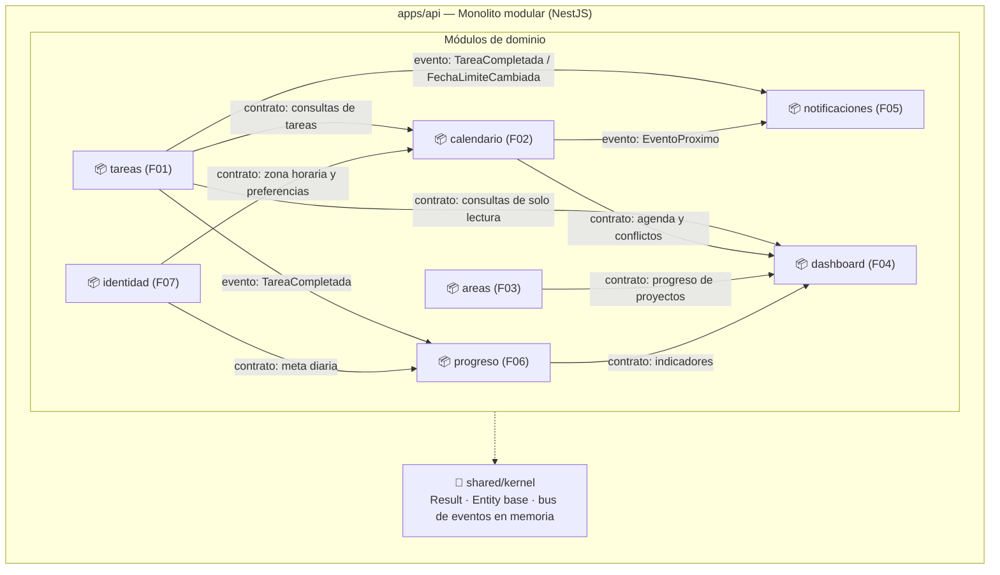
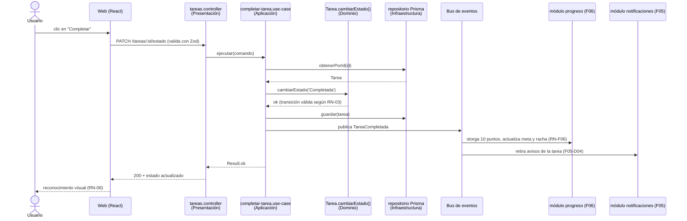

# ARC-002 — Arquitectura técnica: monolito modular con Clean Architecture

| Campo | Valor |
|---|---|
| Identificador | ARC-002 |
| Versión | 1.0; referencias y estado de versionado actualizados el 18-nov-2026 |
| Estado | **Aprobado** — 16-nov-2026 |
| Contenido | Capas, módulos, tecnologías, estructura del monorepo y reglas de dependencia |
| Base funcional | [ARC-001](./ARC-001-contexto-y-responsabilidades.md) (`architecture-context.md` + `responsibilities.md`) |
| Decisión que la habilita | [DEC-001 — Estilo y stack](./DEC-001-stack-y-estilo.md) |

---

## Índice

1. [Cómo leer este documento](#1-cómo-leer-este-documento)
2. [Vista general del sistema](#2-vista-general-del-sistema)
3. [Las cuatro capas de Clean Architecture](#3-las-cuatro-capas-de-clean-architecture)
4. [El monolito modular: módulos y fronteras](#4-el-monolito-modular-módulos-y-fronteras)
5. [Estructura del monorepo](#5-estructura-del-monorepo)
6. [Flujo de una operación de ejemplo](#6-flujo-de-una-operación-de-ejemplo)
7. [Reglas de dependencia y su verificación](#7-reglas-de-dependencia-y-su-verificación)
8. [Arquitectura de datos](#8-arquitectura-de-datos)
9. [Trazabilidad con ARC-001](#9-trazabilidad-con-arc-001)
10. [Estado y aprobación](#10-estado-y-aprobación)

---

## 1. Cómo leer este documento

Este documento responde tres preguntas, en orden:

1. **¿Qué piezas tiene el sistema y con qué tecnología?** → sección 2.
2. **¿Cómo se organiza el código por dentro?** → secciones 3 a 5 (capas, módulos, carpetas).
3. **¿Cómo se garantiza que el diseño se cumpla?** → secciones 6 y 7 (flujo de ejemplo y verificación automática).

ARC-001 definió el *qué* (responsabilidades funcionales, neutral en tecnología). Este documento define el *cómo*. Ninguna regla funcional de ARC-001 se modifica aquí.

---

## 2. Vista general del sistema

Un solo contenedor Docker de aplicación sirve la API y los estáticos del frontend, contra una base de datos PostgreSQL gestionada. La vista [C4 nivel 2](architecture-containers.md) distingue las unidades de ejecución (web y API) del empaquetado Docker; el [contexto C4 nivel 1](architecture-context.md#2-diagrama-de-contexto--c4-nivel-1) muestra el límite del sistema. El siguiente gráfico conserva la vista técnica general, incluidos móvil futuro y CI/CD.



| Pieza | Tecnología | Por qué (resumen; detalle en DEC-001) |
|---|---|---|
| Frontend web | React 18 + Vite + TanStack Query | Base directa para React Native: hooks y cliente compartibles |
| API | NestJS 11 + Fastify | Módulos y DI nativos: el monolito modular viene de fábrica |
| Contrato | Zod + OpenAPI | Una fuente de verdad que valida en backend y tipa a todos los clientes |
| Persistencia | PostgreSQL 16 + Prisma | Migraciones versionadas en el repo; cliente tipado |
| Autenticación | Argon2 + cookie HttpOnly | Sin proveedores externos (E01) |
| Operación | Docker + GitHub Actions | Un contenedor, un pipeline: operable por una persona |

---

## 3. Las cuatro capas de Clean Architecture

Cada módulo (sección 4) se organiza internamente en cuatro capas. **La regla de oro: las dependencias siempre apuntan hacia el dominio.** El dominio no conoce a nadie; la infraestructura conoce a todos.



### Qué contiene y qué puede importar cada capa

| Capa | Contiene | Puede importar | Prohibido | Ejemplo (módulo Tareas) |
|---|---|---|---|---|
| **Dominio** | Entidades, value objects, reglas de negocio puras, errores de dominio | Solo el kernel compartido (`Result`, `Entity` base) | NestJS, Prisma, HTTP, cualquier librería de infraestructura | `tarea.entity.ts` con la tabla de transiciones de estados de F01 |
| **Aplicación** | Casos de uso, interfaces de repositorio (puertos), eventos de dominio que publica | Dominio y kernel | Prisma, HTTP, detalles de infraestructura | `completar-tarea.use-case.ts`, `tarea.repository.ts` (interfaz) |
| **Infraestructura** | Implementaciones de repositorios, acceso a Prisma, adaptadores | Aplicación, Dominio, Prisma | Controladores de otros módulos | `tareas.prisma.repository.ts` |
| **Presentación** | Controladores REST, DTOs validados con Zod, mapeo de errores a HTTP | Aplicación, contratos compartidos | Dominio directamente (pasa por casos de uso), Prisma | `tareas.controller.ts` |

### La regla de negocio vive en el dominio — ejemplo real

La tabla de transiciones de F01 (RN-03 del Discovery) escrita como código puro, testeable sin base de datos ni framework:

```ts
// apps/api/src/modules/tareas/domain/tarea.entity.ts
const TRANSICIONES: Record<EstadoTarea, EstadoTarea[]> = {
  Pendiente:  ['EnProgreso', 'Completada', 'Cancelada'],
  EnProgreso: ['Pausada', 'Completada', 'Cancelada'],
  Pausada:    ['EnProgreso', 'Completada', 'Cancelada'],
  Completada: ['Pendiente'],   // reabrir
  Cancelada:  ['Pendiente'],   // reactivar
};

export class Tarea {
  cambiarEstado(nuevo: EstadoTarea): Result<void> {
    if (!TRANSICIONES[this.estado].includes(nuevo)) {
      return Result.fail(new TransicionNoPermitida(this.estado, nuevo));
    }
    this.estado = nuevo;
    return Result.ok();
  }
}
```

---

## 4. El monolito modular: módulos y fronteras

Un módulo NestJS por agrupación del Discovery. Cada caja interna replica las cuatro capas de la sección 3. Los módulos **no se tocan entre sí directamente**: se comunican por **contratos públicos** (consultas) o **eventos de dominio** (notificación de hechos).



**Reglas de frontera (equivalentes a R1–R12 de ARC-001):**

1. Un módulo expone un **contrato público** (`contracts/`): tipos y servicios de consulta que otros módulos pueden inyectar. Todo lo demás es privado.
2. Los **eventos de dominio** viajan por un bus en memoria (event emitter de NestJS). `TareaCompletada` → progreso otorga puntos (R3) y notificaciones limpia avisos (R4), sin que Tareas conozca a sus consumidores.
3. **Dashboard (F04) solo consume contratos de lectura** — fiel a su límite funcional (F04-D25): no posee motor propio.
4. Si algún día se extrae un módulo a servicio (candidato: notificaciones), el evento ya existe y solo cambia el transporte.

---

## 5. Estructura del monorepo

```text
relajao/
├── apps/
│   ├── api/                        # Backend NestJS — el monolito modular
│   │   └── src/
│   │       ├── main.ts             # arranque, middleware, OpenAPI
│   │       ├── modules/
│   │       │   ├── tareas/         # F01 ─┐
│   │       │   │   ├── domain/           │ cada módulo con las
│   │       │   │   ├── application/      │ 4 capas de la sección 3
│   │       │   │   ├── infrastructure/   │ + su contrato público
│   │       │   │   ├── contracts/        │
│   │       │   │   ├── tareas.controller.ts
│   │       │   │   └── tareas.module.ts ─┘
│   │       │   ├── calendario/     # F02
│   │       │   ├── areas/          # F03
│   │       │   ├── dashboard/      # F04
│   │       │   ├── notificaciones/ # F05
│   │       │   ├── progreso/       # F06
│   │       │   └── identidad/      # F07 (cuenta, sesión, preferencias)
│   │       └── shared/kernel/      # Result, Entity base, bus de eventos
│   ├── web/                        # React 18 + Vite (MVP)
│   │   └── src/features/           # tareas/, calendario/, dashboard/… espejo de los módulos
│   └── mobile/                     # Expo / React Native (post-MVP; vacía al inicio)
├── packages/
│   ├── contracts/                  # Esquemas Zod por módulo — LA fuente de verdad del contrato
│   ├── api-client/                 # Cliente HTTP tipado generado del contrato (web y móvil)
│   └── config/                     # ESLint, tsconfig y Prettier compartidos
├── prisma/
│   ├── schema.prisma               # Modelo de datos (un esquema PostgreSQL por módulo)
│   └── migrations/                 # Migraciones SQL versionadas
├── .dependency-cruiser.cjs         # Reglas de dependencia (sección 7)
├── turbo.json · pnpm-workspace.yaml
├── Dockerfile                      # Multi-stage: build web + api → un contenedor
└── .github/workflows/ci.yml        # build + tests en PR; deploy en main
```

**Por qué cada pieza está donde está:**

- `packages/contracts` es el corazón de la reutilización (DEC-001, criterio C2): el esquema Zod de `CrearTarea` valida la petición en la API, tipa el formulario en web y tipará la pantalla en React Native.
- `apps/web/src/features` refleja los módulos del backend: navegar el frontend y el backend usa el mismo mapa mental.
- `apps/mobile` existe desde el día uno (vacía) para que el monorepo ya esté preparado; las apps nativas siguen fuera del MVP (E02).

---

## 6. Flujo de una operación de ejemplo

**"El usuario completa una tarea desde el Dashboard"** — recorre capas, módulos y eventos:



Obsérvese la separación: la **regla** (qué transición es válida) está en el dominio; la **orquestación** en el caso de uso; los **efectos colaterales** (puntos, avisos) en otros módulos vía evento, sin acoplamiento directo.

---

## 7. Reglas de dependencia y su verificación

El diseño prevé verificación automática en CI: **el build deberá fallar si se rompe una frontera.** Esta sección define controles previstos; todavía no existe implementación ni pipeline en el repositorio.

| Regla | Herramienta que la hace cumplir |
|---|---|
| `domain/` no importa NestJS, Prisma ni HTTP | `dependency-cruiser` (regla por capa) |
| `application/` solo importa `domain/` y kernel | `dependency-cruiser` |
| Un módulo no importa `domain/`, `application/` ni `infrastructure/` de otro módulo; solo su `contracts/` | `dependency-cruiser` (regla por módulo) |
| El frontend solo consume `packages/api-client` y `packages/contracts`; nunca código del backend | `dependency-cruiser` + boundaries del monorepo |
| Las reglas de dominio funcionan sin infraestructura | Pruebas unitarias (Vitest) sobre `domain/` sin mocks de BD |
| La API cumple el contrato | Pruebas de integración (Testcontainers + PostgreSQL efímero) |

Se prevé versionar `.dependency-cruiser.cjs` en la raíz y configurar el pipeline para rechazar PRs que violen las fronteras. Esos archivos y controles aún no están implementados. Es el equivalente a los `ArchitectureTests` del mundo .NET.

---

## 8. Arquitectura de datos

- **Una base PostgreSQL, un esquema (namespace) por módulo:** `tareas.*`, `calendario.*`, `areas.*`, `notificaciones.*`, `progreso.*`, `identidad.*`. Separación visible sin pagar varias bases; el dashboard no tiene esquema propio (solo lee).
- **Todo filtrado por `usuario_id`** desde la capa de aplicación: un usuario por cuenta, sin colaboración (E09).
- **Migraciones Prisma versionadas** en `prisma/migrations/`: el esquema vive en el repo, no en la base; desarrollo, pruebas y producción aplican las mismas migraciones en orden.
- **Entornos:** desarrollo con Docker Compose local; pruebas con Testcontainers (PostgreSQL efímero por corrida); producción con PostgreSQL gestionado en free tier (Neon/Render/Railway — elección operativa, no arquitectónica).

---

## 9. Trazabilidad con ARC-001

| Agrupación funcional (ARC-001) | Módulo técnico | Esquema BD | Dependencias que implementa |
|---|---|---|---|
| Organización del trabajo | `tareas` (F01), `areas` (F03) | `tareas.*`, `areas.*` | R1, R2, R3, R4, R7 |
| Planificación del tiempo | `calendario` (F02) | `calendario.*` | R2, R5, R6, R10 |
| Visibilidad y motivación | `dashboard` (F04), `progreso` (F06) | `progreso.*` (dashboard no persiste) | R6, R7, R8, R9, R10, R12 |
| Avisos internos | `notificaciones` (F05) | `notificaciones.*` | R4, R5 |
| Cuenta y preferencias | `identidad` (F07) | `identidad.*` | R11, R12 |
| Almacenamiento persistente | PostgreSQL 16 + Prisma | — | S07 |

El diagrama neutral de ARC-001 sigue siendo válido: este documento lo materializa sin contradecirlo.

---

## 10. Estado y aprobación

| Condición | Estado |
|---|---|
| DEC-001 (estilo y stack) aprobada | ✅ 16-nov-2026 |
| ARC-002 revisado y aprobado | ✅ 16-nov-2026 |
| Versión original en Git | ✅ Disponible en feature_initialDocs, commit 26fd8ca |
| Ajustes documentales del 18-nov-2026 | ⏳ Locales, pendientes de commit |
| PR e integración en main | ⏳ Pendientes; main conserva lo oficial y terminado |

**La implementación (fase 3) no inicia hasta la autorización explícita del responsable del producto.**
