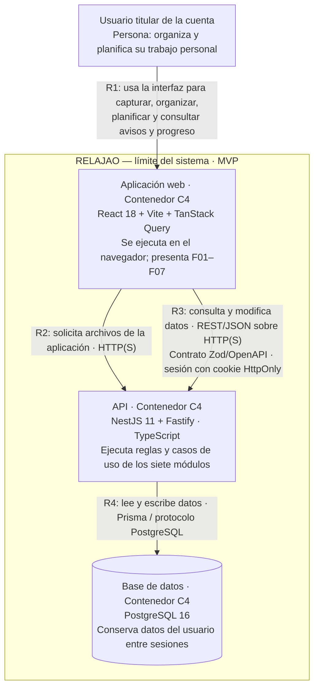

# RELAJAO — Contenedores C4 (nivel 2)

| Campo | Valor |
|---|---|
| Tarea | [ARC-001](ARC-001-contexto-y-responsabilidades.md) · Plan 1 |
| Versión | 1.0 |
| Estado | **Aprobado** — 18-nov-2026; pendiente versionar esta revisión |
| Base | [ARC-002](ARC-002-arquitectura-tecnica.md) §2, §4 y §8; [DEC-001](DEC-001-stack-y-estilo.md) §2 |
| Contexto | [C4 nivel 1](architecture-context.md#2-diagrama-de-contexto--c4-nivel-1) |

## 1. Alcance y nivel de detalle

Esta vista describe las unidades de ejecución y almacenamiento previstas para el MVP. Un contenedor C4 es una aplicación o almacén de datos; no equivale a un contenedor Docker. La aplicación web se ejecuta en el navegador, la API en el servidor y PostgreSQL conserva los datos. El artefacto Docker aprobado sirve la API y los archivos estáticos de la web: esto no convierte la web y la API en una sola unidad de ejecución C4.

Los siete módulos F01–F07 permanecen dentro de la API monolítica. No son siete servicios ni siete contenedores C4. Los esquemas PostgreSQL por módulo tampoco son bases independientes.

## 2. Diagrama de contenedores — MVP

Las flechas indican quién inicia la interacción; las respuestas regresan por la misma relación. HTTP(S) identifica el canal web; la terminación TLS, el dominio y el proveedor concreto de alojamiento no se deciden en este entregable.

## 3. Responsabilidades y relaciones

| Contenedor | Responsabilidad | Límite |
|---|---|---|
| Aplicación web | Presentar tareas, proyectos, calendario, Dashboard, avisos, progreso y configuración; enviar acciones y mostrar advertencias y sugerencias | No accede directamente a PostgreSQL; no constituye otro motor de reglas de negocio |
| API | Validar entradas y sesión, ejecutar casos de uso y reglas F01–F07, mantener el aislamiento de datos por usuario y servir los archivos estáticos de la web | Monolito modular; comunicación interna por contratos públicos o eventos según ARC-002 |
| PostgreSQL | Persistir tareas, planificación, organización, avisos, progreso y preferencias | Una base; separación por esquemas de módulos según ARC-002 §8; Dashboard sin esquema propio |

| Relación | Origen → destino | Propósito y datos | Base |
|---|---|---|---|
| R1 | Usuario → Web | Captura y gestión de responsabilidades, agenda y consulta de resultados | Discovery F01–F07 |
| R2 | Web/navegador → API | Obtener HTML, JavaScript y otros archivos estáticos de la aplicación | ARC-002 §2 y §5: un artefacto sirve web y API |
| R3 | Web → API | Comandos y consultas funcionales; resultados, validaciones y avisos internos en respuesta | DEC-001 §2; ARC-002 §2 y §6 |
| R4 | API → PostgreSQL | Consultar y conservar datos bajo la identidad del usuario autenticado | ARC-002 §8; Discovery S07 |

R1–R4 son identificadores locales de esta vista; no sustituyen las dependencias funcionales R1–R12 de `responsibilities.md`.

## 4. Coherencia y límites

| Acuerdo | Representación |
|---|---|
| DEC-001: monolito modular, un contenedor Docker de aplicación y una base | Web servida por la API; PostgreSQL gestionado separado. No se agrega otro servicio desplegable |
| ARC-002: siete módulos y cuatro capas internas | Se conservan dentro de la API; el detalle interno permanece en ARC-002 |
| F02: sugerir con confirmación; planificación independiente del estado de tareas | Las relaciones transportan acciones del usuario; no implican ejecución automática ni cambios de estado por el paso del tiempo |
| F04: Dashboard sin motor propio | Presentación en web; las reglas se resuelven en los módulos responsables de la API |
| F05 y E04: avisos internos | La web consulta la API; no aparecen correo, push ni avisos del navegador |
| E01, E02, E09 y E10 | Sin integraciones externas, app nativa, colaboración ni agente que reorganice sin confirmación |
| S07 y F07 | Persistencia y sesión reales; el mecanismo aprobado es sesión con cookie HttpOnly |

Móvil post-MVP y GitHub Actions se mantienen descritos en ARC-002, fuera de esta vista de ejecución del MVP. CI/CD es una herramienta de construcción y despliegue, no un contenedor funcional de RELAJAO.

No se introducen decisiones de estilo, stack o alcance. El proveedor de alojamiento y los detalles operativos pendientes no se seleccionan aquí. Las dudas funcionales del Discovery §10 siguen abiertas y no se resuelven por estos diagramas.
