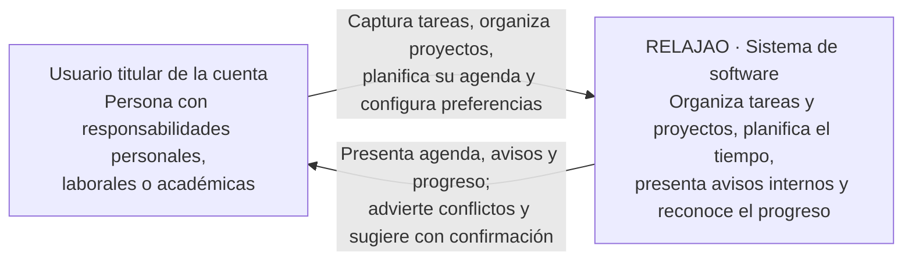
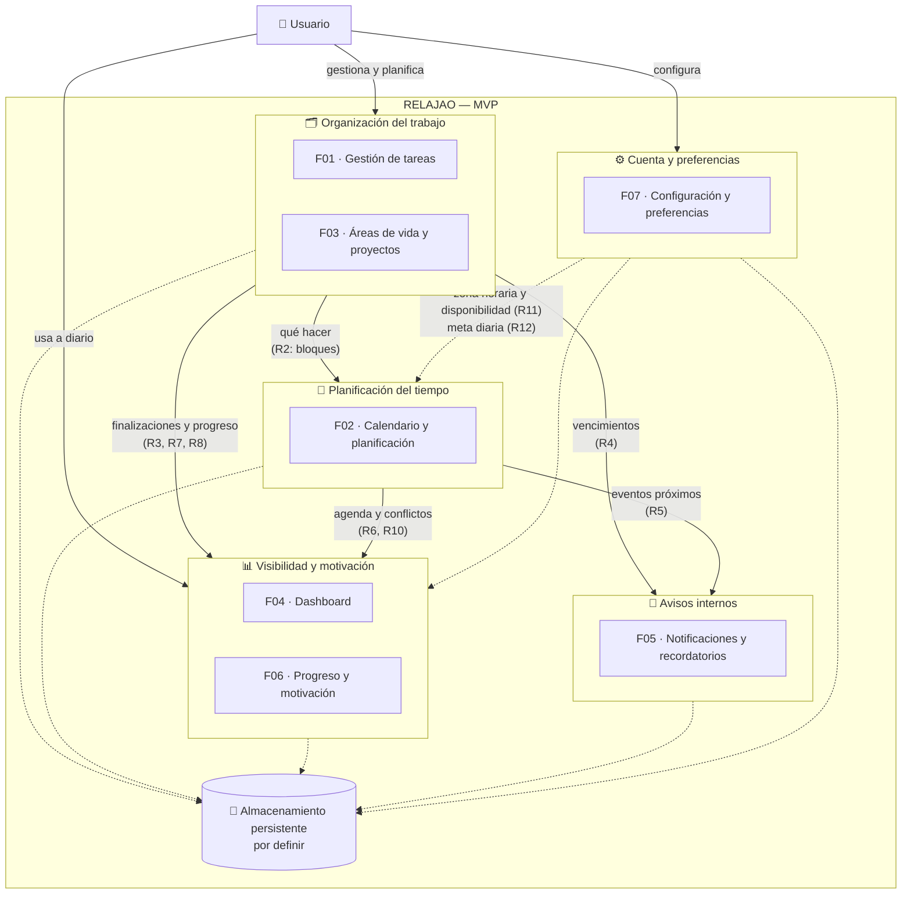

# Contexto de arquitectura

| Campo | Valor |
|---|---|
| Tarea | [ARC-001](./ARC-001-contexto-y-responsabilidades.md) |
| Versión | 1.1 |
| Estado | **Aprobado** — 18-nov-2026; pendiente versionar esta revisión |
| Contenido | Diagramas Mermaid con límites del sistema, actores y relaciones principales |
| Complemento | [`responsibilities.md`](./responsibilities.md) — tabla de responsabilidades, dependencias y referencias |
| Fuente | [Discovery funcional v1.0](../01-discovery/discovery-v1.0.md) (línea base cerrada el 15-nov-2026) |
| Neutralidad | **No** define lenguajes, frameworks, patrones arquitectónicos, servicios cloud, motores de base de datos ni despliegue |

---

## 1. Alcance de este documento

Representa visualmente los **límites** de RELAJAO, sus **actores** y las **relaciones principales**, según el Discovery MVP v1.0 aprobado. Las agrupaciones mostradas son responsabilidades funcionales, no componentes de software: la distribución técnica aprobada se representa en la [vista de contenedores C4](architecture-containers.md).

---

## 2. Diagrama de contexto — C4 nivel 1

RELAJAO se representa como un único sistema de software. El actor es el usuario titular de una cuenta personal. Pueden existir varias cuentas aisladas, sin colaboración (E09). La persistencia y las aplicaciones internas se detallan en la [vista C4 nivel 2](architecture-containers.md).

**Límite del MVP.** No hay relaciones con sistemas externos en esta versión: integraciones de calendario y servicios externos (E01), canales de notificación externos (E04) y colaboración (E09) están excluidos. Las aplicaciones móviles nativas (E02), la exportación (E06) y la automatización que decide sin confirmación (E10) tampoco forman parte del MVP. Estas exclusiones son restricciones, no actores ni sistemas conectados.

El acceso es mediante una interfaz web adaptable a escritorio, tableta y móvil (CA-F04-21). Toda notificación se presenta dentro de la aplicación (F05-D01). El usuario conserva el control de sus decisiones. Las demás exclusiones E01–E12 se trazan en `responsibilities.md` §5.

La vista usa Mermaid con semántica C4: una persona, un sistema y relaciones con propósito. No muestra bases de datos, módulos internos ni infraestructura de despliegue.

---
## 3. Vista funcional complementaria — agrupaciones y relaciones principales

Esta vista complementaria no es un diagrama de contenedores C4. Presenta las cinco agrupaciones funcionales (detalladas en [`responsibilities.md`](./responsibilities.md)) y sus relaciones principales. Cada flecha resume una o varias dependencias R1–R12 de la tabla de responsabilidades.

**Lectura.**

- **Organización del trabajo** es la fuente de *qué* existe por hacer; **Planificación del tiempo** es la fuente de *cuándo*.
- El **Dashboard (F04)** consume y presenta; no tiene motor propio de planificación o progreso (F04-D25). **Progreso (F06)** calcula los reconocimientos y **Avisos internos (F05)** administra los avisos conforme a sus reglas.
- **Cuenta y preferencias** es transversal: da acceso a preferencias cuyas reglas viven en F02 y F06 (RN-F07-09, RN-F07-11).
- Todas las agrupaciones conservan su información entre sesiones (S07) en un almacenamiento cuyo mecanismo **no se selecciona aquí**.

---

## 4. Leyenda de la vista funcional complementaria

| Elemento visual | Significado |
|---|---|
| Rectángulo dentro del límite del MVP | Agrupación o funcionalidad aprobada (F01–F07) |
| Cilindro | Necesidad de persistencia entre sesiones; la tecnología aprobada se detalla en la vista de contenedores |
| Flecha continua | Interacción funcional principal; detalle en [`responsibilities.md` §3](./responsibilities.md) |
| Flecha punteada | Acceso a preferencias o conservación de información |
| `F0x`, `E0x`, `S0x`, `Rn` | Identificadores del Discovery v1.0 y de la tabla de dependencias |

---

*RELAJAO · ARC-001 v1.1 · Generado a partir del Discovery funcional v1.0 sin decisiones técnicas nuevas.*
