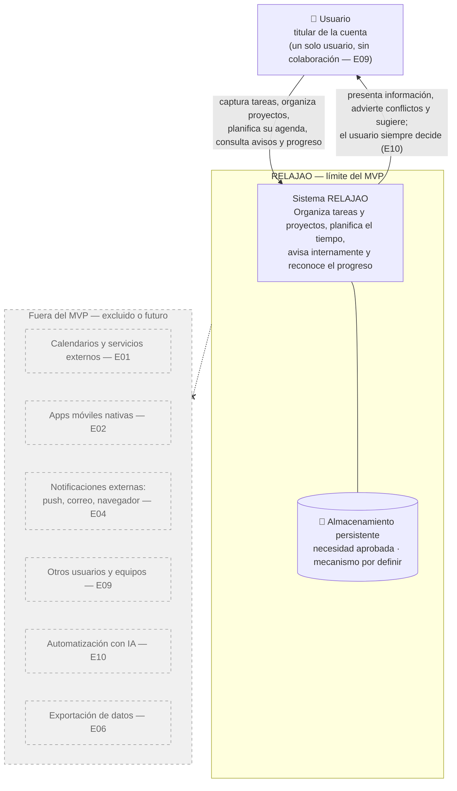
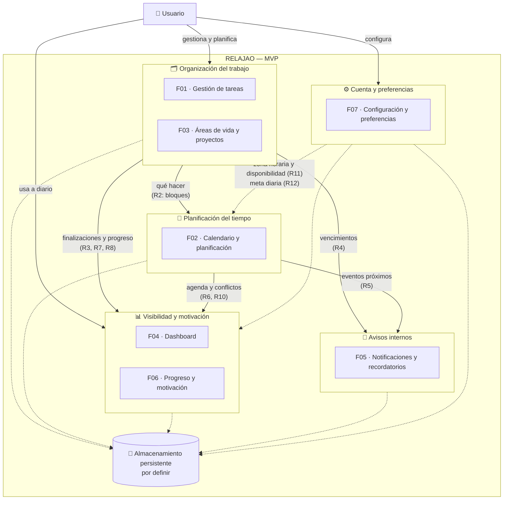

# Contexto de arquitectura

| Campo | Valor |
|---|---|
| Tarea | [ARC-001](./ARC-001-contexto-y-responsabilidades.md) |
| Versión | 1.0 |
| Estado | **Aprobado** — 16-nov-2026 |
| Contenido | Diagramas Mermaid con límites del sistema, actores y relaciones principales |
| Complemento | [`responsibilities.md`](./responsibilities.md) — tabla de responsabilidades, dependencias y referencias |
| Fuente | [Discovery funcional v1.0](../01-discovery/discovery-v1.0.md) (línea base cerrada el 15-nov-2026) |
| Neutralidad | **No** define lenguajes, frameworks, patrones arquitectónicos, servicios cloud, motores de base de datos ni despliegue |

---

## 1. Alcance de este documento

Representa visualmente los **límites** de RELAJAO, sus **actores** y las **relaciones principales**, según el Discovery MVP v1.0 aprobado. Las agrupaciones mostradas son responsabilidades funcionales, no componentes de software: la correspondencia con componentes técnicos se decidirá en tareas posteriores.

---

## 2. Diagrama de contexto — límites y actores

RELAJAO es el sistema central. Su único actor es el **usuario titular de la cuenta**. No existen otros actores en el MVP: ni colaboradores (E09), ni sistemas externos (E01), ni canales de notificación externos (E04).

**Lectura.**

- El usuario accede mediante una interfaz adaptable a escritorio, tableta y móvil (CA-F04-21); las aplicaciones nativas están excluidas (E02).
- Toda comunicación del sistema hacia el usuario ocurre **dentro de la aplicación** (F05-D01).
- El sistema sugiere y advierte, pero **nunca decide por el usuario** (principio rector; E10).
- Con lo excluido **no existe interacción alguna** en esta versión; incorporarlo requiere una solicitud de cambio sobre la línea base.

---

## 3. Vista funcional consolidada — agrupaciones y relaciones principales

Vista de alto nivel: las cinco agrupaciones funcionales (detalladas en [`responsibilities.md`](./responsibilities.md)) y sus relaciones principales. Cada flecha resume una o varias dependencias R1–R12 de la tabla de responsabilidades.

**Lectura.**

- **Organización del trabajo** es la fuente de *qué* existe por hacer; **Planificación del tiempo** es la fuente de *cuándo*.
- **Visibilidad y motivación** y **Avisos internos** consumen y presentan; no poseen motores propios (F04-D25).
- **Cuenta y preferencias** es transversal: da acceso a preferencias cuyas reglas viven en F02 y F06 (RN-F07-09, RN-F07-11).
- Todas las agrupaciones conservan su información entre sesiones (S07) en un almacenamiento cuyo mecanismo **no se selecciona aquí**.

---

## 4. Leyenda

| Elemento visual | Significado |
|---|---|
| Rectángulo dentro del límite del MVP | Agrupación o funcionalidad aprobada (F01–F07) |
| Cilindro | Necesidad de persistencia entre sesiones; **sin** tecnología seleccionada |
| Caja gris punteada | Capacidad excluida del MVP (E01–E12); sin interacción en esta versión |
| Flecha continua | Interacción funcional principal; detalle en [`responsibilities.md` §3](./responsibilities.md) |
| Flecha punteada | Acceso a preferencias o conservación de información |
| `F0x`, `E0x`, `S0x`, `Rn` | Identificadores del Discovery v1.0 y de la tabla de dependencias |

---

*RELAJAO · ARC-001 v1.0 · Generado a partir del Discovery funcional v1.0 sin decisiones técnicas nuevas.*
