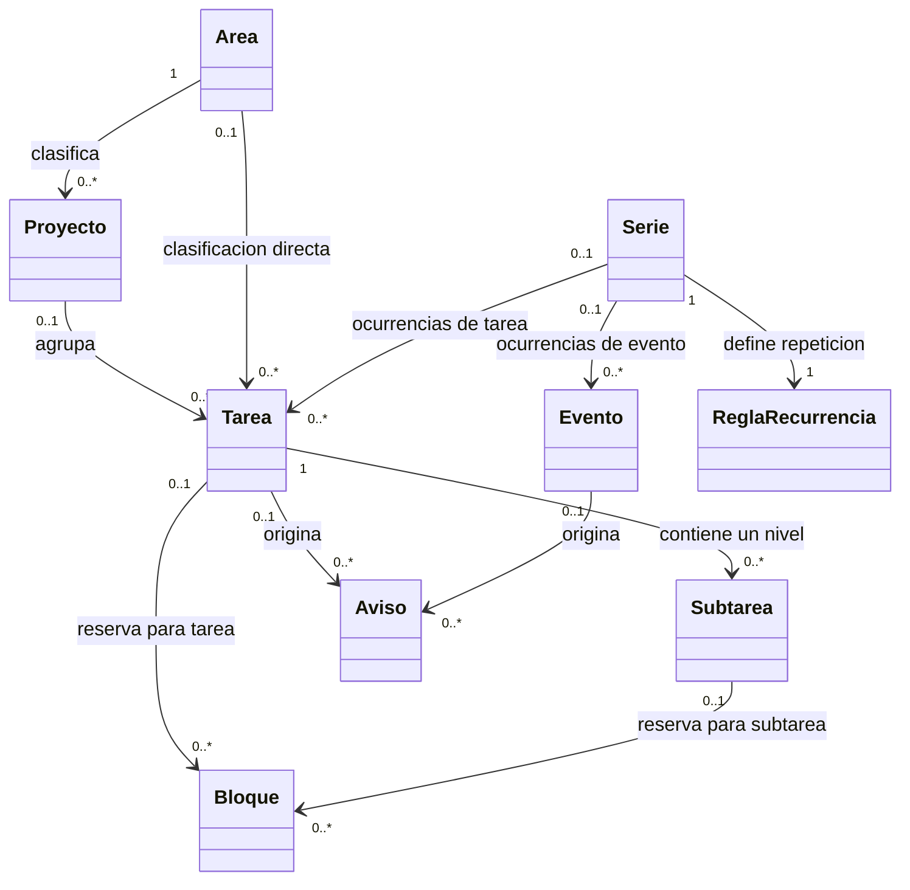
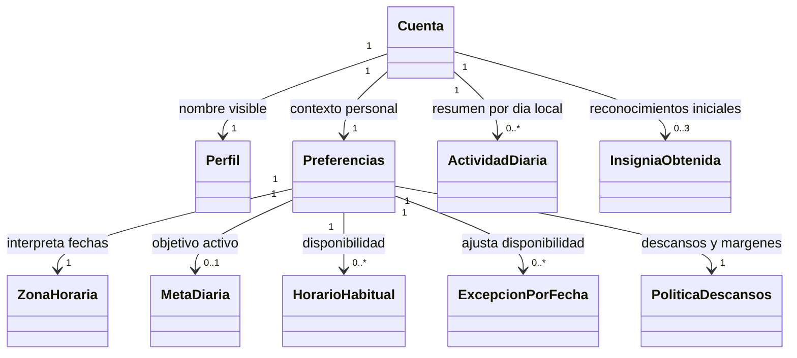
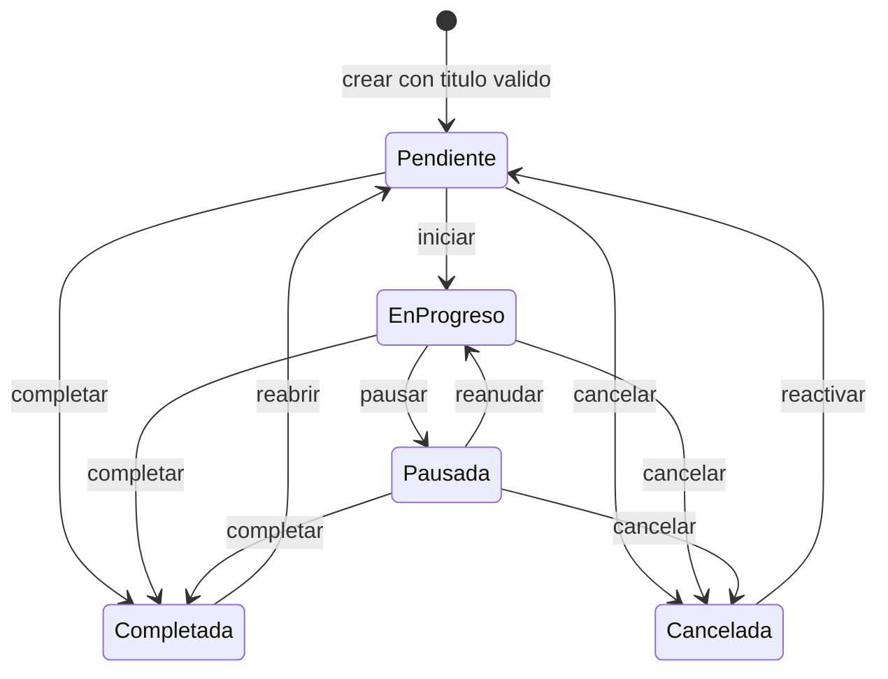

# RELAJAO — Modelo de dominio inicial

| Campo | Valor |
|---|---|
| Entregable | Plan 2 — Modelo de dominio inicial |
| Versión | 0.1 |
| Estado | **Aprobado** — 18-nov-2026; aprobación explícita del responsable del producto |
| Versionado | Preparado localmente sobre feature_initialDocs; pendiente commit |
| Línea base | [Discovery funcional v1.0](../01-discovery/discovery-v1.0.md), cerrado el 15-nov-2026 |
| Alcance | Conceptos, relaciones, cardinalidades, estados y reglas; independiente de tecnologías, tablas y esquemas físicos |

## 1. Propósito y convenciones

Describir el negocio antes de implementar código o diseñar persistencia. Los conceptos se derivan de F01–F07; su clasificación como entidad, valor, política o vista es una **propuesta de modelado**, no una nueva regla aprobada. No se fijan agregados, repositorios, tablas ni mecanismos de generación de ocurrencias.

Las reglas `DM-xx` son referencias locales de este catálogo; no sustituyen los identificadores RN/D/CA del Discovery. Las relaciones describen significado de negocio, no claves foráneas. Toda información pertenece al contexto del titular de una cuenta personal; no se modelan equipos, espacios compartidos ni asignaciones a otras personas (E09).

## 2. Catálogo de conceptos

| Concepto | Naturaleza propuesta | Responsabilidad y datos significativos | Fuente |
|---|---|---|---|
| Tarea | Entidad | Unidad principal de trabajo: título, estado, descripción, prioridad, estimación, fecha límite y fecha/hora de finalización según corresponda; clasificación y planificación opcionales | [F01](../02-requisitos/F01-tareas.md) RN-01–08; F03 |
| Subtarea | Entidad subordinada | Unidad de un solo nivel, con título y estado pendiente/completada; pertenece a una tarea y puede reservar tiempo individualmente | F01 RN-04; F02 CA04 |
| Área | Entidad | Una de cinco áreas personales predefinidas; nombre y color editables | [F03](../02-requisitos/F03-areas-proyectos.md) §2 |
| Proyecto | Entidad | Agrupa tareas en un área; nombre obligatorio, descripción opcional, prioridad y favorito independientes; progreso derivado | F03 §2–5 |
| Bloque de planificación | Entidad | Reserva con inicio y fin para una tarea o subtarea concreta; duración reservada, sin estado de ejecución inferido | [F02](../02-requisitos/F02-calendario.md) §2–4 |
| Evento | Entidad | Compromiso independiente de tareas; intervalo temporal; puede ser fijo y pertenecer a una serie recurrente | F02 CA02, CA13–15 |
| Regla de recurrencia | Valor/política | Repetición diaria, semanal o mensual de tareas o eventos; no existe recurrencia propia del bloque | F01 RN-05; F02 CA14–17, CA26 |
| Serie recurrente | Concepto de agrupación | Identifica qué ocurrencias comparten regla y permite editar el futuro sin alterar historia | F01 CA09–12; F02 CA15–16 |
| Ocurrencia | Papel de una tarea o evento | Instancia identificable de una serie, con estado o cambios propios según su tipo; no es una segunda tarea creada por reservar un bloque | F01 RN-05; F02 CA15–18 |
| Disponibilidad | Política/configuración personal | Horarios habituales, excepciones por fecha, descansos y márgenes para sugerir reservas | F02 CA05, CA09–13 |
| Conflicto / sobrecarga | Resultado de evaluación | Explica superposiciones o capacidad excedida y los elementos involucrados; advertencia, no prohibición general de guardar | F02 CA06, CA09; F04 CA16–18 |
| Sugerencia | Propuesta de planificación | Alternativa individual de ubicación, reprogramación o liberación de bloques; sin efecto hasta confirmar | F02 CA11–13, CA17, CA21 |
| Aviso | Entidad de relevancia temporal | Señala proximidad o vencimiento de una tarea, o proximidad de un evento; estado de lectura independiente del origen | [F05](../02-requisitos/F05-notificaciones.md) D01–15 |
| Finalización / logro | Hecho de negocio | Finalización identificable de una tarea principal con fecha/hora; alimenta actividad y evita duplicados | [F06](../02-requisitos/F06-progreso-motivacion.md) RN-01–04, RN-10, RN-14 |
| Meta diaria | Configuración opcional | Objetivo de cantidad de tareas completadas; se consulta, modifica o desactiva desde F07 | F06 RN-05–08; F07 RN-10–11 |
| Actividad diaria, racha y puntos | Indicadores derivados | Conteos por día local, continuidad de cumplimiento y reconocimientos conforme a F06 | F06 RN-04–15 |
| Insignia / obtención | Condición de reconocimiento y hecho de obtención | Tres condiciones iniciales: primera tarea completada, primera meta alcanzada y racha de tres días | F06 RN-11–12 |
| Cuenta, perfil y preferencias | Contexto personal/configuración | Identidad del titular, nombre visible, zona horaria y acceso a disponibilidad y meta; no duplica reglas de F02/F06 | [F07](../02-requisitos/F07-configuracion.md) RN-01–12 |
| Sesión | Concepto de acceso | Permite acceder y cerrar sesión sin eliminar información; su mecanismo técnico no pertenece a este modelo | F07 RN-13–15 |
| Bandeja, calendario y Dashboard | Vistas | Consultan y presentan tareas, reservas, avisos o indicadores; no son entidades adicionales ni nuevos motores | F01 RN-02; [F04](../02-requisitos/F04-dashboard.md) §1–2 |

## 3. Relaciones y cardinalidades

### 3.1 Organización y planificación

Las asociaciones opcionales requieren las restricciones siguientes; el diagrama por sí solo no expresa exclusividad:

| Relación | Cardinalidad y restricción | Fuente |
|---|---|---|
| Área–Proyecto | Cada proyecto pertenece a exactamente un área; un área admite cero o varios proyectos | F03 §2 |
| Clasificación de Tarea | Exactamente una modalidad: proyecto (área heredada), área directa sin proyecto, o ninguna clasificación. Nunca proyecto y área directa independiente simultáneos | F03 §2, CA3–4 |
| Tarea–Subtarea | Cada subtarea pertenece a una tarea; una tarea admite cero o varias. No hay subtareas de subtareas | F01 RN-04 |
| Destino de Bloque | Cada bloque apunta a exactamente una tarea **o** una subtarea, nunca a ambas ni a ninguna; cada destino admite cero o varios bloques | F02 CA03–04, §4 |
| Serie–Ocurrencia | Una tarea o evento individual pertenece a cero o una serie; una serie agrupa ocurrencias de **un solo tipo**. El mínimo cero expresa que no se fija cuándo se materializan las ocurrencias; no autoriza una serie de negocio sin regla | F01 RN-05; F02 CA14–16; propuesta conceptual |
| Serie–Regla | Una regla vigente por serie en esta vista conceptual; no se define almacenamiento de versiones. Editar el futuro preserva el pasado | F01 CA12; F02 CA15 |
| Origen de Aviso | Cada aviso tiene exactamente un origen: tarea o evento concreto, incluida su ocurrencia. No nace de un bloque. Por origen/condición vigente no hay duplicados | F05 D06–07, D12 y CA18 |

Las ocurrencias de tarea se representan como tareas concretas con sus propios estados y finalizaciones; las de evento como eventos concretos con su intervalo. La serie no se contabiliza además de sus ocurrencias. El horario habitual de una tarea recurrente es opcional y solo origina un bloque si se acepta la sugerencia (F02 CA17).

### 3.2 Contexto personal y motivación

Estas cardinalidades de configuración son propuestas conceptuales del modelo v0.1: un perfil y un conjunto de preferencias vigentes por titular; cero o una meta activa, sin exigir configuración manual para comenzar. No determinan registros físicos, valores por defecto, historia de metas ni número de sesiones simultáneas. Las cinco áreas están en el contexto de cada titular. Actividad diaria es una vista derivada, no una obligación de crear una entidad por día; debe representar días con cero actividad en los últimos siete días. Racha, puntos y progreso se calculan bajo F06; no se crea otro sistema de metas en F07.

## 4. Estados y ciclo de vida

### 4.1 Tarea

Se reproduce el ciclo de F01 §3; no se añaden transiciones. Pendiente, En progreso y Pausada son los estados activos. Completar registra fecha y hora; una ocurrencia no cambia a las demás. La bandeja de entrada, el vencimiento, tener bloques y estar en papelera **no son estados adicionales de ejecución**.

### 4.2 Subtarea, eliminación y avisos

- Subtarea: pendiente o completada. Completar la tarea principal completa automáticamente las subtareas pendientes; completar todas las subtareas no completa la principal (F01 RN-04). F01 no define expresamente la reapertura de subtareas; no se añade una transición inversa por analogía.
- Tarea en papelera: eliminación lógica ortogonal al estado, conserva información y relaciones; restaurar recupera lo conservado (F01 RN-07). Cancelar no equivale a eliminar.
- Bloques de tareas eliminadas: se conservan, se ocultan y dejan de consumir disponibilidad. Restaurar los recupera y advierte conflictos sin mover reservas ajenas (F02 CA22–23).
- Aviso: leído/no leído describe lectura, no validez. Un aviso leído puede seguir vigente; uno irrelevante se retira. La tarea o evento no cambia por leer su aviso (F05 D03–04, CA14–17).

## 5. Catálogo inicial de reglas e invariantes

Las formulaciones sintetizan las fuentes aprobadas. Las incertidumbres de §7 quedan fuera de estas reglas y no se presentan como acuerdos.

| ID | Regla o invariante | Fuente trazable |
|---|---|---|
| DM-01 | Título obligatorio y no vacío; crear inicia Pendiente. Una tarea puede existir sin fecha, estimación, clasificación ni bloques | F01 RN-01–02; F03 CA3 |
| DM-02 | Solo los cinco estados y transiciones de §4.1; completar desde cualquiera de los tres activos. Reabrir/reactivar conserva identidad | F01 §3, RN-03, CA14 |
| DM-03 | Subtareas de un nivel; finalización automática de pendientes al completar la principal, sin efecto inverso automático | F01 RN-04, CA07–08 |
| DM-04 | Cada ocurrencia conserva estado/cumplimiento independiente. Editar una ocurrencia no modifica otras; editar el futuro preserva historia | F01 RN-05, CA10–12; F02 CA15 |
| DM-05 | Repetición diaria, semanal o mensual de tareas/eventos; bloque sin recurrencia propia, ligado a trabajo concreto | F01 RN-05; F02 CA14, CA16, CA26 |
| DM-06 | Bloque reserva tiempo y no crea tareas. Crear, mover o eliminar reservas no cambia estados; un bloque pasado no prueba ejecución | F02 CA03, CA07, CA19, CA27 |
| DM-07 | Inicio de evento anterior a fin. El bloque tiene inicio/fin y duración reservada; la validación exacta de intervalos de bloque se explicita como análisis pendiente en §7 | F02 CA02, §2 |
| DM-08 | Conflicto/sobrecarga advierte y permite guardar manualmente; sugerencias consideran disponibilidad, excepciones, descansos, prioridad, fecha límite y área opcional | F02 CA05–06, CA09–11 |
| DM-09 | Toda creación, redistribución o liberación sugerida requiere confirmación. No mover compromisos fijos por sugerencia; aceptar dos veces no duplica la misma reserva | F02 CA12–13, CA17–18, CA21 |
| DM-10 | Completar/cancelar sugiere liberar bloques futuros de tarea y subtareas; rechazar conserva reservas. Reprogramar conserva las reservas pasadas | F02 CA19–21 |
| DM-11 | Fecha límite independiente de ejecución y reservas; vencer no cambia estado. La zona horaria configurada rige creación, guardado y visualización | F02 CA24–25; F07 RN-06–07 |
| DM-12 | Eliminar evento recurrente permite esta ocurrencia o toda la serie; conserva historia mínima pasada. Editar permite una ocurrencia o esta y las futuras | F02 CA15, CA27; OBS-F02-01 |
| DM-13 | Cinco áreas predefinidas: Trabajo, Salud, Finanzas, Desarrollo personal y Vida personal. Renombrar/color permitidos; crear, archivar y eliminar áreas excluidos | F03 §2, CA1–2 |
| DM-14 | Proyecto con nombre y área obligatorios; identidad estable. Cambiar de área hereda clasificación a tareas sin cambiar estados ni reservas | F03 CA5–6, CA10; RN-F03-63 |
| DM-15 | Eliminar proyecto conserva tareas en su área anterior. Mover tareas conserva estados, subtareas, fechas, recurrencias y bloques | F03 CA7–9 |
| DM-16 | Proyecto: prioridad inicial Media, favorito inicial no; propiedades independientes que no alteran tareas ni bloques. Favoritos aparte; prioridad descendente y luego alfabético, sin duplicar | F03 RN-F03-64–70; F04 RN-F04-42–49 |
| DM-17 | Elegible para progreso/tiempos de proyecto = tarea principal no recurrente, no cancelada y no eliminada lógicamente. Ni serie ni ocurrencias recurrentes suman; siguen visibles | F03 §4 P01/P02, RN-F03-58–62 |
| DM-18 | Progreso de proyecto = completadas elegibles / elegibles × 100; sin elegibles = 0 %, sin declarar completado automáticamente | F03 §4, CA11–14 |
| DM-19 | Tiempo total de proyecto = suma estimaciones elegibles; pendiente = elegibles en estados activos. Sin estimación aporta cero; no se descuenta trabajo parcial ni se mide tiempo real | F03 §4, CA15–17; F02 §7 |
| DM-20 | Papelera de tareas conserva relaciones; excluye tarea de indicadores activos de proyecto y oculta sus bloques. Restaurar recalcula proyecto según clasificación/estado y advierte conflictos | F01 RN-07; F02 CA22–23; F03 P01 |
| DM-21 | Dashboard consulta estados, agenda, conflictos e indicadores de sus fuentes. Sin segundo motor de planificación ni proyecciones; actualiza tras operación confirmada, no tras fallo | F04 D25, P01/P02, CA18–20 |
| DM-22 | Avisos internos: tareas con fecha límite, ventana 24 h antes y vencidas; eventos 30 min antes. Sin fecha límite no hay aviso de tarea; bloque no genera aviso | F05 D01–02, D12; CA02–05 |
| DM-23 | Lectura no altera origen ni condición; abrir desde aviso marca leído y marcar todos afecta a todos los activos. Retirar irrelevantes, sustituir avisos al cambiar fecha o pasar a vencida; sin historia reconstruida al volver | F05 D03–04, D10–15 |
| DM-24 | Sin duplicados por ocurrencia/condición; orden vencidas, eventos próximos, tareas próximas (fecha/hora dentro de grupo); diez iniciales y acceso a todos | F05 D06–09, CA18 |
| DM-25 | Motivación cuenta solo principales completadas; excluye subtareas y canceladas, e incluye cada ocurrencia recurrente completada una sola vez | F06 RN-01–03; distinto de DM-17 |
| DM-26 | Logro en día local de finalización. Meta opcional: sin meta no hay porcentaje ni rachas nuevas; con meta progreso completadas/meta, visualmente hasta 100 %, día cumplido al alcanzar o superar objetivo | F06 RN-04–08 |
| DM-27 | Racha = días consecutivos de meta cumplida; interrupción sin sanción ni pérdida de puntos/insignias por inactividad. Historial de siete días incluye ceros | F06 RN-09, RN-12–13, RN-15 |
| DM-28 | Diez puntos por tarea principal completada y tres insignias iniciales según §2. Evitar duplicación por consultas, reintentos o recompletar; cambio de finalización ajusta conteos | F06 RN-10–11, RN-14; CA10, CA15 |
| DM-29 | Nombre visible no vacío y guardado explícito; zona horaria no cambia estados. Configuración accede a disponibilidad de F02 y meta de F06 sin duplicar reglas | F07 RN-02–11 |
| DM-30 | Cerrar sesión explícitamente no elimina datos ni preferencias; conservar información entre sesiones | F07 RN-13–15; F01 RN-08; S07 |
| DM-31 | Sin integraciones externas, colaboración, registro de tiempo real, automatización sin confirmación, gamificación avanzada ni mensajes motivacionales automáticos | E01, E07–12; F02 D40; F06 RN-15 |

## 6. Cobertura y ejemplos de consistencia

| Funcionalidad | Conceptos y reglas principales | Cobertura / límite |
|---|---|---|
| F01 | Tarea, subtarea, ocurrencia, finalización, papelera; DM-01–06, DM-20, DM-30 | Estados y reglas base representados; dudas de subtareas y recurrencia en §7 |
| F02 | Bloque, evento, serie/regla, disponibilidad, conflicto y sugerencia; DM-04–12 | Sin inferir ejecución; detalles temporales abiertos |
| F03 | Área, proyecto y clasificación; DM-13–20 | Progreso derivado, sin estado manual ni periodicidad del proyecto |
| F04 | Dashboard como vista, favoritos y resultados de F02/F03/F06; DM-16, DM-21 | Sin entidad Dashboard ni motor de negocio duplicado |
| F05 | Aviso, origen, relevancia y lectura; DM-22–24 | Solo internos, sin historial ni recordatorios por bloques |
| F06 | Logro, meta, actividad diaria, puntos, racha e insignias; DM-25–28 | Incluye recurrencias; revisión de recompensas al cambiar finalización en §7 |
| F07 | Cuenta, perfil, preferencias, zona horaria y sesión; DM-29–30 | Dominio personal; sin modelar credenciales ni autenticación técnica |

Casos de comprobación documental, no pruebas de implementación:

1. Capturar solo título: queda Pendiente, sin área/proyecto/bloque, visible en bandeja; planificar dos bloques no duplica tarea ni cambia estado (DM-01, DM-06).
2. Completar principal con subtareas pendientes: completa las subtareas, pero F06 cuenta solo la principal. Completar antes todas las subtareas no completa la tarea (DM-03, DM-25).
3. Proyecto con tareas de 4 h completada, 6 h en progreso, 8 h pendiente, 1 h recurrente y 2 h cancelada: progreso 1/3 = 33,3 %, total 18 h, pendiente 14 h. La recurrente sí puede sumar al logro diario de F06 al completar una ocurrencia (DM-17–19, DM-25).
4. Eliminar proyecto: tareas pasan al área anterior y conservan sus bloques. Eliminar una tarea es otra operación: la lleva a papelera y oculta sus reservas; restaurar advierte conflictos sin mover otras (DM-15, DM-20).
5. Bloque pasado con tarea pendiente: conserva reserva histórica; sugerir otro bloque requiere aceptación y no duplica la tarea (DM-06, DM-09–10).
6. Leer aviso de vencimiento: sigue visible si la condición persiste. Pasar de proximidad a vencida sustituye el aviso por uno sin leer, sin duplicar condiciones (DM-23–24).
7. Reabrir completada: ajusta conteos; completarla otra vez no permite duplicar recompensas. La política exacta de reversión queda abierta, sin asumir pérdida o devolución de puntos (DM-28, §7).

## 7. Análisis adicional y decisiones abiertas

| ID | Punto | Qué está establecido | Qué no se decide en v0.1 |
|---|---|---|---|
| PA-01 | Mensuales en días 29, 30 y 31 | Recurrencias mensuales incluidas | Usar último día disponible fue propuesta, no decisión: no se adopta (Discovery §10.1) |
| PA-02 | Subtareas y finalización automática | Completar principal completa pendientes; un nivel | Marca manual/automática, reapertura de subtareas y efecto de reabrir principal sobre ellas (Discovery §10.2; F01) |
| PA-03 | Fecha límite sin hora | Avisos 24 h antes y vencimiento; zona horaria personal | Hora límite por defecto, cambio de día y tratamiento de esos avisos (Discovery §10.3) |
| PA-04 | Corrección de finalizaciones y recompensas | Ajustar conteos, no duplicar logros; no penalizar inactividad | Reversión de puntos/insignias al reabrir, cancelar después de reabrir, eliminar o restaurar una completada; efecto exacto sobre historia. No se extiende automáticamente la regla de exclusión de F03 a F06 |
| PA-05 | Cambios de meta y zona horaria | Son editables; no modifican estados; logros usan día local | Efectos retroactivos sobre metas cumplidas, rachas e historia al cambiar configuración |
| PA-06 | Materialización de series | Ocurrencias independientes, edición individual/futura, historia preservada | Horizonte de generación, fin de serie, semántica de versiones/excepciones y edición de clasificación de serie frente a ocurrencia |
| PA-07 | Intervalos de bloque | Reserva con inicio/fin; superposición advierte | Formalizar inicio < fin para bloques (explícito en CA02 para eventos), intervalos de duración cero, cruce de medianoche y cambios horarios. No se inventa bloqueo como regla aprobada |
| PA-08 | Disponibilidad y sugerencias | Consideran horarios, excepciones, descansos, compromisos fijos y prioridades | Precedencia detallada de excepciones, desempates y algoritmo de sugerencias; sin nuevas restricciones de guardado |
| PA-09 | Cuenta y preferencias | Contexto de titular, nombre válido, cierre conserva datos | Cardinalidades técnicas de sesiones, alta de cuenta, credenciales y política de seguridad: fuera de este modelo conceptual |

Los puntos PA-04–09 son preguntas detectadas al modelar, no decisiones nuevas ni bloqueos retroactivos al Discovery. Se resolverán explícitamente cuando su detalle sea necesario. No se inventan las RN-F03-01–57 ni RN-F04-01–41 que el Discovery señala como no recuperadas.

## 8. Criterios de aceptación del entregable

| CA | Criterio | Estado de v0.1 | Evidencia |
|---|---|---|---|
| CA-01 | Entidades y conceptos principales identificados | Aprobado — 18-nov-2026 | §2, incluidos valores, hechos, políticas y vistas |
| CA-02 | Relaciones y cardinalidades representadas | Aprobado — 18-nov-2026 | §3: diagramas, tabla de exclusividad y cardinalidades propuestas explícitas |
| CA-03 | Estados y transiciones respetan F01 | Aprobado — 18-nov-2026 | §4: ciclo reproducido de F01, papelera ortogonal |
| CA-04 | Recurrencia y planificación respetan F01/F02 | Aprobado — 18-nov-2026 | DM-04–12; ocurrencias concretas, bloques sin recurrencia; PA-01/06/07 |
| CA-05 | Área → Proyecto → Tarea y opcionalidad respetan F03 | Aprobado — 18-nov-2026 | §3.1, DM-13–16 y DM-20 |
| CA-06 | Progreso, cancelación y eliminación lógica documentados | Aprobado — 18-nov-2026 | DM-17–20, DM-25–28; diferencia F03/F06 y PA-04 |
| CA-07 | Cobertura F01–F07 o análisis adicional identificado | Aprobado — 18-nov-2026 | §6 y §7 |
| CA-08 | Modelo documentado y versionado sin depender de persistencia | Parcial | Documento conceptual disponible; commit de v0.1 pendiente en feature_initialDocs |

El responsable del producto aprobó explícitamente el modelo v0.1 el 18-nov-2026. La aprobación incluye el modelo conceptual y la identificación de los puntos abiertos de §7; no resuelve esas preguntas ni autoriza implementación. CA-01–CA-07 quedan aprobados; CA-08 permanece parcial hasta registrar esta versión en Git. La integración en main se registra por separado.
