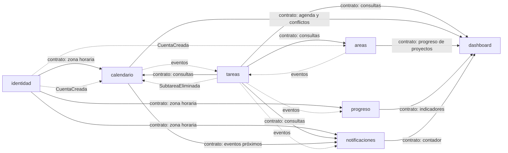
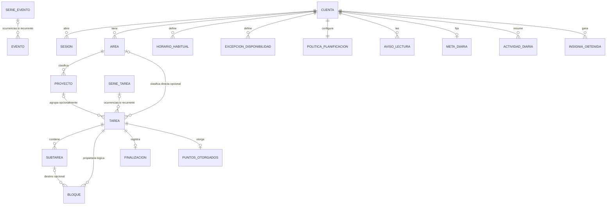

# RELAJAO — Especificación técnica de construcción (SPEC-TEC)

| Campo | Valor |
|---|---|
| Identificador | SPEC-TEC |
| Versión | 0.2 |
| Estado | **Aprobado como documentación de construcción** — 18-nov-2026; las propuestas DTP y los puntos abiertos de §17 siguen pendientes de decisión |
| Línea base funcional | [Discovery funcional v1.0](../01-discovery/discovery-v1.0.md), cerrado el 15-nov-2026 |
| Arquitectura vinculante | [DEC-001](../04-arquitectura/DEC-001-stack-y-estilo.md) y [ARC-002](../04-arquitectura/ARC-002-arquitectura-tecnica.md), aprobadas el 16-nov-2026 |
| Fuentes integradas | SPEC funcional · F01–F07 · ARC-001 v1.1 · C4 contexto y contenedores · responsabilidades R1–R12 · [modelo de dominio v0.1](../04-arquitectura/domain-model.md) · [incrementos e historias](../03-planificacion/incrementos-historias.md) |
| Propósito | Insumo técnico de construcción junto con las historias: módulos, datos, contratos, algoritmos, seguridad y pruebas; el backlog conserva orden y aceptación funcional |
| Autorización | Este documento **no autoriza la implementación**. La fase 3 inicia solo con autorización explícita del responsable del producto |

## Índice

1. [Alcance y criterios de éxito](#1-alcance-y-criterios-de-éxito)
2. [Arquitectura vinculante](#2-arquitectura-vinculante)
3. [Modelo de datos](#3-modelo-de-datos)
4. [Convenciones transversales](#4-convenciones-transversales)
5. [Módulo identidad (F07 — cuenta y sesión)](#5-módulo-identidad-f07--cuenta-y-sesión)
6. [Módulo tareas (F01)](#6-módulo-tareas-f01)
7. [Módulo áreas y proyectos (F03)](#7-módulo-áreas-y-proyectos-f03)
8. [Módulo calendario y planificación (F02)](#8-módulo-calendario-y-planificación-f02)
9. [Módulo notificaciones (F05)](#9-módulo-notificaciones-f05)
10. [Módulo progreso y motivación (F06)](#10-módulo-progreso-y-motivación-f06)
11. [Módulo dashboard (F04)](#11-módulo-dashboard-f04)
12. [Configuración y preferencias (F07)](#12-configuración-y-preferencias-f07)
13. [Frontend web](#13-frontend-web)
14. [Requisitos no funcionales](#14-requisitos-no-funcionales)
15. [Calidad, pruebas y CI/CD](#15-calidad-pruebas-y-cicd)
16. [Plan de construcción](#16-plan-de-construcción)
17. [Decisiones técnicas propuestas y puntos abiertos](#17-decisiones-técnicas-propuestas-y-puntos-abiertos)
18. [Trazabilidad](#18-trazabilidad)

## Punto de entrada para construir

La aprobación documental del 18-nov-2026 establece este SPEC y el backlog como insumos de construcción. **No aprueba de manera implícita las 21 alternativas DTP, sus valores de ejemplo, ni las desviaciones de ARC-002 o del Discovery.** Se conserva su estado pendiente en §17 y las preguntas PA del modelo no se cierran sin una decisión identificada. Esta distinción prevalece sobre cualquier «debe» en un apartado que dependa de una DTP pendiente.

| Insumo | Fuente de referencia |
|---|---|
| Incremento, historia, resultado para el usuario y aceptación | [Backlog aprobado](../03-planificacion/incrementos-historias.md) |
| Reglas originales del producto | [SPEC funcional y F01–F07](../02-requisitos/SPEC.md) |
| Significado, estados e invariantes | [Modelo de dominio aprobado](../04-arquitectura/domain-model.md) |
| Estilo, tecnologías y fronteras | [DEC-001](../04-arquitectura/DEC-001-stack-y-estilo.md) y [ARC-002](../04-arquitectura/ARC-002-arquitectura-tecnica.md) |
| Diseño técnico detallado y propuestas pendientes | Este SPEC; puertas de decisión en §17 |

Para cada historia: (1) identificar sus CA originales; (2) leer el módulo técnico y las DTP que lo condicionan; (3) resolver únicamente las decisiones necesarias para esa parte; (4) concretar contrato, migración y pruebas del incremento; (5) construir el flujo completo; (6) demostrar y registrar la evidencia. La aprobación del documento no marca esos pasos como realizados.

### Madurez del diseño por apartado

| Apartado | Cómo se usa durante la construcción |
|---|---|
| §1–2 | Alcance y arquitectura heredados de la línea base; librerías, kernel ampliado y eventos adicionales son propuestas donde exceden ARC-002 |
| §3 | Modelo físico candidato: tablas, columnas, tipos, índices y restricciones no son una migración aprobada ni implementada. Validar contra dominio y DTP antes de generar Prisma |
| §4 | Convenciones técnicas de construcción; parámetros de sesión, idempotencia, transacciones y reglas temporales dependen de sus DTP |
| §5–12 | Las RN/CA citadas son vinculantes; rutas, DTO, algoritmos, consultas y restricciones adicionales desarrollan una solución candidata. No aplicar un límite o bloqueo nuevo como si fuera regla original |
| §13 | Guía de frontend; rutas y layouts no añaden alcance. El acceso inicial debe llevar a una pantalla ya entregada: tareas en I01, Dashboard cuando exista en I05 |
| §14 | Objetivos propuestos DTP-18; no se convierten en compromisos numéricos por aprobar la documentación |
| §15–16 | Estrategia y orden técnico previstos, no scripts, pipelines o pruebas ya disponibles. Cada paso puede requerir varias sesiones; tamaños sin estimación aprobada |
| §17–18 | Registro de decisiones pendientes y trazabilidad; ninguna tabla de cobertura equivale a una prueba superada |

**Situación actual:** solo documentación. Las carpetas de código, migraciones, CLI y pipeline descritos no existen todavía. Los comandos de este SPEC se implementarán y verificarán en sus historias; no son instrucciones de arranque disponibles en este checkout.

## Cómo se usa este documento

- **Jerarquía de fuentes.** Si este documento contradice al Discovery, DEC-001 o ARC-002, prevalecen estos. Toda contradicción detectada se reporta como solicitud de cambio; no se resuelve en silencio.
- **Marcas de procedencia.** Las reglas llevan su identificador de origen (`RN-xx`, `D-xx`, `CA-xx`, `DM-xx`). Lo que **no** está en la línea base y este documento propone para poder construir se identifica como **`DTP-xx`** (decisión técnica propuesta) y se lista en la [sección 17](#17-decisiones-técnicas-propuestas-y-puntos-abiertos). Un `DTP` no es una decisión aprobada hasta que el responsable del producto lo apruebe.
- **Lenguaje normativo.** *Debe* = obligatorio para aceptar la historia; *debería* = recomendado; *puede* = opcional.
- **Nombres.** Dominio y base de datos en español (`tarea`, `bloque`), identificadores de código en español para el dominio y en inglés para infraestructura de framework, coherente con ARC-002 §5.

---

## 1. Alcance y criterios de éxito

### 1.1 Producto

RELAJAO es una aplicación de productividad personal que organiza responsabilidades, planifica el tiempo y sostiene la constancia sin generar sobrecarga. El sistema recomienda; **el usuario decide**. Filosofía transversal: **Keep Simple**.

### 1.2 Funcionalidades en alcance

| ID | Funcionalidad | Versión | Módulo técnico | Esquema BD |
|---|---|---|---|---|
| F01 | Gestión de tareas | 1.0 | `tareas` | `tareas` |
| F02 | Calendario y planificación (P0 + P1) | 1.0 | `calendario` | `calendario` |
| F03 | Áreas de vida y proyectos | 1.1 | `areas` | `areas` |
| F04 | Dashboard | 1.16 | `dashboard` | — (solo lectura) |
| F05 | Notificaciones y recordatorios | 1.0 | `notificaciones` | `notificaciones` |
| F06 | Progreso y motivación | 1.0 | `progreso` | `progreso` |
| F07 | Configuración y preferencias | 1.0 | `identidad` (+ accesos a `calendario` y `progreso`) | `identidad` |

### 1.3 Fuera de alcance (E01–E12)

El sistema **no** debe incluir: E01 integraciones externas (Gmail, Outlook, Google/Microsoft Calendar, Slack) · E02 apps móviles nativas · E03 carga masiva y voz · E04 notificaciones externas (push, correo, navegador) · E05 personalización avanzada (tema claro/oscuro, avisos configurables, restablecimiento global) · E06 exportación · E07 analítica avanzada (tiempo real, estadísticas complejas, análisis semanal de carga) · E08 gamificación avanzada (niveles, rankings, tienda) · E09 colaboración y equipos · E10 automatización que decide sin confirmación · E11 gestión avanzada de proyectos · E12 mensajes motivacionales automáticos.

**Consecuencia funcional:** no se implementan correo, push, integraciones externas de producto ni endpoints de importación/exportación; tampoco medición de tiempo real. El alojamiento y PostgreSQL gestionado previstos en ARC-002 no son una integración funcional excluida por E01.

### 1.4 Criterios de éxito (S01–S10)

| ID | Criterio | Cómo lo verifica este SPEC |
|---|---|---|
| S01 | Flujo completo de tareas sin herramientas externas | Módulos `tareas`, `areas`, `calendario` (§6–8) |
| S02 | Planificación funcional (agenda, bloques, conflictos) | Módulo `calendario` (§8) |
| S03 | Visibilidad del día | Módulo `dashboard` (§11) |
| S04 | Organización personal (áreas, proyectos, progreso) | Módulo `areas` (§7) |
| S05 | Recordatorios internos sin duplicados ni obsoletos | Módulo `notificaciones` (§9) |
| S06 | Motivación funcional (metas, puntos, insignias, rachas) | Módulo `progreso` (§10) |
| S07 | Persistencia y continuidad entre sesiones | PostgreSQL + §3; pruebas de reingreso (§15) |
| S08 | Uso cotidiano sencillo (captura rápida, consulta fácil) | §13; objetivos de interacción (§14) |
| S09 | Prueba piloto ≥ 7 días con usuarios reales | Incremento I08 (§16) |
| S10 | Criterios de aceptación F01–F07 cumplidos, sin defectos críticos | Matriz de CA (§18) y pruebas (§15) |

**Definición de «MVP validado»:** CA de F01–F07 cumplidos sin defectos críticos abiertos; flujo extremo a extremo; datos conservados entre sesiones; captura y planificación sencillas; piloto de al menos siete días con usuarios reales.

### 1.5 Principios que gobiernan el diseño

| Principio | Efecto técnico obligatorio |
|---|---|
| **Keep Simple** | Ante la duda, no se construye la capacidad avanzada; no se añaden entidades «por si acaso» |
| **Planificar, no fiscalizar** | No existen columnas de tiempo real, estado de ejecución de bloques ni «cumplido/incumplido» en bloques (DM-06, CA19) |
| **El usuario conserva el control** | Toda sugerencia es **efímera** (no se persiste) y no modifica datos hasta una confirmación explícita (DM-09) |
| **Advertir, no impedir** | Conflictos y sobrecarga devuelven advertencias; el guardado se completa con confirmación del usuario (CA06, CA09) |
| **Sin castigos** | No hay puntuaciones negativas, pérdida de puntos/insignias por inactividad ni comparaciones (RN-F06-15) |
| **Planificación y estado son independientes** | Las operaciones sobre bloques no cambian estados de tareas (CA07). Completar/cancelar puede ofrecer liberar bloques futuros solo con confirmación (CA21) |

---

## 2. Arquitectura vinculante

Resumen de lo aprobado en DEC-001 y ARC-002; **no se modifica aquí**.

### 2.1 Estilo y stack

| Pieza | Tecnología | Notas de uso |
|---|---|---|
| Lenguaje | TypeScript estricto (`strict`, `noUncheckedIndexedAccess`) | Servidor y cliente |
| API | NestJS 11 + Fastify | Monolito modular: un módulo Nest por F0x |
| Web (MVP) | React 18 + Vite + TanStack Query | SPA responsive (escritorio, tableta, móvil) |
| Móvil | Expo / React Native | **Post-MVP**; `apps/mobile` existe vacía (E02) |
| Contrato | Zod + OpenAPI | Fuente única en `packages/contracts` |
| Base de datos | PostgreSQL 16 | Un esquema por módulo |
| ORM | Prisma | Migraciones versionadas en `prisma/migrations/` |
| Autenticación | Argon2 + sesión con cookie HttpOnly | Sin proveedor externo |
| Monorepo | pnpm workspaces + Turborepo | |
| Despliegue | Docker (contenedor único) + GitHub Actions | Free tier (Render / Fly.io / Railway) |
| Pruebas | Vitest, Testcontainers (PostgreSQL efímero) | |
| Fronteras | dependency-cruiser en CI | |

Librerías complementarias que este SPEC **sugiere** (no aprobadas; ver DTP-19): `luxon`, `nestjs-zod`, `@nestjs/event-emitter`, `@fastify/helmet`, `@fastify/rate-limit`, `@fastify/static`, `@fastify/cookie`, `pino`, `react-router`, `react-hook-form`, `openapi-typescript` + `openapi-fetch`, Playwright.

### 2.2 Capas dentro de cada módulo

| Capa | Contiene | Puede importar | Prohibido |
|---|---|---|---|
| `domain/` | Entidades, value objects, reglas puras, errores de dominio | Solo `shared/kernel` | NestJS, Prisma, HTTP, `luxon` directo (usa el puerto `Reloj` y utilidades del kernel) |
| `application/` | Casos de uso, puertos (interfaces de repositorio), eventos que publica | `domain/`, kernel | Prisma, HTTP |
| `infrastructure/` | Repositorios Prisma, adaptadores | `application/`, `domain/`, Prisma | Controladores de otros módulos |
| presentación (`*.controller.ts`) | Controladores REST, validación Zod en frontera, mapeo de errores a HTTP | `application/`, `packages/contracts` | `domain/` directo, Prisma |

Todo módulo expone únicamente `contracts/` (tipos y servicios de consulta/comando público). Los demás módulos **solo** pueden importar `contracts/` de otro módulo (verificado por dependency-cruiser).

### 2.3 Mapa de dependencias entre módulos



Reglas: (1) flechas continuas = el origen **expone** un contrato que el destino **inyecta**; (2) flechas punteadas = el origen **publica** un evento al que el destino se suscribe; (3) `dashboard` no tiene dominio ni esquema propio (F04-D25); (4) se deben evitar ciclos de dependencia directa. El detalle debe revisarse antes de implementar: §6.8 hace que tareas consulte áreas y §7.4 hace que áreas consulte tareas; el diagrama por sí solo no demuestra ausencia de ciclos. La solución se acuerda bajo DTP-15/17 sin autorizar importaciones privadas entre módulos.

Esta es la vista técnica de ARC-002 §4, ampliada con eventos propuestos para cubrir reglas de F01/F03 (`ProyectoEliminado`/`ProyectoAreaCambiada` hacia `tareas`; `PlanificacionDeTareaActualizada` hacia `tareas`; `SubtareaEliminada` hacia `calendario`; `CuentaCreada` hacia `areas` y `calendario`). Ver DTP-09 y DTP-15.

### 2.4 Estructura del monorepo

Se adopta tal cual ARC-002 §5. Complementos de este SPEC:

```text
relajao/
├── apps/
│   ├── api/src/
│   │   ├── main.ts                       # arranque, helmet, cookies, OpenAPI, estáticos del web
│   │   ├── cli/                          # comandos administrativos (crear-cuenta, restablecer-clave)
│   │   ├── modules/{identidad,tareas,areas,calendario,notificaciones,progreso,dashboard}/
│   │   │   ├── domain/ · application/ · infrastructure/ · contracts/
│   │   │   └── <modulo>.controller.ts · <modulo>.module.ts
│   │   └── shared/kernel/                # Result, Entity, Reloj, Zona/Fecha, ReglaRecurrencia, bus, UnitOfWork
│   ├── web/src/{app,features,shared}/    # features/ espejo de los módulos
│   └── mobile/                           # vacía
├── packages/{contracts,api-client,config}/
├── prisma/{schema.prisma,migrations/}
├── e2e/                                  # pruebas de extremo a extremo (Playwright)
├── Dockerfile · .dependency-cruiser.cjs · turbo.json · pnpm-workspace.yaml
└── .github/workflows/ci.yml
```

### 2.5 Kernel compartido (`shared/kernel`)

| Pieza | Responsabilidad |
|---|---|
| `Result<T,E>` | Retorno de reglas de dominio sin excepciones para flujos esperados |
| `Entity` / `ValueObject` | Base de identidad e igualdad |
| `Reloj` (puerto) | `ahora(): Date`; implementación real y fija para pruebas. **Ninguna regla usa `new Date()` directamente** |
| `ZonaHoraria`, `FechaLocal` | Conversión instante ↔ día local con IANA tz; inicio/fin del día local; DST correcto |
| `ReglaRecurrencia` | Función pura `ocurrenciasEntre(ancla, regla, desde, hasta, zona)` (DTP-03) compartida por `tareas` y `calendario` |
| `BusEventos` | Bus en proceso, entrega síncrona dentro de la transacción (DTP-15) |
| `UnitOfWork` | Transacción Prisma propagada por `AsyncLocalStorage`; los repositorios la usan implícitamente |
| `Idempotencia` | Almacén de claves de idempotencia (DTP-16) |
| `Paginacion`, `ErrorDeDominio` | Utilidades comunes |

---

## 3. Modelo de datos

### 3.1 Principios

1. **Un esquema PostgreSQL por módulo** (`identidad`, `tareas`, `areas`, `calendario`, `notificaciones`, `progreso`) más `compartido` (idempotencia). `dashboard` no persiste.
2. **Todo registro de usuario lleva `usuario_id`** y **toda consulta de repositorio lo exige como parámetro** (aislamiento F07/HU-01). No existe un método de repositorio que lea por `id` sin `usuario_id`.
3. **Sin claves foráneas entre esquemas** (DTP-17). Las referencias entre módulos son columnas `uuid` validadas por la capa de aplicación mediante contratos; la integridad se cubre con pruebas de integración. Las FK **dentro** de un esquema sí se declaran.
4. **Instantes en `timestamptz` (UTC)**; fechas de calendario en `date`; horas del día en `time`. La zona del usuario se aplica solo en dominio/presentación (DTP-02, DTP-05).
5. **Identificadores `uuid`** generados en la aplicación. **Concurrencia optimista:** columnas `version int` en `tarea`, `proyecto`, `evento`, `bloque`; las actualizaciones incluyen `WHERE version = :v`.
6. **Eliminación lógica** solo donde el negocio la exige: `tareas.tarea.eliminada_en` (papelera, RN-07) y `calendario.evento.eliminado_en` (DTP-03). Proyectos y bloques se eliminan físicamente.
7. **Migraciones Prisma** versionadas; desarrollo, pruebas y producción aplican las mismas en orden. Prohibido modificar una migración ya fusionada en `main`.
8. Nombres de tablas y columnas en `snake_case` español; enums de BD en `SCREAMING_SNAKE`.

### 3.2 Vista general



La ausencia de FK entre esquemas es una propuesta pendiente DTP-17. El diagrama permite tarea sin proyecto, sin área directa y sin serie; una tarea de proyecto hereda su área. El área efectiva duplicada en la propuesta física no representa una segunda clasificación independiente. En el bloque, tarea propietaria y subtarea opcional no son dos destinos: si existe subtarea, ella es el único destino lógico y pertenece a esa tarea.

### 3.3 Esquema `identidad`

| Tabla | Columnas | Restricciones |
|---|---|---|
| `cuenta` | `id uuid pk` · `email citext not null` · `clave_hash text not null` · `nombre_visible varchar(80) not null` · `zona_horaria text not null` · `activa boolean not null default true` · `creada_en timestamptz` | `unique(email)` · `check (btrim(nombre_visible) <> '')` · `zona_horaria` validada contra IANA en dominio |
| `sesion` | `id_hash char(64) pk` (SHA-256 del identificador) · `cuenta_id uuid fk` · `creada_en` · `ultimo_uso_en` · `expira_en` · `agente varchar(200)?` | Índice `(cuenta_id)`; borrado en cascada con la cuenta |

### 3.4 Esquema `tareas`

| Tabla | Columnas | Restricciones e índices |
|---|---|---|
| `tarea` | `id` · `usuario_id` · `titulo varchar(200) not null` · `descripcion text?` · `prioridad enum(ALTA,MEDIA,BAJA)?` · `estimacion_min int?` · `fecha_limite timestamptz?` · `fecha_limite_con_hora boolean not null default false` · `estado enum(PENDIENTE,EN_PROGRESO,PAUSADA,COMPLETADA,CANCELADA) not null default 'PENDIENTE'` · `completada_en timestamptz?` · `eliminada_en timestamptz?` · `area_id uuid?` · `proyecto_id uuid?` · `serie_id uuid? fk` · `ancla_ocurrencia timestamptz?` · `es_excepcion boolean not null default false` · `planificado_hasta timestamptz?` · `version int not null default 1` · `creada_en` · `actualizada_en` | `check (btrim(titulo) <> '')` · `check (estimacion_min is null or estimacion_min between 1 and 1440)` · `check ((estado = 'COMPLETADA') = (completada_en is not null))` · `check ((serie_id is null) = (ancla_ocurrencia is null))` · `unique(serie_id, ancla_ocurrencia)` · invariante de clasificación: si `proyecto_id` no es nulo, `area_id` = área del proyecto (mantenido por la aplicación) · índices `(usuario_id, estado) where eliminada_en is null`, `(usuario_id, fecha_limite) where eliminada_en is null`, `(usuario_id, proyecto_id)`, `(usuario_id, area_id)`, `(usuario_id, eliminada_en)` |
| `subtarea` | `id` · `usuario_id` · `tarea_id fk` · `titulo varchar(200) not null` · `estado enum(PENDIENTE,COMPLETADA)` · `origen_finalizacion enum(MANUAL,AUTOMATICA)?` · `orden int` · `creada_en` · `actualizada_en` | `check (btrim(titulo) <> '')` · índice `(tarea_id, orden)` · `on delete cascade` solo si la tarea se elimina físicamente (no ocurre en el MVP) |
| `serie_tarea` | `id` · `usuario_id` · `frecuencia enum(DIARIA,SEMANAL,MENSUAL)` · `ancla timestamptz not null` · `ancla_con_hora boolean` · `hasta date?` · `generada_hasta date not null` · plantilla: `titulo` · `descripcion?` · `prioridad?` · `estimacion_min?` · `area_id?` · `proyecto_id?` · `creada_en` | La plantilla alimenta las ocurrencias futuras. `frecuencia` y `ancla` son **inmutables** tras crear la serie (DTP-03); editar «esta y las futuras» actualiza plantilla y ocurrencias no excepcionales (§6.6) |

### 3.5 Esquema `areas`

| Tabla | Columnas | Restricciones e índices |
|---|---|---|
| `area` | `id` · `usuario_id` · `clave enum(TRABAJO,SALUD,FINANZAS,DESARROLLO_PERSONAL,VIDA_PERSONAL)` · `nombre varchar(60) not null` · `color char(7) not null` · `orden smallint` | `unique(usuario_id, clave)` · `check (color ~ '^#[0-9A-Fa-f]{6}$')` · `check (btrim(nombre) <> '')`. Las cinco filas se crean al crear la cuenta; **no existen operaciones de crear/archivar/eliminar** (D04, CA2) |
| `proyecto` | `id` · `usuario_id` · `area_id fk` · `nombre varchar(100) not null` · `descripcion text?` · `prioridad enum(ALTA,MEDIA,BAJA) not null default 'MEDIA'` · `favorito boolean not null default false` · `version int` · `creado_en` · `actualizado_en` | `check (btrim(nombre) <> '')` · índice `(usuario_id, area_id)`, `(usuario_id, favorito, prioridad, nombre)` |

### 3.6 Esquema `calendario`

| Tabla | Columnas | Restricciones e índices |
|---|---|---|
| `evento` | `id` · `usuario_id` · `titulo varchar(200)` · `descripcion?` · `inicio timestamptz` · `fin timestamptz` · `serie_id uuid? fk` · `ancla_ocurrencia timestamptz?` · `es_excepcion boolean not null default false` · `eliminado_en timestamptz?` · `version` · `creado_en` · `actualizado_en` | `check (fin > inicio)` (CA02) · `check ((serie_id is null) = (ancla_ocurrencia is null))` · `unique(serie_id, ancla_ocurrencia)` · índice `(usuario_id, inicio) where eliminado_en is null` |
| `serie_evento` | `id` · `usuario_id` · `frecuencia` · `ancla_inicio timestamptz` · `duracion_min int` · `hasta date?` · `generada_hasta date` · plantilla: `titulo`, `descripcion?` | Igual criterio de división que `serie_tarea` |
| `bloque` | `id` · `usuario_id` · `tarea_id uuid not null` (tarea propietaria) · `subtarea_id uuid?` (si el destino es una subtarea) · `inicio timestamptz` · `fin timestamptz` · `version` · `creado_en` | **Destino único:** el destino es la subtarea si `subtarea_id` no es nulo; si no, la tarea. Nunca ambos destinos ni ninguno (DM del modelo de dominio) · `tarea_id` se guarda siempre para propagar visibilidad y planificación al padre · `check (fin > inicio)` (DTP-05) · **sin columnas de estado de ejecución, recurrencia ni tiempo real** · índices `(usuario_id, inicio)`, `(tarea_id)`, `(subtarea_id)` |
| `horario_habitual` | `id` · `usuario_id` · `dia_semana smallint (1=lunes … 7=domingo)` · `hora_inicio time` · `hora_fin time` | `check (hora_inicio < hora_fin)` · la aplicación impide intervalos solapados en el mismo día |
| `excepcion_disponibilidad` | `id` · `usuario_id` · `fecha date` · `tipo enum(NO_DISPONIBLE,PERSONALIZADA)` | `unique(usuario_id, fecha)` |
| `excepcion_intervalo` | `id` · `excepcion_id fk` · `hora_inicio time` · `hora_fin time` | `check (hora_inicio < hora_fin)`; solo para `PERSONALIZADA` |
| `politica_planificacion` | `usuario_id pk` · `descanso_min smallint` · `margen_min smallint` · `sesion_min smallint` | Valores por defecto: DTP-06 |
| `horario_habitual_serie` | `serie_tarea_id uuid pk` · `usuario_id` · `hora_inicio time` · `duracion_min smallint` | Horario habitual opcional de una tarea recurrente (F02-11, CA17) |

### 3.7 Esquema `notificaciones`

| Tabla | Columnas | Restricciones |
|---|---|---|
| `aviso_lectura` | `usuario_id` · `clave_aviso varchar(160)` · `leido_en timestamptz` | `pk(usuario_id, clave_aviso)`. Es el **único** estado persistido de los avisos (DTP-10) |

### 3.8 Esquema `progreso`

| Tabla | Columnas | Restricciones |
|---|---|---|
| `meta_diaria` | `usuario_id pk` · `cantidad smallint` | `check (cantidad between 1 and 99)` (DTP-08). Ausencia de fila = meta desactivada |
| `finalizacion` | `id` · `usuario_id` · `tarea_id uuid` · `completada_en timestamptz` · `dia_local date` · `vigente boolean` | `unique(tarea_id)`. `dia_local` se fija al completar y **no se recalcula** si cambia la zona (DTP-08). Reabrir pone `vigente=false` |
| `puntos_otorgados` | `id` · `usuario_id` · `tarea_id uuid` · `puntos smallint` · `otorgado_en` | `unique(tarea_id)` → garantiza «una sola vez» (RN-F06-10, CA-F06-10) |
| `actividad_diaria` | `usuario_id` · `dia date` · `completadas smallint` · `meta smallint?` · `cumplido boolean` | `pk(usuario_id, dia)`. Un día sin fila equivale a cero (RN-F06-13) |
| `insignia_obtenida` | `usuario_id` · `clave enum(PRIMERA_TAREA,PRIMERA_META,RACHA_3)` · `obtenida_en` | `pk(usuario_id, clave)` |

### 3.9 Esquema `compartido`

| Tabla | Columnas | Restricciones |
|---|---|---|
| `idempotencia` | `usuario_id` · `clave varchar(80)` · `operacion varchar(60)` · `huella char(64)` · `respuesta jsonb` · `creada_en` | `pk(usuario_id, clave)`; purga de filas con más de 24 h al arrancar y cada 6 h |

### 3.10 Límites de campos (DTP-14)

| Campo | Límite |
|---|---|
| Título de tarea/subtarea/evento | 1–200 caracteres tras `trim` |
| Descripción | ≤ 5 000 |
| Nombre de proyecto | 1–100 · de área 1–60 · nombre visible 1–80 |
| Estimación | 1–1 440 min |
| Meta diaria | 1–99 |
| Subtareas por tarea | ≤ 50 |

Se validan en `packages/contracts` (Zod) **y** con `check` en la base.

---

## 4. Convenciones transversales

### 4.1 API REST

| Aspecto | Regla |
|---|---|
| Base | `/api/v1`; JSON `application/json; charset=utf-8`; el contrato OpenAPI se genera de los esquemas Zod |
| Recursos | Sustantivos en español plural (`/tareas`, `/bloques`); acciones de estado como subrecurso (`PATCH /tareas/:id/estado`); acciones no CRUD como `POST /recurso/:id/accion` |
| Fechas | Instantes en ISO-8601 UTC con `Z`; fechas de calendario `YYYY-MM-DD`; horas locales `HH:mm`. El cliente muestra en la zona del usuario |
| Identificadores | `uuid` |
| Paginación | `?limite=` (por defecto 50, máximo 200) y `?cursor=` opaco; respuesta `{ datos, siguienteCursor }`. Las vistas acotadas por diseño (agenda, avisos) no paginan |
| Concurrencia | `ETag` = `version` en recursos con versión; `If-Match` opcional en `PATCH`/`DELETE`; conflicto → `412` |
| Idempotencia | Cabecera `Idempotency-Key` **obligatoria** en confirmaciones que crean/mueven reservas (§8.9). Misma clave + misma huella → misma respuesta; misma clave + otra huella → `422 IDEMPOTENCIA_CONFLICTO` |
| Advertencias | Operaciones que advierten (conflicto, sobrecarga) se ejecutan en dos pasos: sin `confirmaAdvertencias` devuelven `409 REQUIERE_CONFIRMACION` con la lista de advertencias y **no cambian nada**; repetidas con `confirmaAdvertencias=true` guardan |
| Idioma | Mensajes de error en español; los `code` son estables y los consume el cliente |

#### Formato de error (RFC 9457 `application/problem+json`)

```json
{
  "type": "about:blank",
  "title": "Título inválido",
  "status": 422,
  "code": "TAREA_TITULO_INVALIDO",
  "detail": "El título no puede estar vacío ni contener solo espacios.",
  "errores": [{ "campo": "titulo", "code": "VACIO" }],
  "traceId": "9f6c…"
}
```

| Estado | Uso |
|---|---|
| 400 | Cuerpo/consulta malformados (fallo de esquema Zod) |
| 401 | Sin sesión válida |
| 403 | Origen no permitido (verificación de `Origin`) |
| 404 | Recurso inexistente **o de otro usuario** (no se distingue) |
| 409 | `REQUIERE_CONFIRMACION` o conflicto de unicidad; transición no permitida usa 422 como §6.3 |
| 412 | `If-Match` desactualizado |
| 422 | Violación de regla de negocio (`code` de dominio) |
| 429 | Límite de tasa |
| 500 | Error no controlado (sin detalles internos; con `traceId`) |

### 4.2 Seguridad y aislamiento

| Tema | Especificación |
|---|---|
| Contraseñas | **Argon2id** (parámetros ≥ mínimo OWASP vigente); nunca se registran ni se devuelven |
| Sesión | Identificador aleatorio de 256 bits; en BD solo su SHA-256. Cookie `__Host-sid`: `HttpOnly; Secure; SameSite=Lax; Path=/`. Expira por inactividad a 7 días (deslizante) y absoluta a 30 días (DTP-01) |
| Cliente móvil futuro | El mismo endpoint de login emitirá *bearer token* cuando exista `apps/mobile`; **no se implementa en el MVP** |
| CSRF | Mismo origen (la API sirve el web) + `SameSite=Lax` + verificación de cabecera `Origin` en `POST/PATCH/PUT/DELETE` contra `ORIGEN_PERMITIDO` |
| Aislamiento | Guard global exige sesión salvo `POST /auth/login` y `GET /salud`; el `usuarioId` se obtiene **solo** de la sesión, nunca del cuerpo ni de la URL |
| Cabeceras | `helmet`: CSP restrictiva (`default-src 'self'`), `X-Content-Type-Options`, `Referrer-Policy`, HSTS en producción |
| Tasa | Login: 5 intentos fallidos por (email, IP) en 15 min → `429` con espera creciente; resto de la API: límite generoso por sesión |
| Validación | Toda entrada pasa por Zod en el controlador; el dominio revalida invariantes |
| Datos | Registros sin contraseñas ni cuerpos de petición; `traceId` por solicitud |
| Dependencias | `pnpm-lock.yaml` versionado; versiones fijadas; auditoría (`pnpm audit`) en CI |

### 4.3 Tiempo y zona horaria

1. Se almacenan **instantes UTC**; el **día local** de un instante se calcula con la zona IANA del usuario (`identidad.cuenta.zona_horaria`) mediante `FechaLocal` del kernel (RN-06 F07, CA25 F02).
2. Cambiar la zona **no modifica estados** (RN-F07-07) ni reescribe `dia_local` ya guardado (DTP-08); afecta solo a visualización y a cálculos futuros.
3. Reglas temporales (hoy y día de logro en zona local; ventanas de 120 min, 24 h y 30 min por duración transcurrida) usan siempre el `Reloj` del kernel, de modo que las pruebas fijan «ahora» y la zona.
4. Fecha límite sin hora: ver DTP-02 (§17).

### 4.4 Eventos de dominio

Bus en proceso, entrega **síncrona dentro de la misma transacción** de la operación que los origina (DTP-15): si un manejador falla, se revierte toda la operación. Los manejadores deben ser **idempotentes**.

| Evento | Productor | Carga útil mínima | Consumidores y efecto |
|---|---|---|---|
| `CuentaCreada` | identidad | `usuarioId` | areas: crear las 5 áreas · calendario: crear `politica_planificacion` por defecto |
| `TareaCompletada` | tareas | `usuarioId, tareaId, completadaEn, esOcurrencia` | progreso: registrar finalización, puntos, actividad, insignias · notificaciones: purgar lecturas del origen |
| `TareaReabierta` | tareas | `usuarioId, tareaId` | progreso: `vigente=false` y recalcular el día |
| `TareaCancelada` | tareas | `usuarioId, tareaId` | notificaciones: purgar lecturas |
| `TareaEliminada` / `TareaRestaurada` | tareas | `usuarioId, tareaId` | notificaciones: purgar lecturas |
| `SubtareaEliminada` | tareas | `usuarioId, tareaId, subtareaId` | calendario: eliminar los bloques **futuros** de la subtarea; los pasados se conservan |
| `FechaLimiteCambiada` | tareas | `usuarioId, tareaId` | notificaciones: purgar lecturas anteriores del origen |
| `ProyectoAreaCambiada` | areas | `usuarioId, proyectoId, areaId` | tareas: actualizar `area_id` de sus tareas (D09), sin tocar estados ni bloques |
| `ProyectoEliminado` | areas | `usuarioId, proyectoId, areaId` | tareas: poner `proyecto_id=null` conservando `area_id` (D08) |
| `PlanificacionDeTareaActualizada` | calendario | `usuarioId, tareaId, planificadoHasta` | tareas: actualizar `planificado_hasta` (alimenta la bandeja, DTP-09) |
| `MetaDiariaCambiada` | progreso | `usuarioId` | progreso (interno): recalcular `actividad_diaria` de hoy |

Los efectos de un evento nunca cambian estados de tareas que el evento no deba tocar (CA07 F02, RN-F03).

---

## 5. Módulo identidad (F07 — cuenta y sesión)

Responsabilidad: identidad del titular, sesión, perfil y zona horaria. **No** duplica reglas de F02 (disponibilidad) ni F06 (meta); esos accesos se exponen en [§12](#12-configuración-y-preferencias-f07).

### 5.1 Requisitos

| ID | Requisito | Fuente |
|---|---|---|
| RF-ID-01 | Acceder con credenciales válidas y cerrar sesión de forma explícita | HU-01; F07 RN-13, CA-14 |
| RF-ID-02 | Sin sesión válida no se puede consultar ni modificar ningún dato; una cuenta A nunca ve ni modifica datos de B aunque conozca sus identificadores | HU-01 |
| RF-ID-03 | Consultar información básica de la cuenta (nombre visible, email, zona horaria) | F07 RN-12, CA-13 |
| RF-ID-04 | Editar el nombre visible con acción explícita de guardar | F07 RN-02–04, CA-03 |
| RF-ID-05 | Consultar y modificar la zona horaria | F07 RN-05, CA-05–06 |
| RF-ID-06 | Cerrar sesión no elimina ni modifica datos; al volver a entrar todo se conserva | F07 RN-14–15, CA-15–16 |
| RF-ID-07 | Alta de cuentas por el administrador (sin registro público) | DTP-01 |

### 5.2 Reglas de negocio

| ID | Regla | Capa |
|---|---|---|
| RN-F07-03 | `nombre_visible` no puede estar vacío ni ser solo espacios | Dominio + `check` BD |
| RN-F07-04 | Los cambios del perfil se aplican solo con un `PATCH` explícito | Presentación |
| RN-F07-06/07 | Fechas y horas se interpretan según la zona; cambiar la zona **no** modifica estados de tareas ni eventos | Dominio |
| RN-F07-13/14 | Cerrar sesión elimina únicamente la fila de `sesion` | Aplicación |
| RN-F07-15 | Preferencias persistentes entre sesiones | BD |
| RN-ID-01 | Zona horaria válida = identificador IANA reconocido por el runtime (`Intl.supportedValuesOf('timeZone')`) | Dominio |
| RN-ID-02 | Una cuenta inactiva (`activa=false`) no puede abrir sesión | Aplicación |
| RN-ID-03 | Credenciales inválidas devuelven el mismo error genérico para email inexistente y contraseña errónea | Aplicación |

### 5.3 API

| Método y ruta | Cuerpo | Respuesta | Errores clave |
|---|---|---|---|
| `POST /auth/login` | `{ email, clave }` | `200` + cookie de sesión; `{ cuenta }` | `401 CREDENCIALES_INVALIDAS`, `429 DEMASIADOS_INTENTOS` |
| `POST /auth/logout` | — | `204`; borra cookie y fila de sesión | — |
| `GET /me` | — | `{ id, email, nombreVisible, zonaHoraria }` | `401` |
| `PATCH /me` | `{ nombreVisible?, zonaHoraria? }` | cuenta actualizada | `422 NOMBRE_VISIBLE_INVALIDO`, `422 ZONA_HORARIA_INVALIDA` |
| `GET /salud` | — | `{ estado: "ok" }` sin sesión; verifica BD | — |

### 5.4 Casos de uso y CLI

| Caso de uso | Detalle |
|---|---|
| `IniciarSesion` | Verifica Argon2id; crea `sesion`; renueva `ultimo_uso_en` en cada solicitud autenticada (deslizante, DTP-01) |
| `CerrarSesion` | Elimina la sesión actual |
| `ActualizarPerfil` | Valida nombre y zona; guarda |
| `CrearCuenta` (CLI) | `pnpm --filter api cli crear-cuenta --email … --nombre … --zona …`; solicita clave por entrada segura; publica `CuentaCreada` |
| `RestablecerClave` (CLI) | Solo administrador; invalida todas las sesiones de la cuenta |

### 5.5 Contrato público (`identidad/contracts`)

`IdentidadLectura`: `obtenerZonaHoraria(usuarioId): ZonaHoraria` · `existeCuentaActiva(usuarioId): boolean`.

### 5.6 Criterios de aceptación que cubre

CA-F07-01–04, 13–17 (HU-07); CA-F07-05–07 (HU-14); CA-F07-14–15 (HU-01).

---

## 6. Módulo tareas (F01)

Responsabilidad: **qué** hay por hacer. Fuente única de tareas, subtareas, estados, recurrencias y papelera. No reserva tiempo ni decide cuándo se hace.

### 6.1 Requisitos funcionales

| ID | Capacidad | Comportamiento | Fuente |
|---|---|---|---|
| F01.01 | Captura rápida | Crear tarea solo con título | CA-01, CA-02 |
| F01.02 | Bandeja de entrada | Vista de tareas no planificadas | CA-03, DTP-09 |
| F01.03 | Datos de la tarea | Descripción, prioridad, estimación y fecha límite opcionales | CA-04 |
| F01.04 | Estados | Cinco estados con transiciones fijas | CA-05, CA-06 |
| F01.05 | Subtareas | Crear, editar, completar y eliminar subtareas de un nivel | CA-07, CA-08 |
| F01.06 | Recurrencias | Diarias, semanales y mensuales | CA-09, CA-10 |
| F01.07 | Edición de recurrencias | Una ocurrencia o esta y las futuras | CA-11, CA-12 |
| F01.08 | Finalización | Completar desde cualquier estado activo | CA-06, CA-13 |
| F01.09 | Reapertura | Reabrir completada / reactivar cancelada | CA-14, CA-15 |
| F01.10 | Papelera | Eliminar lógicamente y restaurar | CA-16, CA-17 |
| F01.11 | Persistencia | Conservar todo entre sesiones | CA-18 |
| F01.12 | Clasificación | Asignar o mover a proyecto, área directa o ninguna | F03 CA3, CA8–10 |

### 6.2 Reglas de negocio

| ID | Regla | Capa |
|---|---|---|
| RN-01 | Título obligatorio, sin ser solo espacios; la tarea nueva inicia `PENDIENTE`; todo lo demás es opcional | Dominio + BD |
| RN-02 | La bandeja es una **vista**, no un estado. Una tarea puede existir sin fecha, sin estimación, sin clasificación y sin bloques | Consulta |
| RN-03 | Transiciones (§6.3). Completar desde cualquier estado activo sin pasos intermedios. Reabrir/reactivar conserva la identidad (no duplica) | Dominio |
| RN-04 | Subtareas de **un nivel**. Al completar la principal se completan automáticamente las subtareas pendientes. Completar todas las subtareas **no** completa la principal | Dominio |
| RN-05 | Cada ocurrencia conserva su estado y registro propios. Editar una ocurrencia no altera las demás; editar las futuras no altera el historial anterior | Dominio + aplicación |
| RN-06 | Completar registra fecha y hora (`completada_en` = `Reloj.ahora`) y emite `TareaCompletada`. Una cancelada **no** cuenta como completada ni genera reconocimiento | Dominio |
| RN-07 | Eliminar = mover a papelera (`eliminada_en`); restaurar recupera datos y relaciones. **No** existe eliminación definitiva en el MVP. Eliminar ≠ cancelar | Dominio |
| RN-08 | Todo cambio persiste entre sesiones | BD |
| RN-T-01 | La papelera es ortogonal al estado: una tarea eliminada conserva su estado de ejecución | Dominio |
| RN-T-02 | Una tarea en papelera no es editable ni cambia de estado hasta restaurarse | Dominio |
| RN-T-03 | Un reintento de la misma transición (misma tarea, mismo estado destino) es **idempotente**: devuelve `200` con el estado actual, sin evento nuevo ni duplicados | Aplicación |
| RN-T-04 | Eliminar una tarea no cancela ni modifica sus subtareas, bloques ni clasificación; sus bloques se ocultan (F02 CA22) | Dominio |
| RN-T-05 | La fecha límite es independiente de la planificación: asignarla no crea bloques ni cambia el estado; vencer no cambia el estado (F02 CA24) | Dominio |
| RN-T-06 | Mover entre proyecto / área directa / ninguna conserva estado, subtareas, fechas, recurrencia y bloques (F03 CA9) | Dominio |

### 6.3 Máquina de estados

| Desde \ Hacia | PENDIENTE | EN_PROGRESO | PAUSADA | COMPLETADA | CANCELADA |
|---|---|---|---|---|---|
| **PENDIENTE** | — | iniciar | ✗ | completar | cancelar |
| **EN_PROGRESO** | ✗ | — | pausar | completar | cancelar |
| **PAUSADA** | ✗ | reanudar | — | completar | cancelar |
| **COMPLETADA** | reabrir | ✗ | ✗ | — | ✗ |
| **CANCELADA** | reactivar | ✗ | ✗ | ✗ | — |

Una transición ✗ devuelve `422 TRANSICION_NO_PERMITIDA` sin alterar datos. Implementación normativa: la tabla `TRANSICIONES` de `tarea.entity.ts` (ARC-002 §3).

**Efectos por transición**

| Transición | Efectos |
|---|---|
| → COMPLETADA | `completada_en = ahora` · subtareas `PENDIENTE` → `COMPLETADA` con `origen_finalizacion = AUTOMATICA` · evento `TareaCompletada` |
| COMPLETADA → PENDIENTE (reabrir) | `completada_en = null` · las subtareas **no** se reabren (DTP-04) · evento `TareaReabierta` |
| → CANCELADA | evento `TareaCancelada` · no suma a logros ni progreso |
| CANCELADA → PENDIENTE (reactivar) | sin efecto adicional |

### 6.4 Subtareas

| Operación | Regla |
|---|---|
| Crear | Título válido; máximo 50 por tarea; estado `PENDIENTE`; solo sobre tareas no eliminadas, no completadas y no canceladas |
| Editar título | Válido |
| Completar | `PENDIENTE → COMPLETADA`, `origen_finalizacion = MANUAL`. Completar la última **no** completa la principal |
| Reabrir subtarea | `COMPLETADA → PENDIENTE` manualmente (DTP-04) |
| Eliminar | Eliminación física de la subtarea; sus bloques futuros se eliminan junto con ella; los pasados se conservan como historial del padre (DTP-05) |

Las subtareas **no** cuentan en progreso de proyectos ni en logros (RN-F06-02, D13 F03).

### 6.5 Listados y bandeja

| Vista | Criterio |
|---|---|
| Bandeja (`vista=bandeja`) | Estado en {PENDIENTE, EN_PROGRESO, PAUSADA}, no eliminada, y (`planificado_hasta` nulo o ≤ ahora); para ocurrencias de series, solo las de `ancla_ocurrencia` ≤ fin del día local de hoy (DTP-09) |
| Todas (`vista=activas`) | Estados activos, no eliminadas; ocurrencias futuras limitadas por `horizonteDias` (por defecto 7) |
| Vencidas (`vista=vencidas`) | Estados activos, no eliminadas, fecha límite efectiva ≤ ahora; orden por fecha límite ascendente (usada por «ver todas» del Dashboard) |
| Hechas | `estado = COMPLETADA`, orden por `completada_en` descendente |
| Canceladas | `estado = CANCELADA` |
| Papelera (`vista=papelera`) | `eliminada_en` no nulo |

Filtros comunes: `areaId`, `proyectoId`, `sinClasificar=true`, `q` (búsqueda por título, insensible a mayúsculas y acentos). Orden por defecto: prioridad (ALTA primero; nula = MEDIA), luego fecha límite efectiva ascendente (nulas al final), luego `creada_en`.

### 6.6 Recurrencias

**Modelo (DTP-03).** `serie_tarea` guarda plantilla, `frecuencia ∈ {DIARIA, SEMANAL, MENSUAL}`, `ancla`, `hasta?`. Intervalo fijo de 1.

| Frecuencia | Regla de ocurrencias |
|---|---|
| DIARIA | Cada día local desde la ancla |
| SEMANAL | Cada semana, el mismo día de la semana de la ancla |
| MENSUAL | Cada mes, el mismo día del mes de la ancla; si el mes no tiene ese día (29, 30, 31), el **último día del mes** (propuesta del Discovery §10.1, pendiente de aprobación) |

**Reloj local.** Cada ocurrencia se calcula como (fecha local, hora local de la ancla) en la zona vigente al generarla; el instante resultante se guarda en `fecha_limite`/`ancla_ocurrencia`. Las ocurrencias ya materializadas no se reescriben si cambia la zona.

**Materialización.** Al crear la serie se generan las ocurrencias desde la ancla hasta `min(hasta, hoy + 90 días)` y se guarda `generada_hasta`. Antes de listar tareas o consultar la agenda se ejecuta `CompletarSeries(usuarioId)`: para cada serie con `generada_hasta < hoy + 60 días` genera hasta `hoy + 90 días`. La inserción usa `INSERT … ON CONFLICT (serie_id, ancla_ocurrencia) DO NOTHING`: **nunca duplica** (mismo criterio que F02 CA18). No se requiere trabajo programado.

**Ocurrencia como tarea.** Cada ocurrencia es una fila de `tarea` con `serie_id`; copia los campos de la plantilla; su `fecha_limite` es la ancla de la ocurrencia; **no copia subtareas** (DTP-04); puede tener bloques propios.

**Alcance de edición** (`?alcance=ocurrencia|futuras`, por defecto `ocurrencia`):

| Alcance | Efecto |
|---|---|
| `ocurrencia` | Actualiza esa fila y la marca `es_excepcion = true`. No toca las demás |
| `futuras` | Actualiza la plantilla de la serie y todas las ocurrencias con `ancla ≥` la actual que estén activas, no eliminadas y con `es_excepcion = false`. Las pasadas, las completadas/canceladas y las excepcionales quedan intactas |
| `futuras` con `hasta` | Fija el fin de la serie; ocurrencias posteriores a `hasta` en estado `PENDIENTE`, sin bloques y sin excepción se eliminan físicamente; las que tengan bloques, progreso o excepción se conservan como tareas sueltas |

`frecuencia` y `ancla` no se editan (DTP-03): para cambiar la repetición se termina la serie y se crea otra.

**Completar una ocurrencia** afecta solo esa fila (CA-10). **Eliminar** una ocurrencia = papelera de esa fila (DTP-12).

### 6.7 Papelera

| Operación | Efecto |
|---|---|
| `DELETE /tareas/:id` | `eliminada_en = ahora`; evento `TareaEliminada`; sus bloques se ocultan en calendario (visibilidad derivada, §8.4); proyectos recalculan al consultar |
| `POST /tareas/:id/restaurar` | `eliminada_en = null`; evento `TareaRestaurada`; devuelve la tarea. El cliente consulta `GET /planificacion/conflictos?tareaId=` para advertir conflictos de las reservas restauradas (F02 CA23) |

### 6.8 API

| Método y ruta | Cuerpo / parámetros | Respuesta | Errores clave |
|---|---|---|---|
| `POST /tareas` | `{ titulo, descripcion?, prioridad?, estimacionMin?, fechaLimite?{fecha,hora?}, clasificacion?, recurrencia?{frecuencia, hasta?}, subtareas?[] }` | `201` tarea (con `serieId` si recurrente) | `422 TAREA_TITULO_INVALIDO`, `422 RECURRENCIA_REQUIERE_FECHA` |
| `GET /tareas` | `vista`, `estado`, `areaId`, `proyectoId`, `sinClasificar`, `q`, `horizonteDias`, `limite`, `cursor` | `{ datos, siguienteCursor }` | — |
| `GET /tareas/:id` | — | Tarea + subtareas + `serie` (si aplica) | `404` |
| `PATCH /tareas/:id` | `{ titulo?, descripcion?, prioridad?, estimacionMin?, fechaLimite?, clasificacion? }` + `?alcance=` | Tarea actualizada | `422` reglas · `422 TAREA_EN_PAPELERA` |
| `PATCH /tareas/:id/estado` | `{ estado }` | Tarea; si se completó o canceló, además `{ bloquesFuturos: n }` para ofrecer su liberación (F02 CA21) | `422 TRANSICION_NO_PERMITIDA` |
| `DELETE /tareas/:id` | — | `204` | `404` |
| `POST /tareas/:id/restaurar` | — | Tarea | `422 TAREA_NO_ESTA_EN_PAPELERA` |
| `POST /tareas/:id/subtareas` | `{ titulo }` | `201` subtarea | `422 SUBTAREAS_LIMITE` |
| `PATCH /subtareas/:id` | `{ titulo?, estado? }` | Subtarea | `422` |
| `DELETE /subtareas/:id` | — | `204` | — |

`clasificacion` es una unión discriminada: `{ tipo: "PROYECTO", proyectoId }` · `{ tipo: "AREA", areaId }` · `{ tipo: "NINGUNA" }`. Con `PROYECTO`, el área efectiva se toma del proyecto. Se valida existencia y pertenencia mediante `AreasLectura` (contrato).

### 6.9 Contrato público y eventos

| Contrato `TareasLectura` | Consumidores |
|---|---|
| `obtenerPorIds(usuarioId, ids)` · `estadoActivoDe(usuarioId, tareaIds)` (visibilidad: no eliminada) | calendario, dashboard |
| `consultarParaDia(usuarioId, desde, hasta)` (fecha límite en rango, estados) | dashboard, notificaciones |
| `consultarVencidas(usuarioId, ahora, limite)` | dashboard |
| `consultarConFechaLimiteEnVentana(usuarioId, desde, hasta)` | notificaciones |
| `resumenPorProyecto(usuarioId, proyectoIds)` → `{ elegibles, completadasElegibles, estimacionTotalMin, estimacionPendienteMin }` | areas |
| `listarPorClasificacion(usuarioId, filtro)` | areas (jerarquía) |
| `contarCompletadasEntre(usuarioId, desde, hasta)` | dashboard (progreso diario/semanal) |

Comandos expuestos para `dashboard` (captura rápida y cambio de estado) pasan por **los mismos casos de uso** (`CrearTarea`, `CambiarEstadoTarea`) invocados desde el controlador de `tareas`; `dashboard` no tiene lógica propia. Eventos: ver [§4.4](#44-eventos-de-dominio).

### 6.10 Códigos de error del módulo

`TAREA_TITULO_INVALIDO` · `TRANSICION_NO_PERMITIDA` · `TAREA_EN_PAPELERA` · `TAREA_NO_ESTA_EN_PAPELERA` · `SUBTAREAS_LIMITE` · `RECURRENCIA_REQUIERE_FECHA` · `CLASIFICACION_INVALIDA` · `ESTIMACION_INVALIDA`.

### 6.11 Criterios de aceptación que cubre

F01 CA-01 a CA-18 (HU-02–HU-09). Escenarios de integración adicionales: CA-07/08 con F06 (solo cuenta la principal), CA-16/17 con F02 (bloques) y F03 (indicadores).

---

## 7. Módulo áreas y proyectos (F03)

Responsabilidad: clasificar el trabajo en la jerarquía **Área → Proyecto → Tareas** y derivar progreso y tiempos estimados de las tareas elegibles. **No posee tareas**: las consulta mediante `TareasLectura`.

### 7.1 Requisitos funcionales

| ID | Capacidad | Fuente |
|---|---|---|
| RF-AR-01 | Cinco áreas predefinidas por usuario; solo renombrar y cambiar color | D04, D12; CA1–2 |
| RF-AR-02 | Una tarea pertenece a un proyecto, a un área directa o a ninguna | D01–D02; CA3 |
| RF-AR-03 | Crear/editar/eliminar proyectos (nombre y área obligatorios, descripción opcional) | D05, D08; CA5–7 |
| RF-AR-04 | Cambiar el área de un proyecto: las tareas heredan la nueva área sin tocar estados ni bloques | D09; CA4, CA10 |
| RF-AR-05 | Mover tareas libremente entre proyecto/área/ninguna | D10; CA8–9 |
| RF-AR-06 | Lista jerárquica con filtros por área y proyecto | D11; CA18 |
| RF-AR-07 | Progreso y tiempos estimados del proyecto | D05–D07, D13–D16; CA11–17 |
| RF-AR-08 | Prioridad y favorito de proyectos; orden y agrupación | CR-F03-01/02; CA-F03-21–26 |

### 7.2 Reglas de negocio

| ID | Regla | Capa |
|---|---|---|
| D04/D12 | Existen exactamente cinco áreas por usuario: Trabajo, Salud, Finanzas, Desarrollo personal, Vida personal. Sin crear/archivar/eliminar | Dominio + BD |
| D05 | Proyecto: `nombre` obligatorio, `descripcion` opcional, `area` obligatoria | Dominio |
| RN-F03-63 | El proyecto conserva su `id` aunque cambie de nombre o de área | Dominio |
| D08 | Eliminar un proyecto conserva sus tareas, que quedan asociadas directamente a su área | Aplicación (evento) |
| D09 | Cambiar el área del proyecto actualiza el `area_id` de sus tareas sin modificar estados ni bloques | Aplicación (evento) |
| RN-F03-64–66 | `prioridad ∈ {ALTA, MEDIA, BAJA}` (inicial **MEDIA**); `favorito` (inicial `false`); independientes entre sí | Dominio |
| RN-F03-67 | Cambiar prioridad o favorito **no** altera estados, prioridades ni fechas de tareas, ni progreso ni bloques | Dominio |
| RN-F03-69/70 | Orden: prioridad descendente (ALTA → MEDIA → BAJA), empates por nombre alfabético (colación `es`, sin distinguir mayúsculas) | Consulta |
| D06/D13/D14 | **Tarea elegible** = principal, no recurrente (`serie_id` nulo), no cancelada y no eliminada lógicamente. Las subtareas y las recurrentes nunca cuentan | Consulta |
| Progreso | `progreso = completadasElegibles / elegibles × 100`; sin elegibles = **0 %**, sin marcar el proyecto como completado | Dominio |
| Tiempo total | Suma de `estimacion_min` de tareas elegibles (cualquier estado de ejecución); sin estimación aporta 0 | Dominio |
| Tiempo pendiente | Suma de `estimacion_min` de elegibles en `PENDIENTE`, `EN_PROGRESO` o `PAUSADA`. **No** son horas restantes reales (una tarea de 6 h en progreso conserva 6 h) | Dominio |
| RN-F03-58/59 | Una tarea eliminada lógicamente deja de contar; al restaurarla vuelve a contar según su estado y clasificación (el cálculo es **bajo demanda**, no almacenado) | Consulta |
| P02 / RN-F03-60 | Las tareas recurrentes siguen visibles en la lista del proyecto, identificadas como recurrentes; ni la serie ni sus ocurrencias cuentan en indicadores | Presentación |

**Verificación numérica** (modelo de dominio §6, caso 3): tareas de 4 h completada, 6 h en progreso, 8 h pendiente, 1 h recurrente y 2 h cancelada → elegibles = 3, progreso = 1/3 = **33,3 %**, total = **18 h**, pendiente = **14 h**. Debe existir como prueba de dominio.

### 7.3 API

| Método y ruta | Cuerpo / parámetros | Respuesta |
|---|---|---|
| `GET /areas` | — | Cinco áreas con `id, clave, nombre, color` |
| `PATCH /areas/:id` | `{ nombre?, color? }` | Área |
| `GET /areas/jerarquia` | `areaId?`, `proyectoId?`, `incluirTareas?` | `[{ area, proyectos:[{ proyecto, indicadores, tareas? }], tareasDirectas?, sinClasificar? }]` |
| `POST /proyectos` | `{ nombre, areaId, descripcion?, prioridad?, favorito? }` | `201` proyecto + indicadores |
| `GET /proyectos` | `areaId?`, `favorito?`, `conTrabajoPendiente?` | Lista ordenada (favoritos primero como grupo; luego orden RN-F03-69/70) con indicadores |
| `GET /proyectos/:id` | — | Proyecto + indicadores |
| `PATCH /proyectos/:id` | `{ nombre?, descripcion?, areaId?, prioridad?, favorito? }` | Proyecto; si cambió `areaId`, emite `ProyectoAreaCambiada` |
| `DELETE /proyectos/:id` | — | `204`; emite `ProyectoEliminado` |

`indicadores = { elegibles, completadas, progresoPct, tiempoTotalMin, tiempoPendienteMin }`. Las tareas se mueven con `PATCH /tareas/:id` (§6.8), no desde este módulo.

### 7.4 Contrato público y eventos

| `AreasLectura` | Uso |
|---|---|
| `obtenerArea(usuarioId, areaId)` · `obtenerProyecto(usuarioId, proyectoId)` | tareas (validar clasificación) |
| `listarProyectosConIndicadores(usuarioId, filtros)` | dashboard (progreso y favoritos) |

Publica `ProyectoAreaCambiada` y `ProyectoEliminado`; consume `CuentaCreada` (crea las cinco áreas con nombre y color por defecto).

### 7.5 Códigos de error

`PROYECTO_NOMBRE_INVALIDO` · `AREA_NOMBRE_INVALIDO` · `AREA_COLOR_INVALIDO` · `PROYECTO_AREA_REQUERIDA` · `AREA_NO_EXISTE`.

### 7.6 Criterios de aceptación que cubre

F03 CA1–20 (v1.0) y CA-F03-21–26 (v1.1) → HU-10 a HU-13.

---

## 8. Módulo calendario y planificación (F02)

Responsabilidad: **cuándo**. Fuente única de eventos, bloques, disponibilidad, conflictos y sugerencias. Principio: *planificar tiempo, no fiscalizar tiempo*. No cambia estados de tareas.

### 8.1 Requisitos funcionales

| ID | Capacidad | Prioridad | Fuente |
|---|---|---|---|
| F02-01 | Vistas diaria, semanal y mensual | P0 | CA01 |
| F02-02 | Gestión de eventos independientes | P0 | CA02 |
| F02-03 | Programar tareas y subtareas mediante bloques | P0 | CA03, CA04 |
| F02-04 | Disponibilidad recurrente y excepciones | P0 | CA05 |
| F02-05 | Detección de superposiciones | P0 | CA06 |
| F02-06 | Independencia entre calendario y estados de tareas | P0 | CA07 |
| F02-07 | Detección de sobrecarga | P1 | CA09 |
| F02-08 | Sugerencias individuales y reprogramación | P1 | CA11–13 |
| F02-09 | Descansos y márgenes configurables | P1 | CA10 |
| F02-10 | Eventos recurrentes | P1 | CA14–15 |
| F02-11 | Horarios habituales sugeridos para tareas recurrentes | P1 | CA16–18 |
| F02-12 | Historial mínimo, papelera y restauración de reservas | P1 | CA19–23 |

P0 y P1 pertenecen al MVP y se entregan de forma incremental (P0 en I03; P1 en I04).

### 8.2 Reglas de negocio

| Grupo | Regla | Capa |
|---|---|---|
| Identidad del bloque | Un bloque **reserva tiempo y nunca crea una tarea**. Cada bloque referencia exactamente un destino (tarea o subtarea). Una tarea o subtarea admite 0, 1 o varios bloques | Dominio + BD |
| Independencia | Crear, mover o eliminar bloques **no cambia** estados de tareas/subtareas; un bloque pasado **no demuestra ejecución** y no se marca realizado ni incumplido (CA07, CA19, D42) | Dominio |
| Sin recurrencia propia | Los bloques no se repiten; las tareas y los eventos sí (D38, CA26) | Dominio |
| Tiempo | La duración del bloque (`fin − inicio`) es **tiempo reservado**, no trabajado. No existen minutos reales (D40) | Dominio |
| Evento | `inicio < fin` obligatorio (CA02). Los eventos son **compromisos fijos**: ninguna sugerencia los mueve (D11, DTP-13) | Dominio |
| Conflictos | Superposición y sobrecarga **advierten** y permiten guardar con confirmación (CA06, CA09, D13) | Aplicación |
| Sugerencias | Efímeras; no modifican datos hasta la confirmación; no mueven compromisos fijos; confirmar dos veces no duplica (CA12, CA13, CA18) | Aplicación |
| Fecha límite | Es independiente de la reserva; vencer advierte, no cambia estado, y permite reprogramar (CA24, D12, D16) | Dominio |
| Historial | Los bloques pasados (`fin ≤ ahora`) son **inmutables**: no se editan ni se eliminan (CA19, CA27, DTP-05) | Dominio |
| Liberación | Al completar o cancelar una tarea se **sugiere** liberar sus bloques futuros, incluidos los de subtareas; aceptar elimina los seleccionados, rechazar los conserva (CA21, D41) | Aplicación |
| Papelera | Los bloques de tareas eliminadas lógicamente se ocultan y **no consumen disponibilidad**; restaurar los recupera y advierte conflictos sin mover reservas ajenas (CA22–23, D43) | Consulta |
| Zona horaria | Horarios creados, guardados y visualizados en la zona configurada (CA25) | Dominio + presentación |
| Autonomía | F02 funciona sin áreas, sin proyectos y sin calendarios externos (CA08, D29, D32) | Diseño |
| BL-01 | No se puede reservar sobre una tarea/subtarea `COMPLETADA`, `CANCELADA` o eliminada (`422 DESTINO_NO_PLANIFICABLE`) (DTP-05) | Dominio |
| BL-02 | No se pueden crear bloques cuyo `fin ≤ ahora` (`422 BLOQUE_EN_EL_PASADO`) (DTP-05) | Dominio |

### 8.3 Disponibilidad y política de planificación

| Concepto | Regla |
|---|---|
| Horario habitual | Intervalos `[hora_inicio, hora_fin)` por día de la semana (ISO 1–7), uno o varios por día, sin solaparse dentro del mismo día. Opcional (D39) |
| Excepción por fecha | `NO_DISPONIBLE` (el día no tiene disponibilidad) o `PERSONALIZADA` (intervalos propios). **Reemplaza por completo** el horario habitual de esa fecha (DTP-06) |
| Política de planificación | `descanso_min` (pausa entre bloques consecutivos), `margen_min` (colchón alrededor de eventos), `sesion_min` (duración máxima recomendada de una sesión). Valores recomendados por defecto: **10 / 10 / 60** (DTP-06). Rango 0–120 / 0–120 / 15–240 |
| Disponibilidad efectiva de un día | Intervalos de la excepción si existe; si no, los habituales del día de la semana; ambos interpretados en la zona del usuario y convertidos a instantes |
| Sin disponibilidad configurada | Si el usuario no tiene ningún horario habitual ni excepciones, **no se evalúa sobrecarga** y las sugerencias usan una ventana por defecto 08:00–18:00 de lunes a viernes, indicando `usoVentanaPorDefecto: true` (DTP-06) |

### 8.4 Visibilidad de bloques

La visibilidad es **derivada**, no almacenada: al consultar bloques el módulo obtiene sus `tarea_id` y pregunta a `TareasLectura.estadoActivoDe` cuáles tareas están eliminadas; los bloques de tareas eliminadas se **excluyen** de la agenda, de los conflictos, de la sobrecarga y de los espacios libres. Restaurar la tarea los vuelve a incluir sin ninguna escritura (CA22–23). Los bloques de tareas completadas o canceladas permanecen visibles hasta que el usuario acepte liberarlos (CA21).

### 8.5 Detección de superposición y sobrecarga

**Superposición.** Dos intervalos A y B se superponen si `A.inicio < B.fin ∧ B.inicio < A.fin`. Aplica entre bloque–bloque, bloque–evento y evento–evento. Los extremos que se tocan **no** se superponen.

**Evaluación al guardar.** Al crear o mover un bloque (o crear/editar un evento) se compara el nuevo intervalo contra lo visible y no histórico; cada coincidencia genera `{ tipo: "SUPERPOSICION", con: { tipo, id, titulo, inicio, fin } }`.

**Sobrecarga (P1).** Por día local con disponibilidad configurada:

```
minutosReservados(d)  = longitud de la UNIÓN de los bloques visibles de d
                        (las superposiciones no se cuentan dos veces)
minutosDisponibles(d) = longitud de (disponibilidad efectiva de d) − (eventos de d)
sobrecarga(d)         = minutosReservados(d) > minutosDisponibles(d)
```

Un bloque que cruza la medianoche se reparte entre los días locales que toca. La advertencia lleva `{ tipo: "SOBRECARGA", fecha, minutosReservados, minutosDisponibles }` (datos de F02; el Dashboard no calcula porcentajes — F04 P01).

**Dos pasos.** Si hay advertencias y no llega `confirmaAdvertencias=true` → `409 REQUIERE_CONFIRMACION` con la lista; no se guarda nada. Con `true` se guarda y la respuesta repite las advertencias.

### 8.6 Espacios libres

`espaciosLibres(fecha) = disponibilidadEfectiva − eventos − bloques visibles`, descartando huecos menores a **15 minutos**. Se devuelven como intervalos `[inicio, fin)` en UTC. No aplican márgenes ni descansos (son criterios de **sugerencia**, §8.7).

### 8.7 Sugerencias (P1, D01, D06, D08, D21)

Servicio de dominio puro `Sugeridor` (sin BD) alimentado por un instante `ahora`, la disponibilidad, los ocupados y la política.

**Entrada:** destino (tarea o subtarea), `horizonteDias` (por defecto 14, máx. 30), `cantidad` (por defecto 3).

**1. Duración y sesiones.** `E` = `estimacion_min` de la tarea (para una subtarea, la de la tarea padre dividida en la cantidad de subtareas pendientes, con mínimo 15; sin estimación, `sesion_min`). Si `E ≤ sesion_min` → una sesión de `E`; si no → `n = ⌈E / sesion_min⌉` sesiones consecutivas (**división sugerida**): cada propuesta devuelve la lista de sesiones.

**2. Ventana de búsqueda.** Desde `max(ahora, redondeo a 15 min)` hasta `ahora + horizonteDias`. Si la tarea tiene fecha límite futura, hasta esa fecha efectiva; si la fecha límite ya venció, no se limita y cada propuesta marca `despuesDeFechaLimite: true` (D16).

**3. Espacio permitido.** Disponibilidad efectiva menos: eventos expandidos `margen_min` por ambos lados; bloques expandidos `descanso_min` por ambos lados. Los candidatos se alinean a una grilla de 15 minutos y deben caber completos.

**4. Puntaje (valores iniciales, ajustables sin cambio de contrato — DTP-06).**

```
H  = días hasta la fecha límite (mín. 1) si existe, si no horizonteDias
E  = 1 − (díasDesdeHoyHastaElDelSlot / H), acotado a [0,1]      # más temprano = mejor
Pr = 1 (ALTA) | 0,5 (MEDIA o sin prioridad) | 0 (BAJA)
B  = 1 − min(1, minutosYaReservadosEseDiaDeLaMismaÁrea / (0,5 × minutosDisponiblesDelDía))
     (sin área: usa todas las reservas del día)                   # equilibrio de áreas de vida
puntaje = 100 × ( 0,6 × E × (0,5 + 0,5 × Pr) + 0,4 × B )
```

**5. Selección.** Se ordena por puntaje descendente (desempate: inicio más temprano, luego `id` estable). Se devuelven hasta `cantidad` propuestas, **una por día** en la primera pasada; si faltan, se completan con segundas opciones de un mismo día.

**Salida:** `propuestas: [{ sesiones:[{inicio,fin}], puntaje, razones:["PRIORIDAD_ALTA","ANTES_DE_FECHA_LIMITE","DIA_POCO_CARGADO", …], advertencias:[] }]`. Si no hay espacio: `propuestas: []` y `motivo: "SIN_ESPACIO_EN_HORIZONTE"`. Una propuesta **nunca** incluye superposiciones (se filtran), por lo que sus `advertencias` suelen estar vacías.

**Redistribución ante sobrecarga (D06).** Para un día sobrecargado, se ordenan sus bloques futuros (no históricos, no en curso) por: prioridad de la tarea ascendente (BAJA primero), fecha límite más lejana primero (sin fecha primero), `inicio` descendente. Se quita bloque por bloque y se pide una sugerencia con la misma duración excluyendo ese día, hasta que `minutosReservados ≤ minutosDisponibles`. Resultado: `cambios: [{ tipo:"MOVER", bloqueId, inicio, fin }]`. Nunca se mueven eventos, bloques históricos ni en curso.

**Reprogramar (D15, CA20).** Para una tarea pendiente con bloques pasados se pide una sugerencia normal; al confirmar se **crea** una reserva nueva y se conservan las pasadas.

### 8.8 Eventos recurrentes (P1)

Se aplica la misma mecánica de series que `tareas` (§6.6, DTP-03) con estas particularidades:

| Aspecto | Regla |
|---|---|
| Serie | `serie_evento` con `frecuencia`, `ancla_inicio`, `duracion_min`, `hasta?`; `frecuencia` y `ancla` inmutables |
| Materialización | Igual que tareas (90 días, completada de forma perezosa antes de consultar la agenda; `ON CONFLICT DO NOTHING`) |
| Editar `ocurrencia` | Cambia esa fila (título, descripción, inicio, fin) y la marca `es_excepcion` |
| Editar `futuras` | Actualiza plantilla y ocurrencias futuras **no excepcionales** (título, descripción, hora local de inicio y duración); preserva excepciones y pasadas (CA15) |
| Eliminar `ocurrencia` | `eliminado_en = ahora` en esa fila (la fila existente evita su regeneración) |
| Eliminar `serie` | Ocurrencias con `fin > ahora` → `eliminado_en`; se fija `hasta` al día local de hoy; las **pasadas se conservan** como historial mínimo (CA15, CA27, OBS-F02-01) |
| Bloque ↔ ocurrencia de tarea | Un bloque se vincula a la **fila concreta** de la ocurrencia; no se duplica la tarea ni el bloque se repite (CA16, CA26) |
| Estado de tareas | Ninguna de estas acciones modifica estados de tareas vinculadas (CA27) |

### 8.9 Confirmaciones e idempotencia (CA18)

| Operación | Cabecera `Idempotency-Key` | Comportamiento |
|---|---|---|
| `POST /bloques` (manual) | Obligatoria | Misma clave y huella → misma respuesta, sin duplicar |
| `POST /planificacion/confirmar` | Obligatoria | Aplica **atómicamente** una lista de cambios (`CREAR`, `MOVER`, `ELIMINAR`); sirve para aceptar sugerencias, redistribuciones, horarios habituales y liberaciones |
| `PATCH /bloques/:id`, `DELETE /bloques/:id` | No | Naturalmente idempotentes |

Una sesión **intencionalmente nueva** del usuario usa una clave distinta. El cliente genera la clave (UUID) por intención del usuario y la reutiliza en los reintentos. Antes de aplicar, `confirmar` **revalida** cada cambio (estado actual de tarea/subtarea, históricos, superposición): si un cambio ya no es válido devuelve `422` con el índice del cambio y no aplica ninguno.

Tras cada escritura de bloques el módulo recalcula `planificado_hasta` de las tareas afectadas (`max(fin)` de sus bloques visibles) y publica `PlanificacionDeTareaActualizada` si cambió (DTP-09).

### 8.10 API

| Método y ruta | Cuerpo / parámetros | Respuesta | Errores clave |
|---|---|---|---|
| `GET /calendario/agenda` | `desde`, `hasta` (instantes; máx. 42 días), `conEspacios?` | `{ eventos[], bloques[], disponibilidad[], espaciosLibres[]? }`; cada bloque incluye resumen del destino (`tareaId`, `subtareaId?`, `titulo`, `estadoTarea`, `prioridad`, `fechaLimite`) | `422 RANGO_INVALIDO` |
| `POST /eventos` | `{ titulo, descripcion?, inicio, fin, recurrencia?{frecuencia, hasta?}, confirmaAdvertencias? }` | `201` evento (+ `advertencias`) | `422 EVENTO_INTERVALO_INVALIDO`, `409 REQUIERE_CONFIRMACION` |
| `GET /eventos/:id` | — | Evento (+ `serie`) | `404` |
| `PATCH /eventos/:id` | `{ titulo?, descripcion?, inicio?, fin?, confirmaAdvertencias? }` + `?alcance=ocurrencia\|futuras` | Evento | idem |
| `DELETE /eventos/:id` | `?alcance=ocurrencia\|serie` | `204` | `404` |
| `POST /bloques/evaluar` | `{ destino:{tipo,id}, inicio, fin, ignorarBloqueId? }` | `{ advertencias[] }` sin efectos | — |
| `POST /bloques` | `{ destino:{tipo:"TAREA"\|"SUBTAREA", id}, inicio, fin, confirmaAdvertencias? }` + `Idempotency-Key` | `201` bloque (+ `advertencias`) | `422 DESTINO_NO_PLANIFICABLE`, `422 BLOQUE_EN_EL_PASADO`, `422 BLOQUE_INTERVALO_INVALIDO`, `409 REQUIERE_CONFIRMACION` |
| `PATCH /bloques/:id` | `{ inicio?, fin?, confirmaAdvertencias? }` | Bloque | `422 BLOQUE_HISTORICO` |
| `DELETE /bloques/:id` | — | `204` | `422 BLOQUE_HISTORICO` |
| `GET /planificacion/conflictos` | `desde`, `hasta` ó `tareaId` | `{ conflictos:[{ tipo, causa, elementos[], fecha? }] }` | — |
| `POST /planificacion/sugerencias` | `{ destino:{tipo,id}, horizonteDias?, cantidad? }` | `{ propuestas[], motivo? }` | `422 DESTINO_NO_PLANIFICABLE` |
| `POST /planificacion/sugerencias/redistribuir` | `{ fecha }` | `{ cambios[], resuelve: boolean }` | — |
| `GET /planificacion/liberables` | `tareaId` | `{ bloques:[{ id, destino, inicio, fin }] }` (futuros de la tarea y sus subtareas) | — |
| `GET /planificacion/sugerencias/habituales` | `serieId` | `{ propuestas:[{ tareaId, inicio, fin, advertencias[] }] }` para ocurrencias sin bloque de los próximos 14 días | `404` |
| `POST /planificacion/confirmar` | `{ cambios[], confirmaAdvertencias? }` + `Idempotency-Key` | `{ aplicados[], advertencias[] }` | `422 CAMBIO_INVALIDO`, `409 REQUIERE_CONFIRMACION` |
| `GET` / `PUT /calendario/disponibilidad/habitual` | `{ intervalos:[{ diaSemana, horaInicio, horaFin }] }` | Horarios | `422 DISPONIBILIDAD_SOLAPADA` |
| `GET` / `POST` / `DELETE /calendario/disponibilidad/excepciones` | `{ fecha, tipo, intervalos? }` | Excepciones | `422 EXCEPCION_INVALIDA` |
| `GET` / `PUT /calendario/politica` | `{ descansoMin, margenMin, sesionMin }` | Política | `422 POLITICA_INVALIDA` |
| `PUT` / `DELETE /planificacion/horarios-habituales/:serieId` | `{ horaInicio, duracionMin }` | Horario habitual de la serie | `404` |

**Flujos de ejemplo.** *Aceptar una sugerencia:* `POST /planificacion/sugerencias` → el usuario elige → `POST /planificacion/confirmar` con `CREAR` y una clave nueva. *Liberar al completar:* `PATCH /tareas/:id/estado` devuelve `bloquesFuturos > 0` → el cliente ofrece → `GET /planificacion/liberables` → `POST /planificacion/confirmar` con `ELIMINAR` de los elegidos.

### 8.11 Contrato público y eventos

`CalendarioLectura`: `agendaDelDia(usuarioId, fecha)` · `espaciosLibres(usuarioId, fecha)` · `conflictos(usuarioId, desde, hasta)` · `bloquesDeTarea(usuarioId, tareaId)` · `tareasConBloqueEnRango(usuarioId, desde, hasta)` · `eventosEnVentana(usuarioId, desde, hasta)`.
Publica `PlanificacionDeTareaActualizada`. Consume `CuentaCreada` y `SubtareaEliminada` (elimina los bloques **futuros** de esa subtarea; los pasados se conservan con su `subtarea_id`, mostrados como «subtarea eliminada»).

### 8.12 Códigos de error

`EVENTO_INTERVALO_INVALIDO` · `BLOQUE_INTERVALO_INVALIDO` · `BLOQUE_EN_EL_PASADO` · `BLOQUE_HISTORICO` · `DESTINO_NO_PLANIFICABLE` · `REQUIERE_CONFIRMACION` · `CAMBIO_INVALIDO` · `DISPONIBILIDAD_SOLAPADA` · `EXCEPCION_INVALIDA` · `POLITICA_INVALIDA` · `RANGO_INVALIDO` · `IDEMPOTENCIA_CONFLICTO`.

### 8.13 Cobertura de criterios de aceptación

| CA | Dónde se cumple |
|---|---|
| CA01 | `GET /calendario/agenda` con rangos día/semana/mes (el cliente elige el rango) |
| CA02 | `POST/PATCH /eventos` + `check (fin > inicio)` |
| CA03, CA04 | `POST /bloques` con destino tarea o subtarea; varios bloques por destino; sin crear tareas |
| CA05 | Disponibilidad habitual y excepciones (§8.3) |
| CA06 | §8.5 superposición + dos pasos |
| CA07, CA19, CA27 | Reglas «Independencia», «Historial» y «Estado de tareas» (§8.2, §8.8) |
| CA08 | F02 no depende de `areas` ni de integraciones |
| CA09, CA10 | Sobrecarga (§8.5) y política (§8.3) |
| CA11–CA13 | `Sugeridor` (§8.7), `confirmar` (§8.9), eventos fijos (DTP-13) |
| CA14–CA17 | §8.8 y horarios habituales de serie |
| CA18 | Idempotencia (§8.9) |
| CA20, CA21 | Reprogramar y `liberables` + `confirmar` |
| CA22, CA23 | Visibilidad derivada (§8.4) + `GET /planificacion/conflictos?tareaId=` |
| CA24 | Fecha límite independiente (RN-T-05) |
| CA25 | Zona horaria (§4.3) |
| CA26 | Bloque sin recurrencia propia; vínculo a ocurrencia concreta |

---

## 9. Módulo notificaciones (F05)

Responsabilidad: **avisos internos** de vencimientos de tareas y proximidad de eventos. Sin canales externos (E04). No tiene motor de programación: los avisos se **evalúan al consultar** (DTP-10).

### 9.1 Requisitos y reglas

| ID | Regla | Fuente |
|---|---|---|
| RN-AV-01 | Solo avisos dentro de la aplicación | D01, CA-F05-01 |
| RN-AV-02 | **Tarea próxima:** tarea activa, no eliminada, con fecha límite efectiva en `(ahora, ahora + 24 h]` | D02, CA-F05-02 |
| RN-AV-03 | **Tarea vencida:** tarea activa (`PENDIENTE`, `EN_PROGRESO`, `PAUSADA`), no eliminada, con fecha límite efectiva `≤ ahora`; el aviso **permanece activo** mientras se cumpla | D02, CA-F05-03 |
| RN-AV-04 | **Evento próximo:** evento no eliminado en la ventana `[inicio − 30 min, fin)` | D02, D04, CA-F05-04 |
| RN-AV-05 | Las tareas **sin fecha límite no generan avisos**, aunque tengan bloques. Los bloques no generan avisos | D12, CA-F05-05 |
| RN-AV-06 | Cada ocurrencia recurrente (de tarea o evento) genera avisos independientes, respetando ediciones y eliminaciones individuales | D06, D07, CA-F05-06 |
| RN-AV-07 | Un aviso deja de existir cuando su condición deja de cumplirse (tarea completada/cancelada/eliminada, fecha cambiada, evento finalizado o eliminado) | D04, CA-F05-15 |
| RN-AV-08 | **Cambio de fecha límite:** el aviso anterior desaparece y, si corresponde, aparece uno nuevo **sin leer** | D13, CA-F05-16 |
| RN-AV-09 | **Transición a vencida:** el aviso de proximidad es sustituido por uno de vencimiento **sin leer** | D14, CA-F05-17 |
| RN-AV-10 | Tras varios días sin acceso solo se muestran los avisos **vigentes**, sin duplicados por ocurrencia y condición | D15, CA-F05-18 |
| RN-AV-11 | Leer un aviso **no modifica ni elimina** la tarea, evento o condición origen | D03, CA-F05-14 |
| RN-AV-12 | Abrir el elemento desde su aviso lo marca como leído | D10, CA-F05-11 |
| RN-AV-13 | Orden: **vencidas → eventos próximos → tareas próximas**, por fecha/hora ascendente dentro de cada grupo | D08, CA-F05-09 |
| RN-AV-14 | Se muestran 10 inicialmente; «Ver todos» muestra el resto; «Marcar todos como leídos» afecta a **todos** los avisos activos, no solo a los visibles | D09, D11, CA-F05-10, CA-F05-13 |
| RN-AV-15 | El contador de la campana = avisos **activos no leídos** | D05, CA-F05-08 |

### 9.2 Algoritmo de evaluación

`AvisosActivos(usuarioId, ahora)`:

1. `tareasProximas` ← `TareasLectura.consultarConFechaLimiteEnVentana(ahora, ahora + 24 h)`; `tareasVencidas` ← tareas activas con fecha límite efectiva `≤ ahora` (sin tope inferior).
2. `eventosProximos` ← `CalendarioLectura.eventosEnVentana(ahora, ahora + 30 min)` ∪ eventos en curso (`inicio ≤ ahora < fin`).
3. Para cada origen se construye `clave` = `<TIPO>:<origenId>:<epochMs de la fecha de referencia>` con `TIPO ∈ {TAREA_PROXIMA, TAREA_VENCIDA, EVENTO_PROXIMO}` y fecha de referencia = fecha límite efectiva (tareas) o `inicio` (eventos).
4. Se cruza con `aviso_lectura` para fijar `leido`.
5. Se ordena según RN-AV-13.

La **clave incorpora el tipo y la fecha de referencia**: cambiar la fecha límite (RN-AV-08) o pasar de próxima a vencida (RN-AV-09) produce una clave nueva, sin lectura previa → «sin leer» sin lógica adicional. Los manejadores de `TareaCompletada`, `TareaCancelada`, `TareaEliminada`, `FechaLimiteCambiada` borran por limpieza las filas `aviso_lectura` del origen (housekeeping; la corrección funcional no depende de ello).

**Fecha límite efectiva.** Con hora: el instante guardado. Sin hora: fin del día local de la fecha en la zona del usuario (DTP-02).

### 9.3 API

| Método y ruta | Parámetros | Respuesta |
|---|---|---|
| `GET /avisos` | `limite?` (por defecto 10), `todos?` | `{ avisos:[{ clave, tipo, origen:{ tipo, id, titulo }, fechaReferencia, leido }], total, noLeidos }` |
| `GET /avisos/resumen` | — | `{ noLeidos }` (consulta ligera para la campana) |
| `POST /avisos/:clave/leer` | — | `204` (idempotente) |
| `POST /avisos/leer-todos` | — | `{ marcados }` (todos los activos) |

### 9.4 Contrato público y eventos

`NotificacionesLectura.contarNoLeidos(usuarioId)` (usado por el cliente a través de `GET /avisos/resumen`). Consume `TareaCompletada`, `TareaCancelada`, `TareaEliminada`, `TareaRestaurada`, `FechaLimiteCambiada` solo para limpieza.

### 9.5 Cobertura de criterios

CA-F05-01–06 (HU-28) · CA-F05-07–14 (HU-29) · CA-F05-15–18 (HU-30). El centro de avisos vive **únicamente** en la cabecera global (D05); el Dashboard no lo duplica.

---

## 10. Módulo progreso y motivación (F06)

Responsabilidad: **reconocer logros** (conteos, meta diaria, rachas, puntos, insignias). Sin penalizaciones, sin comparaciones, sin mensajes automáticos (E08, E12, RN-F06-15). **D04 (mensajes de reconocimiento) está pospuesto.**

### 10.1 Requisitos y reglas

| ID | Regla | Fuente |
|---|---|---|
| RN-F06-01 | Se contabilizan tareas **principales** completadas (datos de F01) | CA-F06-01 |
| RN-F06-02 | Se excluyen subtareas y tareas canceladas | CA-F06-02 |
| RN-F06-03 | Cada ocurrencia recurrente completada cuenta **una sola vez**, de forma independiente | CA-F06-03 |
| RN-F06-04 | El logro se asigna al **día local de finalización**, según la zona horaria configurada | CA-F06-14 |
| RN-F06-05 | La meta diaria es **opcional** y se expresa en cantidad de tareas | CA-F06-04 |
| RN-F06-06 | Sin meta: se muestran logros **sin porcentaje ni rachas nuevas** | CA-F06-06 |
| RN-F06-07 | `progreso = completadasDelDía / meta`; el indicador visual se limita al 100 % | CA-F06-05 |
| RN-F06-08 | Día cumplido cuando `completadas ≥ meta` | CA-F06-07 |
| RN-F06-09 | **Racha** = días consecutivos con meta cumplida; un día sin cumplimiento interrumpe la continuidad **sin sanciones** | CA-F06-08, CA-F06-09 |
| RN-F06-10 | **10 puntos** por tarea principal completada, **una sola vez**; consultar de nuevo no los duplica | CA-F06-10 |
| RN-F06-11 | Tres insignias: `PRIMERA_TAREA` (primera tarea completada), `PRIMERA_META` (primera meta diaria alcanzada), `RACHA_3` (racha de 3 días) | CA-F06-11 |
| RN-F06-12 | Se conservan puntos e insignias aunque se interrumpa una racha | CA-F06-12 |
| RN-F06-13 | Historial de los **últimos siete días**, incluidos los días con cero tareas | CA-F06-13 |
| RN-F06-14 | Los indicadores se actualizan cuando cambia una finalización, sin puntos ni logros duplicados | CA-F06-15 |
| RN-F06-15 | Sin penalizaciones, puntuaciones negativas, comparaciones entre usuarios ni notificaciones motivacionales | CA-F06-17 |
| RN-F06-16 | Los indicadores se muestran en una sección compacta del Dashboard, sin duplicar el progreso de proyectos | CA-F06-16 |

### 10.2 Algoritmos

**Algoritmo candidato al recibir `TareaCompletada`** (idempotente; transacción sujeta a DTP-15, recompensas y calendario a DTP-07/08):

1. `dia = FechaLocal(completadaEn, zonaDelUsuario)`.
2. `finalizacion` (`unique(tarea_id)`): si existe y `vigente` → fin sin cambios; si existe y no vigente → `vigente = true`, actualizar `completada_en` y `dia_local`; si no existe → insertar.
3. `puntos_otorgados`: `INSERT … ON CONFLICT (tarea_id) DO NOTHING` con 10 puntos (así recompletar **no** duplica, DTP-07).
4. Si se reactiva una finalización que pertenecía a otro día, conservar primero ese día anterior y reconstruir tanto el anterior como el nuevo tras actualizarla; no dejar un conteo obsoleto. Si el día no cambia, reconstruir una vez.
5. `EvaluarInsignias()`.

**Al recibir `TareaReabierta`:** `finalizacion.vigente = false` → `ReconstruirActividad(dia_local)`. Puntos e insignias **no se revierten** (DTP-07).

**`ReconstruirActividad(dia)`:** `completadas = count(finalizacion donde vigente ∧ dia_local = dia)`. La meta aplicada es la **vigente** si `dia` es hoy (día local); para días pasados se conserva la `meta` ya guardada en su fila (no retroactiva, DTP-08). `cumplido = meta ≠ null ∧ completadas ≥ meta`. Upsert en `actividad_diaria`.

**`EvaluarInsignias()`:** `PRIMERA_TAREA` si existe alguna `finalizacion`; `PRIMERA_META` si existe algún día `cumplido`; `RACHA_3` si `racha ≥ 3`. Inserción con `ON CONFLICT DO NOTHING`.

**Racha:** conjunto `S` de días con `cumplido`; si `hoy ∈ S`, cuenta hacia atrás desde hoy; si no, desde ayer (la racha no se rompe hasta que termina un día sin cumplir). Sin meta vigente la API devuelve `racha: null`.

**Semana:** lunes–domingo en la zona del usuario (DTP-08). **Historial:** los 7 días locales que terminan hoy, con ceros.

**Al cambiar la meta (`PUT /progreso/meta-diaria`):** actualiza `meta_diaria` y reconstruye **solo hoy**; los días anteriores no cambian (DTP-08).

### 10.3 API

| Método y ruta | Cuerpo | Respuesta | Errores |
|---|---|---|---|
| `GET /progreso/resumen` | — | `{ hoy:{ completadas, meta, progresoPct, cumplido }, semana:{ completadas }, racha, puntos, insignias:[{ clave, obtenidaEn }], historial:[{ dia, completadas, cumplido }] }` | — |
| `GET /progreso/meta-diaria` | — | `{ cantidad: number \| null }` | — |
| `PUT /progreso/meta-diaria` | `{ cantidad: 1..99 \| null }` | `{ cantidad }` | `422 META_INVALIDA` |

`progresoPct` es `null` sin meta. No hay endpoints de escritura de puntos o insignias: **solo los eventos los producen**.

### 10.4 Contrato público

`ProgresoLectura.resumenCompacto(usuarioId)` para el Dashboard. Consume `TareaCompletada`, `TareaReabierta`, `CuentaCreada` (no crea nada: ausencia = cero).

### 10.5 Cobertura de criterios

CA-F06-01–03, 13–16 (HU-31) · CA-F06-04–07 (HU-32) · CA-F06-08–09, 12, 17 (HU-33) · CA-F06-10–12, 15, 17 (HU-34).

---

## 11. Módulo dashboard (F04)

Responsabilidad: **presentar y componer**; no tiene dominio, tablas ni motor propio (F04-D25). Reutiliza los casos de uso de `tareas` y los contratos de lectura. Prioridad: *lo que debo hacer hoy*.

### 11.1 Componentes

| Componente | Origen de datos | Regla |
|---|---|---|
| Tareas de hoy | `dashboard/hoy` (tareas + calendario) | D03: tareas **activas** con bloque hoy ∪ con fecha límite hoy, **sin duplicados** |
| Completadas hoy | `dashboard/hoy` | D12: sección secundaria **contraída**; tareas con `completada_en` en el día local de hoy |
| Vencidas | `dashboard/vencidas` | D04, D23: lista aparte; **5** iniciales, orden por **mayor atraso**, contador total y «ver todas» |
| Agenda del día | `GET /calendario/agenda` | D14, D15: línea de tiempo por horas, eventos (fijos) y bloques diferenciados, espacios libres |
| Planificación manual en espacio libre | `POST /bloques` | D16: seleccionar espacio → validar → confirmar |
| Captura rápida | `POST /tareas` | D13: título obligatorio; prioridad, fecha límite y área opcionales; sin exigir planificación |
| Proyectos | `dashboard/proyectos` | RN-F04-42–49, D08 |
| Panel preventivo | `GET /planificacion/conflictos` (semana actual) | D25, P01 |
| Progreso compacto | `GET /progreso/resumen` | RN-F06-16 |

### 11.2 Reglas

**Tareas de hoy y orden (D03, D09, D10).** «Hoy» = día local actual. Orden estricto:

1. Bloques **en curso** (`inicio ≤ ahora < fin`) y **próximos** (`inicio` en `(ahora, ahora + 120 min]`), por `inicio`.
2. Bloques **posteriores** de hoy, por `inicio`.
3. Tareas que **vencen hoy sin bloque hoy**, por fecha límite efectiva, luego prioridad.

Cada ítem muestra prioridad y fecha límite; el orden **no** altera F02. Una tarea con varios bloques hoy aparece **una vez**, ubicada por su bloque más relevante.

**Precedencia de secciones (DTP-21).** Una tarea figura en una sola sección: si su fecha límite efectiva ya pasó (`≤ ahora`) y **no** tiene bloque hoy → solo en *Vencidas*; si tiene bloque hoy → se queda en *Tareas de hoy* con indicador de atraso; si vence hoy más tarde → *Tareas de hoy*.

**Vencidas (D04).** Tareas activas, no eliminadas, con fecha límite efectiva `≤ ahora`, ordenadas por fecha límite ascendente (mayor atraso primero). Cada una muestra el atraso (días/horas) y permite abrir, completar o pedir sugerencia de reprogramación a F02.

**Acciones (D11).** Abrir detalle · iniciar · pausar · completar (transiciones válidas de F01 mediante `PATCH /tareas/:id/estado`) · pedir sugerencias (`POST /planificacion/sugerencias`).

**Proyectos (RN-F04-42–49, D08, CR-F03-01).** Sección **Favoritos**: todos los proyectos con `favorito`, **aunque no tengan trabajo pendiente**. Sección **Proyectos activos**: no favoritos con al menos una tarea principal elegible en estado activo. Un proyecto aparece **una sola vez**. Ambas secciones usan el mismo orden (prioridad descendente, nombre) y muestran la prioridad. Marcar/desmarcar favorito desde el Dashboard usa `PATCH /proyectos/:id`.

**Panel preventivo (D25, P01).** Muestra los conflictos que F02 detecta en la **semana actual (lunes–domingo local)**: tipo, causa y elementos involucrados; el usuario puede expandir y pedir alternativas a F02. **Prohibido** calcular porcentajes de ocupación, pronósticos o recomendaciones propias; **prohibido** modificar la planificación automáticamente.

**Actualización (D21, P02).** Se consulta al abrir y tras cada operación **confirmada** que afecte tareas, agenda, progreso o alertas; una operación fallida no se refleja como completada. La invalidación de consultas está definida en [§13.4](#134-invalidación-de-consultas).

**Estados (D20, CA-F04-19, CA-F04-22).** Mensajes sencillos cuando no hay información; indicador de carga inicial; ante fallo de consulta, mensaje y **reintento** por componente.

**Distribución (D22, CA-F04-21).** Layout fijo adaptable a escritorio, tableta y móvil; sin reorganización por el usuario.

### 11.3 API

| Método y ruta | Respuesta |
|---|---|
| `GET /dashboard/hoy` | `{ fecha, items:[{ tareaId, titulo, estado, prioridad, fechaLimite, bloque?{ id, inicio, fin }, grupo:"EN_CURSO_O_PROXIMO"\|"POSTERIOR"\|"VENCE_HOY", enAtraso }], completadasHoy:[…] }` |
| `GET /dashboard/vencidas` | `{ total, items:[{ tareaId, titulo, fechaLimite, atrasoMin, prioridad }] }` (primeros 5; `?todas=true` devuelve el resto) |
| `GET /dashboard/proyectos` | `{ favoritos:[proyecto+indicadores], activos:[proyecto+indicadores] }` |

El resto de componentes consume directamente los endpoints de cada módulo (agenda, conflictos, progreso, avisos).

### 11.4 Cobertura de criterios

CA-F04-01–06 (HU-23) · CA-F04-07–11 (HU-24) · CA-F04-12–15 (HU-25) · CA-F04-16–18 (HU-26) · CA-F04-19–22 (HU-27). Los indicadores diario y semanal usan `ProgresoLectura`/`TareasLectura.contarCompletadasEntre`; el progreso de proyectos usa las reglas de F03 sin recalcularlas.

---

## 12. Configuración y preferencias (F07)

La pantalla de Configuración es una **composición de la interfaz** sobre endpoints de tres módulos; no tiene lógica propia (RN-F07-09, RN-F07-11).

| Sección | Capacidad (F07) | Endpoints | Dueño de la regla |
|---|---|---|---|
| Perfil | D01: consultar/editar nombre visible | `GET/PATCH /me` | identidad |
| Zona horaria | D02 | `PATCH /me` (`zonaHoraria`) | identidad |
| Disponibilidad | D03: horarios habituales, excepciones y descansos | `/calendario/disponibilidad/*`, `/calendario/politica` | calendario (validaciones de F02, RN-F07-09) |
| Meta diaria | D04: consultar, modificar o desactivar | `GET/PUT /progreso/meta-diaria` | progreso (sin segundo sistema de metas, RN-F07-11) |
| Cuenta | D08: información básica y cerrar sesión | `GET /me`, `POST /auth/logout` | identidad |

**No deben existir controles de** apariencia (claro/oscuro), preferencias de avisos, exportación ni restablecimiento global (D05–D07, D09; E05, E06; CA-F07-17). Cambios del perfil requieren acción explícita de guardar (RN-F07-04).

Cobertura: CA-F07-01–17 (HU-07, HU-14, HU-17, HU-18, HU-32).

---

## 13. Frontend web

### 13.1 Estructura

`apps/web/src/features/*` refleja los módulos del backend (ARC-002 §5). El frontend **solo** importa `packages/api-client` y `packages/contracts`; nunca código del backend.

```text
apps/web/src/
├── app/            # arranque, router, proveedores (QueryClient, sesión), layout con cabecera
├── features/
│   ├── auth/ · tareas/ · areas/ · calendario/ · dashboard/ · avisos/ · progreso/ · configuracion/
│   │   ├── api/        # hooks de TanStack Query sobre api-client (useTareas, useCompletarTarea…)
│   │   ├── components/ # componentes de la funcionalidad
│   │   └── pages/
└── shared/         # componentes base, formularios, utilidades de fecha/zona, i18n (es)
```

### 13.2 Pantallas y rutas

| Ruta | Pantalla | Funcionalidades |
|---|---|---|
| `/entrar` | Inicio de sesión | HU-01 |
| `/` | **Dashboard** (pantalla inicial) | F04, F06 compacto |
| `/tareas` | Bandeja, activas, hechas, canceladas, papelera; captura rápida | F01 |
| `/tareas/:id` | Detalle: datos, estado, subtareas, recurrencia, bloques, clasificación | F01, F02, F03 |
| `/calendario/:vista` (`dia`, `semana`, `mes`) | Calendario con eventos, bloques, espacios libres y advertencias | F02 |
| `/proyectos` | Lista jerárquica Área → Proyecto → Tareas con filtros | F03 |
| `/proyectos/:id` | Detalle del proyecto con indicadores | F03 |
| `/configuracion` | Perfil, zona horaria, disponibilidad, meta diaria, cuenta | F07 |

**Cabecera global** (todas las pantallas autenticadas): navegación principal, **campana de avisos** con contador y panel desplegable (F05), acceso rápido a captura de tarea y menú de cuenta. En móvil la navegación pasa a barra inferior.

### 13.3 Estado y acceso a datos

| Aspecto | Regla |
|---|---|
| Datos del servidor | **TanStack Query**; el servidor es la única fuente de verdad. Sin almacén global duplicado |
| Cliente HTTP | `packages/api-client` generado del OpenAPI; `credentials: "same-origin"`; manejo uniforme de `problem+json` |
| Formularios | Esquemas Zod de `packages/contracts` reutilizados para validar en cliente; errores de dominio (`code`) mapeados a mensajes en español |
| Actualizaciones optimistas | **No** en operaciones de dominio (estado, bloques, confirmaciones): una operación fallida **no** debe mostrarse como guardada (F04 P02). Permitidas solo en marcar avisos como leídos, con reversión |
| Sesión | Respuesta `401` en cualquier consulta → limpiar caché y redirigir a `/entrar` |
| Zona horaria | Todas las fechas se muestran con la zona de `GET /me`; utilidades `shared/fecha` encapsulan la conversión |
| Idempotencia | Los hooks de confirmación generan un `Idempotency-Key` por intención del usuario (al abrir el diálogo) y lo reutilizan en reintentos |

### 13.4 Invalidación de consultas

Tras una mutación **exitosa** se invalidan las consultas afectadas (F04 D21, CA-F04-20). Claves: `['tareas', …]`, `['proyectos', …]`, `['areas', …]`, `['calendario', 'agenda', rango]`, `['planificacion', 'conflictos', …]`, `['dashboard', 'hoy'|'vencidas'|'proyectos']`, `['progreso', 'resumen']`, `['avisos', …]`, `['me']`.

| Mutación | Invalida |
|---|---|
| Crear / editar tarea | tareas · dashboard (hoy, vencidas, proyectos) · avisos · calendario/agenda · proyectos/áreas (indicadores) |
| Cambiar estado | tareas · dashboard (todo) · progreso · avisos · calendario/agenda · proyectos/áreas |
| Eliminar / restaurar tarea | tareas · dashboard · avisos · calendario/agenda · planificacion/conflictos · proyectos/áreas |
| Mover de clasificación | tareas · proyectos · áreas · dashboard/proyectos |
| Crear / mover / eliminar bloque, confirmar plan | calendario/agenda · planificacion/conflictos · dashboard/hoy · tareas (bandeja) |
| Crear / editar / eliminar evento | calendario/agenda · planificacion/conflictos · avisos · dashboard/hoy |
| CRUD de proyecto, favorito, prioridad | proyectos · áreas · dashboard/proyectos · tareas |
| Cambiar meta diaria | progreso · dashboard |
| Cambiar disponibilidad o política | calendario · planificacion |
| Cambiar zona horaria | **todo** (`invalidateQueries()`) |
| Cerrar sesión | vaciar la caché completa |

### 13.5 Comportamientos de interfaz obligatorios

| Tema | Regla | Fuente |
|---|---|---|
| Captura rápida | Accesible desde la cabecera y el Dashboard; un solo campo (título) para crear; Enter guarda; título vacío muestra validación | CA-01, CA-02, CA-F04-07, S08 |
| Reconocimiento al completar | Retroalimentación **visual** (marca/animación breve); **sin mensaje motivacional automático** (E12) | RN-06, HU-05 |
| Advertencias | Conflicto/sobrecarga se muestran en un diálogo con detalle y los botones «Guardar de todos modos» / «Cancelar» (segundo paso de §4.1) | CA06, CA09 |
| Sugerencias | Siempre en un panel de propuestas; ninguna se aplica sin confirmación explícita; cada propuesta muestra sus razones | D01, CA12 |
| Liberar bloques | Al completar/cancelar con bloques futuros se ofrece una lista seleccionable; aceptar elimina los seleccionados, rechazar conserva todos | CA21 |
| Restaurar tarea | Tras restaurar se consultan conflictos de la tarea y se advierte si existen | CA23 |
| Avisos | Orden RN-AV-13, 10 visibles + «Ver todos», «Marcar todos como leídos»; abrir el elemento marca leído | F05 |
| Rachas | Texto neutro cuando se interrumpe; no se muestran pérdidas ni comparaciones | RN-F06-09, 15 |
| Configuración | Solo los controles de §12; guardado explícito | CA-F07-17 |
| Estados vacíos, carga y error | Cada lista/componente define los tres; el error incluye «Reintentar» | CA-F04-19, 22 |
| Responsive | Escritorio ≥ 1024 px, tableta 640–1023 px, móvil < 640 px; el Dashboard mantiene un layout fijo sin reorganización por el usuario | CA-F04-21 |
| Calendario | Vistas día, semana y mes sobre los mismos datos; eventos (compromisos fijos) y bloques con diferenciación visual | CA01, D14 |

### 13.6 Elementos de interfaz aún sin decisión

Librería de componentes y sistema visual, componente de calendario (propio o de terceros con licencia compatible), iconografía y paleta. Ver [§17.3](#173-puntos-abiertos-sin-propuesta).

---

## 14. Requisitos no funcionales

Los objetivos numéricos **no existen en la línea base**; se proponen como metas de aceptación del MVP (DTP-18) y se revisan con el piloto.

| ID | Categoría | Requisito |
|---|---|---|
| RNF-01 | Rendimiento | Consultas de lectura: p95 ≤ 300 ms; escrituras: p95 ≤ 500 ms con ≤ 10 000 tareas por usuario (percentil medido en el servidor, sin latencia de red) |
| RNF-02 | Rendimiento | Dashboard: cada componente carga de forma independiente; el primer contenido útil ≤ 2,5 s en conexión 4G con caché fría |
| RNF-03 | Capacidad | Dimensionado para decenas de usuarios del piloto en una instancia pequeña; todas las consultas por usuario usan índices (§3) |
| RNF-04 | Disponibilidad | Mejor esfuerzo (free tier). Si la instancia está «dormida», el cliente muestra el indicador de carga y reintenta; sin pérdida de datos |
| RNF-05 | Persistencia | Todo dato confirmado sobrevive a cierre de sesión, reinicios y despliegues (S07). Las migraciones no pierden datos; se prueban contra una base con datos |
| RNF-06 | Seguridad | §4.2 completo; ninguna ruta de datos sin sesión; aislamiento entre cuentas probado en CI |
| RNF-07 | Privacidad | Solo se guardan los datos necesarios (email, nombre visible, contenido del usuario); sin analítica ni scripts de terceros; sin datos personales en logs |
| RNF-08 | Observabilidad | Logs estructurados (`pino`) con `traceId` por solicitud; `GET /salud` verifica la base; errores 5xx registrados con contexto, sin cuerpos de petición |
| RNF-09 | Respaldo | Restauración de la base posible desde las copias del proveedor; procedimiento documentado antes del piloto (abierto, §17.3) |
| RNF-10 | Mantenibilidad | Fronteras de módulos y capas verificadas en CI; cobertura de líneas del `domain/` ≥ 90 % y de `application/` ≥ 80 % |
| RNF-11 | Accesibilidad | Objetivo WCAG 2.1 nivel AA: contraste, foco visible, navegación por teclado, etiquetas en formularios, no depender solo del color |
| RNF-12 | Compatibilidad | Dos últimas versiones estables de Chrome, Edge, Firefox y Safari (escritorio y móvil) |
| RNF-13 | Idioma | Solo español en el MVP; los textos van en un catálogo (`es.json`) y no incrustados en componentes |
| RNF-14 | Configuración | Toda configuración de entorno por variables (Apéndice A); sin secretos en el repositorio |
| RNF-15 | Reproducibilidad | `pnpm install --frozen-lockfile` y un `docker compose up` levantan un entorno local completo con datos semilla |
| RNF-16 | Retención | La papelera no se purga automáticamente en el MVP; solo se purgan claves de idempotencia (> 24 h) |

---

## 15. Calidad, pruebas y CI/CD

### 15.1 Estrategia de pruebas

| Nivel | Qué prueba | Herramienta | Regla |
|---|---|---|---|
| **Dominio** | Reglas puras: transiciones, recurrencia, elegibilidad, progreso, superposición, sobrecarga, sugeridor, racha, claves de aviso | Vitest | Sin BD ni framework; `Reloj` fijo; cada regla de §6–11 tiene al menos una prueba |
| **Casos de uso** | Orquestación con repositorios en memoria y bus real | Vitest | Verifica eventos publicados y efectos entre módulos |
| **Integración** | Repositorios Prisma, migraciones, consultas, transacciones, aislamiento por usuario | Vitest + Testcontainers (PostgreSQL 16 efímero) | Aplica las migraciones reales en orden |
| **API / contrato** | Endpoints contra el contrato OpenAPI, códigos de error, sesión y `Origin` | Vitest + Fastify `inject` | El OpenAPI regenerado no puede diferir del versionado |
| **Extremo a extremo** | Demostraciones de cada incremento y flujos críticos en navegador | Playwright | Una demostración por incremento (§16) |
| **Arquitectura** | Fronteras de capas y módulos | dependency-cruiser | Falla el build al violarlas |

### 15.2 Trazabilidad CA → prueba

Cada criterio de aceptación original se prueba al menos una vez con un título que contiene su identificador, por ejemplo `it('[F01-CA-07] completar la principal completa las subtareas pendientes')`. Se prevé un comando `pnpm check:ca` con un manifiesto explícito de CA aplicables al incremento y a los incrementos ya entregados. Falla si falta evidencia ejecutada y aprobada para esos criterios; no debe exigir en I01 capacidades previstas para I02–I07. En I08 el manifiesto incluye todos los CA de F01–F07. La presencia de un identificador en el título de una prueba solo demuestra trazabilidad, no aceptación: también deben pasar las pruebas y comprobar sus resultados. El comando y el manifiesto aún no existen.

### 15.3 Pruebas obligatorias de aislamiento (HU-01)

Para **cada** endpoint que recibe un identificador de recurso se prueba con dos cuentas A y B: B recibe `404` al leer, modificar o eliminar un recurso de A, y las listas de B nunca contienen datos de A. La suite se genera a partir de la tabla de rutas para que un endpoint nuevo sin prueba rompa el build.

### 15.4 Pruebas de dominio imprescindibles

| Tema | Casos mínimos |
|---|---|
| Transiciones F01 | Las 25 combinaciones origen→destino; solo las válidas de §6.3 |
| Subtareas | Completar la principal completa pendientes (marca `AUTOMATICA`); completar todas las subtareas no completa la principal |
| Recurrencia | Diaria/semanal/mensual; mensual el día 29/30/31 en meses cortos y años bisiestos; cambio de horario de verano; no duplica al regenerar |
| Progreso de proyecto | Ejemplo numérico de §7.2 (33,3 %; 18 h; 14 h); sin elegibles = 0 %; recurrentes, canceladas, eliminadas y subtareas excluidas; restaurar recalcula |
| Superposición y sobrecarga | Extremos que se tocan no se superponen; unión de bloques traslapados; bloque que cruza medianoche; eventos restan disponibilidad |
| Sugeridor | Determinismo (misma entrada → misma salida); respeta margen, descanso, disponibilidad, fecha límite y eventos; división en sesiones |
| Idempotencia | Doble confirmación con la misma clave no duplica; otra clave sí crea otra sesión |
| Avisos | Ventanas de 24 h y 30 min; cambio de fecha límite → nueva clave sin leer; próxima → vencida; ocurrencias independientes; sin fecha límite → ninguno |
| Progreso F06 | 10 puntos una sola vez tras reabrir y recompletar; recompletar no duplica; racha con y sin meta; día local con zona distinta de UTC; historial de 7 días con ceros |
| Fecha límite sin hora | Fin del día local; vencida al cambiar de día |

### 15.5 Pipeline de CI/CD (GitHub Actions)

| Etapa | Contenido | Se ejecuta en |
|---|---|---|
| 1. Instalar | `pnpm install --frozen-lockfile`; caché de Turborepo | PR y `main` |
| 2. Estática | ESLint, Prettier, `tsc --noEmit`, `pnpm audit` | PR y `main` |
| 3. Arquitectura | dependency-cruiser | PR y `main` |
| 4. Pruebas | Dominio, casos de uso, integración (Testcontainers), contrato, `check:ca` | PR y `main` |
| 5. Construcción | Build de `api` y `web`; build de la imagen Docker multi-etapa | PR y `main` |
| 6. E2E | Playwright contra el contenedor y una BD efímera | `main` y manual en PR |
| 7. Despliegue | `prisma migrate deploy` como paso de **liberación** y luego publicación de la imagen | Solo `main` |

El trabajo se hace en ramas `feature`; `main` conserva lo oficial y terminado; todo entra por pull request (regla de la documentación Docs as Code).

### 15.6 Definición de «terminado» por historia

1. Criterios de aceptación de la historia y los CA originales aplicables **con prueba automatizada** identificada por su ID.
2. Sin defectos que impidan el flujo, la conservación de datos o el aislamiento entre cuentas.
3. Migraciones versionadas y reversibles en desarrollo; contrato OpenAPI actualizado.
4. dependency-cruiser y CI en verde; documentación afectada actualizada en el mismo PR.
5. Demostrada con datos que sobreviven a cerrar sesión y volver a entrar.

**Defecto crítico:** pérdida o corrupción de datos, fuga entre cuentas, imposibilidad de completar un flujo principal (crear, planificar, completar), o violación de una regla invariante del Discovery.

---

## 16. Plan de construcción

Se respeta el orden y la dependencia del [backlog aprobado](../03-planificacion/incrementos-historias.md): **I01 → I08**. Los habilitadores técnicos forman parte de aceptar las historias; no son incrementos de valor separados. Capacidad de referencia: 6 h/semana (martes, jueves y sábado, 2 h por sesión). Los tamaños son **orientativos** y no sustituyen la estimación de historias que el backlog deja pendiente.

### 16.1 Habilitadores de arranque (dentro de I01)

Orden técnico previsto dentro de I01; no equivale a una sesión por paso ni sustituye las historias de usuario. Cada paso tiene un resultado verificable:

| # | Paso | Resultado verificable |
|---|---|---|
| 1 | Monorepo (pnpm + Turborepo), `packages/config`, TypeScript estricto, ESLint/Prettier | `pnpm build` y `pnpm lint` en verde |
| 2 | Pipeline CI mínimo (etapas 1–3 y 5) y `.dependency-cruiser.cjs` con reglas de §2.2 | PR de prueba que viola una frontera **falla** |
| 3 | `apps/api`: NestJS + Fastify, `GET /api/v1/salud`, validación Zod global, filtro de errores `problem+json`, kernel (`Result`, `Reloj`, `BusEventos`, `UnitOfWork`) | Prueba de integración de `/salud` |
| 4 | Prisma + migración `0001` (esquemas, `identidad`, `compartido`), Testcontainers | Migración aplicada en CI sobre BD efímera |
| 5 | `Dockerfile` multi-etapa y `docker-compose` local | `docker compose up` sirve la API y los estáticos |
| 6 | `packages/contracts` + generación del OpenAPI + `packages/api-client` | El cliente tipado compila contra el contrato |
| 7 | `apps/web`: Vite, router, proveedores, layout con cabecera, página `/entrar` | Pantalla vacía autenticada |
| 8 | Identidad: CLI `crear-cuenta`, login/logout, guard global, sesión (**requiere DTP-01 aprobada**) | Suite de aislamiento A/B |

### 16.2 Incrementos

| Inc. | Alcance técnico | Tablas / migraciones | Endpoints principales | Eventos | Decisiones que deben estar aprobadas antes | Demostración | Tamaño orient. |
|---|---|---|---|---|---|---|---|
| **I01** Capturar y ejecutar (HU-01–07) | Habilitadores §16.1; módulos `identidad` y `tareas` (sin subtareas, series ni clasificación) | `identidad.*`, `tareas.tarea` (sin serie), `compartido.idempotencia` | `/auth/*`, `/me`, `/tareas` (CRUD, estado, papelera), `/salud` | `CuentaCreada`, `TareaCompletada/Reabierta/Cancelada/Eliminada/Restaurada`, `FechaLimiteCambiada` | DTP-01, DTP-02 (si se habilita fecha límite), DTP-11, DTP-14 | Entrar → capturar → editar → iniciar/pausar/completar → reabrir → eliminar/restaurar → salir y volver | L |
| **I02** Organizar (HU-08–13) | Subtareas, series de tareas, `areas` completo, clasificación | `tareas.subtarea`, `tareas.serie_tarea`, `areas.*` | `/tareas/:id/subtareas`, `/subtareas/:id`, recurrencia en `/tareas`, `/areas/*`, `/proyectos/*` | `SubtareaEliminada`, `ProyectoAreaCambiada`, `ProyectoEliminado` | DTP-03, DTP-04 | Rutina + tarea con pasos dentro de un proyecto; cambiar área; progreso sin contar recurrentes ni subtareas | L |
| **I03** Agenda realista (HU-14–17) | Zona horaria, eventos, bloques, disponibilidad, superposición | `calendario.evento`, `bloque`, `horario_habitual`, `excepcion_*`, `politica_planificacion` | `/calendario/agenda`, `/eventos`, `/bloques*`, `/calendario/disponibilidad/*`, `PATCH /me` (zona) | `PlanificacionDeTareaActualizada` | DTP-05, DTP-06 (parte de disponibilidad), DTP-08 (zona) | Configurar disponibilidad, evento, 2 bloques de tarea + 1 de subtarea, guardar un conflicto advertido | L |
| **I04** Planificación con ayuda (HU-18–22) | Sobrecarga, política, `Sugeridor`, `confirmar` idempotente, series de eventos, horarios habituales, liberación, historial | `calendario.serie_evento`, `horario_habitual_serie`; `es_excepcion` en eventos | `/planificacion/*`, eventos con `alcance` | — | DTP-03 (eventos), DTP-06 completo, DTP-12, DTP-13, DTP-16 | Detectar sobrecarga → aceptar alternativa → reprogramar conservando historia → restaurar tarea con conflicto | XL |
| **I05** Decidir qué hacer hoy (HU-23–27) | Módulo `dashboard`, panel preventivo, captura rápida, proyectos favoritos | — (sin tablas) | `/dashboard/hoy`, `/dashboard/vencidas`, `/dashboard/proyectos` | — | DTP-21; indicador de carga inicial conforme a CA-F04-22 | Revisar el día, capturar, completar y planificar desde el Dashboard | M |
| **I06** Compromisos a tiempo (HU-28–30) | Módulo `notificaciones` y campana global | `notificaciones.aviso_lectura` | `/avisos*` | Consume eventos de limpieza | DTP-10, DTP-02 | Aviso próximo → leer → cambiar vencimiento → completar origen | M |
| **I07** Reconocer avances (HU-31–34) | Módulo `progreso`, meta diaria, historial, integración compacta en Dashboard | `progreso.*` | `/progreso/*` | Consume `TareaCompletada/Reabierta` | DTP-07, DTP-08 | Completar principal y ocurrencia, cumplir meta, reabrir sin duplicar logros | M |
| **I08** Validar (HU-35) | Entorno del piloto, datos semilla, registro de incidencias, evaluación S01–S10 | — | — | — | Entorno y acceso del piloto (§17.3) | Piloto ≥ 7 días con usuarios reales | tiempo transcurrido |

Notas de secuencia: HU-01 no bloquea tareas que no dependan de sesión en pruebas de dominio, pero **ningún endpoint de datos se entrega sin sesión ni aislamiento**. Las integraciones con motivación (I07) y planificación (I03–I04) se re-prueban al incorporarse (regla de cierre del backlog).

### 16.3 Entorno

| Entorno | Composición |
|---|---|
| Local | `docker compose` (PostgreSQL 16) + `pnpm dev` (API y web con recarga) + datos semilla |
| CI | Testcontainers (PostgreSQL efímero por corrida) |
| Piloto / producción | Un contenedor (API + estáticos) y PostgreSQL 16 gestionado en free tier; proveedor concreto **sin decidir** (§17.3) |

---

## 17. Decisiones técnicas propuestas y puntos abiertos

### 17.1 Cómo se tratan

La línea base deja detalles sin decidir (modelo de dominio §7, Discovery §10). Para que el sistema pueda construirse, este documento propone un valor por defecto para cada uno. **Ninguna propuesta es una decisión mientras no se apruebe.** Al aprobarse, la decisión se registra como `DEC-00X` en `docs/04-arquitectura/` (regla 2 de la documentación) y el `DTP` se marca aprobado aquí. Hasta entonces, la historia afectada **no inicia** la parte que depende de ella (columna «Bloquea»).

### 17.2 Decisiones propuestas

| ID | Tema | Propuesta | Cierra | Bloquea |
|---|---|---|---|---|
| DTP-01 | Acceso y sesión | Cuentas creadas por el administrador con un comando (sin registro público ni recuperación de clave autoservicio); inicio con email + clave; sesión en servidor (cookie HttpOnly), expiración deslizante de 7 días y absoluta de 30 | PA-09 | HU-01 |
| DTP-02 | Fecha límite sin hora | Se guarda la fecha con `con_hora = false`; su instante efectivo es el **fin del día local** en la zona del usuario; vence al terminar ese día | PA-03 | HU-03 (fecha límite), HU-23, HU-28 |
| DTP-03 | Recurrencias | Intervalo fijo 1; semanal = mismo día de la semana de la ancla; mensual = mismo día del mes, con **último día disponible** si el mes es corto; ocurrencias materializadas con horizonte de 90 días, completadas de forma perezosa; `frecuencia` y `ancla` inmutables; ocurrencias editadas individualmente = excepciones; recurrencia de tarea exige fecha límite como ancla; ocurrencias futuras visibles en listas solo dentro de un horizonte (7 días por defecto); eliminar una serie de eventos conserva el pasado | PA-01, PA-06 | HU-09, HU-20 |
| DTP-04 | Subtareas | Se registra el origen de la finalización (`MANUAL`/`AUTOMATICA`); una subtarea completada puede reabrirse manualmente; reabrir la principal no reabre subtareas; las ocurrencias recurrentes no copian subtareas | PA-02 (+ vacío nuevo: subtareas en series) | HU-08 |
| DTP-05 | Bloques | `inicio < fin` estricto, pueden cruzar la medianoche, se guardan como instantes UTC; un bloque con `fin ≤ ahora` es histórico e inmutable; no se crean bloques en el pasado; no se reserva sobre tareas completadas, canceladas o eliminadas | PA-07 | HU-16 |
| DTP-06 | Disponibilidad y sugerencias | Una excepción reemplaza el día completo; política por defecto descanso 10 / margen 10 / sesión 60 min; ventana 08:00–18:00 L–V si no hay disponibilidad; algoritmo y pesos de §8.7 | PA-08 | HU-17–19 |
| DTP-07 | Finalizaciones y recompensas | Los puntos se otorgan una sola vez por tarea y no se revierten; las insignias no se revocan; los conteos derivan de finalizaciones vigentes (reabrir las resta); eliminar o restaurar una tarea completada no altera logros | PA-04 | HU-05 (parte), HU-31, HU-34 |
| DTP-08 | Meta, zona y semana | Meta válida 1–99; un cambio de meta aplica a hoy y adelante, nunca retroactivo; `dia_local` se fija al completar y no cambia con la zona; semana de lunes a domingo | PA-05 | HU-14 (efectos), HU-32–34 |
| DTP-09 | Bandeja | «Sin planificar» = tarea activa sin bloques vigentes (`planificado_hasta` nulo o pasado), mantenido por el evento `PlanificacionDeTareaActualizada`; ocurrencias recurrentes solo cuando vencen hoy o antes | Vacío de F01 RN-02 | HU-02 (consulta), HU-16 |
| DTP-10 | Avisos | Se evalúan al consultar (sin tareas programadas); solo se persiste la lectura por clave tipo + origen + fecha. **Se aparta del diagrama de ARC-002 §4**, que muestra eventos hacia notificaciones, y requiere aprobación como ajuste de arquitectura. Ventana de evento = `[inicio − 30 min, fin)` | — | HU-28–30 |
| DTP-11 | Prioridad de tareas | `ALTA`/`MEDIA`/`BAJA`, opcional; se trata como `MEDIA` al ordenar | Vacío de F01 | HU-03 |
| DTP-12 | Eliminar series | Eliminar una tarea recurrente = papelera de esa ocurrencia; terminar la serie = editar `futuras` con `hasta` | Vacío de F01 | HU-09 |
| DTP-13 | Eventos fijos | Todos los eventos son compromisos fijos; las sugerencias solo operan sobre bloques | D11 | HU-19 |
| DTP-14 | Límites de campos | Los de §3.10 | — | Todas |
| DTP-15 | Eventos en proceso | Entrega síncrona dentro de la misma transacción; manejadores idempotentes | — | I01 |
| DTP-16 | Idempotencia | `Idempotency-Key` obligatoria en crear bloque y confirmar plan; retención 24 h | CA18 | HU-19 |
| DTP-17 | Integridad entre módulos | Sin FK entre esquemas; integridad aplicativa más pruebas de integración | — | I01 |
| DTP-18 | Objetivos no funcionales | Los de §14 | — | I08 |
| DTP-19 | Librerías | Las sugeridas en §2.1 | — | I01 |
| DTP-20 | Horario habitual de serie | Se guarda en `calendario.horario_habitual_serie` (no en `tareas`) | F02-11 | HU-20 |
| DTP-21 | Dashboard: secciones | Una tarea aparece en una sola sección (precedencia de §11.2) | F04-D03/D04 | HU-23 |

### 17.3 Puntos abiertos sin propuesta

| Punto | Detalle | Quién decide |
|---|---|---|
| Proveedor de alojamiento y entorno del piloto | Render / Fly.io / Railway sin elegir; dominio, TLS y acceso de usuarios piloto sin definir (Discovery §10.4; backlog §11) | Responsable del producto |
| Procedimiento de respaldo y restauración | Depende del proveedor elegido; necesario antes del piloto (RNF-09) | Responsable del producto |
| Librería de componentes y sistema visual; componente de calendario | Sin decisión (§13.6) | Responsable del producto |
| D24 del Dashboard | Aclaración documental resuelta: indicador de carga inicial y reintento conforme a CA-F04-22. No es una métrica nueva de carga de trabajo | No requiere una nueva decisión funcional |
| Reglas RN-F03-01 a 57 y RN-F04-01 a 41 | No se recuperaron del registro original (Discovery §12). Este SPEC usa las decisiones D y los criterios de aceptación como fuente normativa; si aparece el detalle original, debe reconciliarse | Responsable del producto |
| Referencia a «F07» en D14 de F02 | La matriz cita F07 como contrato de eventos externos; es una inconsistencia documental (E01). Sin efecto en la construcción | Corrección documental |

### 17.4 Desviaciones respecto a documentos aprobados

| Documento | Punto | Tratamiento |
|---|---|---|
| ARC-002 §4 | Eventos `EventoProximo`/`FechaLimiteCambiada` hacia notificaciones | DTP-10: avisos por consulta; `FechaLimiteCambiada` se conserva solo para limpieza |
| ARC-002 §4 | Eventos adicionales (`ProyectoEliminado`, `ProyectoAreaCambiada`, `PlanificacionDeTareaActualizada`, `SubtareaEliminada`, `CuentaCreada`) | Necesarios para cumplir F03-D08/D09, la bandeja y la limpieza de bloques sin ciclos entre módulos |
| Modelo de dominio v0.1 | «Evento puede ser fijo» | DTP-13: todos fijos en el MVP |
| Modelo de dominio v0.1 | Bloque con destino único tarea **o** subtarea | Se conserva a nivel lógico; físicamente `tarea_id` siempre presente (§3.6) |

---

### 17.5 Comprobaciones previas a concretar contratos y migraciones

Esta revisión identifica inconsistencias del diseño candidato sin resolver en silencio las DTP. Antes de implementar la parte afectada, su decisión debe incluir el ajuste técnico y pruebas de estos casos:

| Punto de construcción | Condición verificable | Decisión / historias |
|---|---|---|
| Referencias entre tareas y áreas | Sin importar dominios, casos de uso o repositorios privados del otro módulo, resolver validación de clasificación y consultas de progreso; el grafo real de dependencias no puede darse por acíclico solo por el dibujo | DTP-15/17; HU-10–13 |
| Fecha límite sin hora | Preservar la fecha de calendario y si tiene hora, sin depender de recuperar una fecha civil desde un UTC ambiguo al cambiar de zona. Ejercitar cambio de zona y días de distinta duración antes de fijar columnas | DTP-02/08; HU-03/14/28 |
| Recurrencia con hora local | Definir qué zona y ancla civil conserva la serie, excepciones y comportamiento en cambio horario; no inferir una recurrencia local estable sumando 24 h a instantes UTC | DTP-03; HU-09/20 |
| Eliminar serie de eventos | Cumplir CA15/27: retirar la serie del calendario activo y conservar historia mínima pasada. Comprobar consulta activa y consulta histórica por separado; preservar filas no autoriza mostrarlas como eventos activos | DTP-03/12; HU-20 |
| Transacciones y eventos en memoria | Definir propagación del contexto de transacción, orden y fallos/reintentos sin introducir acceso directo a Prisma entre módulos. Un bus en memoria no garantiza por sí solo atomicidad ni recuperación después de caída | DTP-15; transversales |
| Integridad sin FK entre módulos | Comprobar eliminación de subtarea con bloques históricos, borrado de proyecto y movimientos simultáneos. No permitir referencias rotas que vuelvan inaccesible el historial conservado | DTP-05/17; HU-08/11/16/21 |
| Reabrir y recompletar en otro día | Recalcular el día anterior y el nuevo sin doble recompensa ni conteos residuales. Distinguir una decisión de no penalizar inactividad de la política todavía pendiente de revocar recompensas | DTP-07/08; HU-05/31–34 |
| Meta e historia diaria | Si un día no tiene finalizaciones pero sí meta vigente, conservar o reconstruir la meta aplicable para interpretar ceros, cumplimiento y racha. Probar cambio de meta tras varios días sin actividad | DTP-08; HU-31–33 |
| Idempotencia concurrente | Probar dos confirmaciones simultáneas de la misma intención, fallo a mitad de operación y reintento tras respuesta perdida; una restricción única y un ejemplo secuencial no prueban el caso completo | DTP-15/16; HU-19–22 |
| Sugerencias | La distribución de estimación de la principal entre subtareas, el horizonte, la grilla de 15 min, pesos y división de sesiones son propuestas, no reglas del Discovery. Probar denominadores cero, descansos entre sesiones y duración no múltiplo de grilla antes de adoptar el algoritmo | DTP-06; HU-18–20 |
| Sesión y entorno local | Definir ejecución local compatible con cookie Secure y producción, variables y valores aprobados. Concretar política de sesión, parámetros de Argon2, cabeceras y límites antes de HU-01; no sustituir controles de servidor por la interfaz | DTP-01/18/19; HU-01 |
| Restricciones adicionales y UX | Límite de 50 subtareas, bloqueos de edición sobre completadas/canceladas, búsqueda por acentos, eliminación física y orden de listas no se atribuyen a RN originales. Ratificar solo los comportamientos necesarios antes de fijar contrato | DTP-04/05/09/11/14; HU-03/06/08/16 |

El modelo de datos, ejemplos de DTO y algoritmos son útiles para preparar la implementación, pero las filas anteriores impiden presentarlos como diseño físico ya cerrado. La resolución se registra con ID y fecha en la decisión correspondiente y se enlaza desde la historia; no se crea otra planificación paralela.

## 18. Trazabilidad

### 18.1 Dependencias funcionales R1–R12 → implementación

| Ref | Dependencia | Implementación |
|---|---|---|
| R1 | F03 → F01 | `areas` consume `TareasLectura.resumenPorProyecto`; `tareas` valida clasificación con `AreasLectura`; eventos `ProyectoAreaCambiada` y `ProyectoEliminado` |
| R2 | F01 → F02 | `calendario` consume `TareasLectura`; el bloque referencia `tarea_id`/`subtarea_id`; no cambia estados |
| R3 | F01 → F06 | Evento `TareaCompletada` / `TareaReabierta` |
| R4 | F01 → F05 | `TareasLectura.consultarConFechaLimiteEnVentana` y vencidas |
| R5 | F02 → F05 | `CalendarioLectura.eventosEnVentana` |
| R6 | F02 → F04 | `CalendarioLectura` (agenda, espacios, conflictos); sugerencias por `/planificacion/*` |
| R7 | F01 → F04 | `TareasLectura` + casos de uso de `tareas` invocados desde el Dashboard |
| R8 | F03 → F04 | `AreasLectura.listarProyectosConIndicadores` |
| R9 | F06 → F04 | `ProgresoLectura.resumenCompacto` |
| R10 | F02/F07 → F06 | `IdentidadLectura.obtenerZonaHoraria` para el día local |
| R11 | F07 → F02 | Pantalla de configuración sobre `/calendario/disponibilidad/*`, `/calendario/politica` y `PATCH /me` |
| R12 | F07 → F06 | Pantalla de configuración sobre `/progreso/meta-diaria` |

### 18.2 Funcionalidad → módulo → criterios → historias

| F | Módulo (sección) | Criterios de aceptación | Historias | Incremento |
|---|---|---|---|---|
| F01 | `tareas` (§6) | CA-01–CA-18 | HU-02–09 | I01, I02 |
| F02 | `calendario` (§8) | CA01–CA27 | HU-14–22 | I03, I04 |
| F03 | `areas` (§7) | CA1–20 y CA-F03-21–26 | HU-10–13 | I02 |
| F04 | `dashboard` (§11) | CA-F04-01–22 | HU-23–27 | I05 |
| F05 | `notificaciones` (§9) | CA-F05-01–18 | HU-28–30 | I06 |
| F06 | `progreso` (§10) | CA-F06-01–17 | HU-31–34 | I07 |
| F07 | `identidad` (§5) + §12 | CA-F07-01–17 | HU-01, HU-07, HU-14, HU-17, HU-18, HU-32 | I01, I03, I07 |
| S09/S10 | Todos (§15) | Todos | HU-35 | I08 |

El detalle fino de cada CA → historia está en la sección 10 del [backlog](../03-planificacion/incrementos-historias.md); este SPEC no lo duplica.

### 18.3 Decisiones D y reglas RN → dónde se implementan (resumen)

| Origen | Reglas | Sección |
|---|---|---|
| F01 | RN-01 a RN-08 | §6.2–6.3 |
| F02 | Matriz D01–D43 (30 cubiertas, 3 ajustadas, 7 pospuestas, 2 sustituidas, 1 futura) | §8; las pospuestas (tiempo real y derivados: D17, D19, D20, D28, D30, D36, D37) **no se implementan** |
| F03 | D01–D16, RN-F03-58 a 70 | §7.2 |
| F04 | D01–D25, RN-F04-42 a 49 (D05/D17 simplificadas por D25; D18 pospuesta a v2) | §11 |
| F05 | D01–D15 | §9.1 |
| F06 | RN-F06-01 a 16 (D04 pospuesta) | §10.1 |
| F07 | RN-F07-01 a 16 (D05–D07, D09 pospuestas) | §5.2, §12 |

---

## Apéndice A — Variables de entorno

| Variable | Obligatoria | Descripción |
|---|---|---|
| `DATABASE_URL` | Sí | Cadena de conexión PostgreSQL 16 |
| `PORT` | No (3000) | Puerto HTTP |
| `NODE_ENV` | Sí | `development` \| `test` \| `production` |
| `ORIGEN_PERMITIDO` | Sí en producción | Origen aceptado en `Origin` para métodos de escritura |
| `SESION_DIAS_INACTIVIDAD` | No (7) | Expiración deslizante |
| `SESION_DIAS_MAXIMO` | No (30) | Expiración absoluta |
| `LOG_NIVEL` | No (`info`) | Nivel de `pino` |
| `ARGON2_MEMORIA_KIB`, `ARGON2_TIEMPO`, `ARGON2_PARALELISMO` | No | Parámetros de Argon2id (por defecto, el mínimo OWASP vigente) |

No existen secretos de proveedores externos (E01). Las claves y la cadena de conexión viven solo en el entorno; nunca en el repositorio.

## Apéndice B — Catálogo consolidado de códigos de error

`TAREA_TITULO_INVALIDO` · `TRANSICION_NO_PERMITIDA` · `TAREA_EN_PAPELERA` · `TAREA_NO_ESTA_EN_PAPELERA` · `SUBTAREAS_LIMITE` · `RECURRENCIA_REQUIERE_FECHA` · `CLASIFICACION_INVALIDA` · `ESTIMACION_INVALIDA` · `PROYECTO_NOMBRE_INVALIDO` · `AREA_NOMBRE_INVALIDO` · `AREA_COLOR_INVALIDO` · `PROYECTO_AREA_REQUERIDA` · `AREA_NO_EXISTE` · `EVENTO_INTERVALO_INVALIDO` · `BLOQUE_INTERVALO_INVALIDO` · `BLOQUE_EN_EL_PASADO` · `BLOQUE_HISTORICO` · `DESTINO_NO_PLANIFICABLE` · `REQUIERE_CONFIRMACION` · `CAMBIO_INVALIDO` · `DISPONIBILIDAD_SOLAPADA` · `EXCEPCION_INVALIDA` · `POLITICA_INVALIDA` · `RANGO_INVALIDO` · `IDEMPOTENCIA_CONFLICTO` · `META_INVALIDA` · `NOMBRE_VISIBLE_INVALIDO` · `ZONA_HORARIA_INVALIDA` · `CREDENCIALES_INVALIDAS` · `DEMASIADOS_INTENTOS`.

## Apéndice C — Historial del documento

| Versión | Fecha | Cambio |
|---|---|---|
| 0.1 | 18-nov-2026 | Borrador inicial consolidado desde la línea base, ARC-001/002, DEC-001, modelo de dominio v0.1 y backlog de incrementos |
| 0.2 | 18-nov-2026 | Documento aprobado como insumo de construcción; delimita DTP pendientes, agrega recorrido por historia y madurez del diseño, corrige cardinalidades y errores, y precisa comprobaciones previas a contratos/migraciones y cobertura de pruebas incremental |
